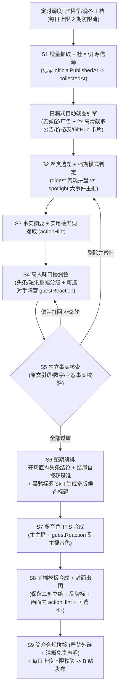

# 《AI 每日报》迭代升级工程化落地方案

> **文档定位**：本文件是面向研发与 AI 编程代理的**自包含工程实施规格书**。只通过阅读本文档，即可按阶段完成本次迭代的全部业务流程调整、代码修改、配置文件变更、自动化测试编写与发布验收。  
> **适用代码库**：`aidaily-monorepo`（Node `>= 24.0.0`，TypeScript + Vitest + Biome + Playwright + FFmpeg）

---

## 一、迭代范围与需求映射总览

本次迭代围绕“**保安全、拉人味、提点击、强证据、出壁垒**”五个方向展开，共拆分为 **4 个可独立合入与验收的里程碑（M1–M4）**：

| 里程碑 | 业务诉求 | 核心工程改动 | 涉及主要目录 / 文件 |
| :--- | :--- | :--- | :--- |
| **M1**<br>内容、标题与合规 | 1. 消除最新两期“机器味”，拉回口播人味<br>2. 开场直抛头条干货，结尾再自报“我是谁”<br>3. 视频标题接入“黑鸦标题 Skill”<br>4. 固定早晚双更防 B 站限流（大事件升级当档，不超发）<br>5. 简介禁外链、写清免责声明；实用入口放视频画面内 | 提示词重构、`prechecks.ts` 校验迁移、新建黑鸦标题 Skill、日发频次护栏、`description.ts` 外链熔断与免责声明升级、`PolishedItem` 扩展 `actionHint` | `packages/contracts/src/{editorial,config}.ts`<br>`packages/core/prompts/{s4-polish,s6-package}.md`<br>`packages/core/prompts/skills/heiya-title.md`<br>`packages/core/src/editorial/{s4-polish,s6-package,prechecks}.ts`<br>`packages/core/src/publish/{description,bilibili}.ts`<br>`config/settings.yaml` |
| **M2**<br>白鸦式抓取与截图 | 结合白鸦工作流，补齐社区/开源高价值信源，并优化原文网页、定价表、GitHub 仓库的自动化干净截图 | `sources.yaml` 扩充、采集五点耗时埋点、`browser-driver.ts` 去弹窗干净截屏、`visual-capture.ts` 扩展素材类型与高清缩放 | `config/sources.yaml`<br>`packages/contracts/src/{article,config}.ts`<br>`packages/core/src/collector/{extractor,browser-driver,visual-capture}.ts` |
| **M3**<br>封面与画面承接 | 保留大家熟知的二创立绘辨识度，叠加事件视觉锤与品牌标识，区分常规早晚报与大事件专场；画面内展示工具/项目搜索标签 | `CoverTemplateData` 扩展、`cover.ts` 注入品牌标与专场模式、`cover-card` 样式升级、`NewsCardPage.tsx` 渲染画面内 `actionHint` | `packages/contracts/src/template.ts`<br>`packages/core/src/media/cover.ts`<br>`templates/cover-card/{index.html,cover.css,cover.js}`<br>`templates/daily-deck/src/components/pages/NewsCardPage.tsx` |
| **M4**<br>四阵营互怼与 4K | 上线争议头条“跨阵营 10 秒插嘴锐评”多音色互动；支持配置 2K/4K 高清渲染输出 | `PolishedItem` 新增 `guestReaction`、`narration.ts` 支持单段副主播多音色合成、`daily-deck` 侧边吐槽气泡组件、`compositor.ts` 支持可配 `deviceScaleFactor` | `packages/contracts/src/{editorial,media,template,config}.ts`<br>`packages/core/src/editorial/{s4-polish,s6-package,prechecks}.ts`<br>`packages/core/src/media/{narration,timeline,compositor}.ts`<br>`templates/daily-deck/src/components/{deck/NewsDeck,pages/NewsCardPage}.tsx` |

---

## 二、业务流程变更说明

### 2.1 改造后全景流程图



### 2.2 五项核心业务规则变更对照

| 流程节点 | 旧规则（当前实现） | 新规则（本次迭代） |
| :--- | :--- | :--- |
| **发稿节奏与档期模式** | 每次任务固定常规拼盘，无每日上传上限保护；大事件需靠额外手建任务加塞。 | **固定早、晚各 1 期**（建议 `08:00` 与 `18:30`），投稿层增加每日上限保护（默认 `maxDailyUploads: 2`）。遇到 S 级重磅事件（`score >= 9.2` 或人工标记 `spotlight`），直接把**当档早/晚报升级为 `spotlight` 主推版**（1–3 条，头条深讲），不再额外超发。 |
| **开场与结尾职责** | `intro.narration` 禁止提新闻、强制包含主播自称 `hostSelfName`（导致前 10 秒纯寒暄）。 | **`intro.narration` 不再做自我介绍**，第 1 句直接抛头条最核心结论或反差；**把主播自报家门（`hostSelfName`）移到 `outro.narration`**，结合当期性格利落收尾。 |
| **口播人味与篇幅分级** | `s4-polish.md` 堆叠大量“严禁”禁令且 `includeReactions: false`，所有条目统一按 40–140 字均分，导致最新两期机器味重、头条讲不透。 | 精简禁令墙、恢复正向真人语感示范与人设反应指引；按 `isHeadline` 区分字数预算（**头条 110–180 字 / 35–45 秒**，`spotlight` 头条可达 240 字；**次要短讯 45–85 字 / 10–15 秒**）。 |
| **标题与简介规范** | 通用 5 风格标题提示词；简介写 `本视频由 AI 整理与配音，不对内容负责。` | 标题切换为独立可维护的**黑鸦标题 Skill**，同时输出 `publish.title` 与 `publish.titleCandidates`（3–5 个备选）。简介**严禁任何外链**，改写为专业清晰的**合规免责声明**；工具/仓库/入口名称通过 `actionHint` 展示在**视频画面内**。 |
| **配图与角色互动** | 仅截取推文卡片与简单 DOM 表格；全程单主播独白。 | 结合白鸦工作流新增**去弹窗网页正文/价格区/GitHub 仓库 2x 高清截图**；争议头条支持 1 句**对手阵营 `guestReaction` 语音+侧边气泡吐槽**。 |

---

## 三、分阶段代码修改详细设计

### Milestone 1：去机器味、开场/结尾对调、黑鸦标题 Skill、早晚双更与合规简介

#### 1.1 数据契约修改

**文件**：`packages/contracts/src/editorial.ts`
1. 在 `createPolishedItemSchema` 中新增两个可选字段：
   - `actionHint: z.string().max(28).optional()`：画面内展示的实用检索提示（如 `GitHub 搜：deepseek-ai/DeepSeek-V4` 或 `入口：Together AI 控制台`，严禁含 URL）。
   - `isHeadlineTier: z.boolean().optional()`：标记该条是否按头条/重点篇幅润色（默认 `false`）。
2. 在 `IssuePackageSchema.publish` 中新增可选字段：
   - `titleCandidates: z.array(z.string().min(1)).max(5).optional()`：供 Web 审阅台一键切换的多档候选标题。
3. 新增档期模式枚举并导出：
   - `export const IssueModeSchema = z.enum(['digest', 'spotlight']);`
   - `export type IssueMode = z.infer<typeof IssueModeSchema>;`

**文件**：`packages/contracts/src/config.ts`
1. 在 `SettingsSchema.publish.bilibili` 下新增：
   - `maxDailyUploads: z.number().int().positive().default(2)`：B 站单日发布上限护栏（按 `settings.timezone` 自然日统计）。
2. 在 `SettingsSchema.editorial` 下新增：
   - `titleSkillFile: z.string().default('skills/heiya-title.md')`：指向标题生成 Skill 提示词文件。
   - `spotlightScoreThreshold: z.number().min(1).max(10).default(9.2)`：触发大事件主推模式的分值阈值。
   - `headlineNarrationMaxChars: z.number().int().positive().default(180)`：常规档头条口播字数上限（`spotlight` 档放宽至 `260`）。
   - `briefNarrationMaxChars: z.number().int().positive().default(90)`：次要短讯口播字数上限。

#### 1.2 配置文件修改

**文件**：`config/settings.yaml`
1. 更新 `publish.bilibili`：
   ```yaml
   publish:
     bilibili:
       maxDailyUploads: 2
       aiDisclaimerText: "免责声明：本视频由 AI 辅助整理、配音及画面渲染，资讯均来自公开报道，仅供参考，不构成任何投资或使用建议，具体信息请以官方最新公告为准。"
   ```
2. 在 `editorial` 下追加上述新字段，并扩充 `metaTextBlacklist`（加入 `"值得一提的是"`, `"综上所述"`, `"令人瞩目的是"`, `"标志着行业"`）。

#### 1.3 去机器味与篇幅分级改造

**文件**：`packages/core/prompts/s4-polish.md` 与 `packages/core/src/editorial/s4-polish.ts`
1. **排查与瘦身（解决机器味根因）**：
   - 将 `s4-polish.md` 中冗长重复的“严禁清单”精简为不超过 8 条硬红线，改用**高人味正向口播改写范例**（对比“新闻腔/机器翻译腔” vs “微信语音跟朋友聊 AI 的自然口吻”）。
   - 修改 `packages/core/src/editorial/s4-polish.ts` 第 136 行与第 192 行：把 `formatPersonaForPrompt(persona, '无特定角色', { includeReactions: false })` 改为 `{ includeReactions: true }`，重新激活 `config/personas.yaml` 中各主播的真实性格反应语料。
   - 精简 `s4-polish.ts` 顶部的 `COMPACT_NARRATION_RULES` 常量（当前单段塞了 500+ 字连续禁令，极易触发 LLM 防御性官腔），改为由函数 `buildNarrationRules(opts: { isHeadline: boolean; issueMode: IssueMode; limits: ContentLimits })` 动态生成简明字数与节奏要求：
     - **常规档头条**：`3～6 句，总长 105～180 字`（约 35–45 秒，讲清“是什么 + 怎么用/影响谁 + 关键限制”）；
     - **`spotlight` 专场头条**：`4～8 句，总长 150～260 字`（讲透背景、实测/算账与边界）；
     - **次要短讯**：`2～3 句，总长 45～90 字`（约 10–15 秒，一句话说清动作与结果，绝不凑字数）。
2. **明确 `actionHint` 产出**：
   - 在 `s4-polish.md` 增加说明：当新闻涉及开源仓库、可试用产品或官方工具时，填写 `actionHint`（如 `GitHub 搜：owner/repo` 或 `体验入口：官网控制台`，≤ 28 字，**严禁写 `http://` 或域名链接**）；纯行业人事/财报新闻留空。

#### 1.4 开场/结尾对调与黑鸦标题 Skill

**新建文件**：`packages/core/prompts/skills/heiya-title.md`
- 独立沉淀“黑鸦标题 Skill”规则，供 `s6-package.md` 通过 `{{titleSkillRules}}` 注入：
  1. **利益/痛点/反差前置**：优先把免费额度、降价幅度、封号限流、型号越级对比、具体数字放在前 15 字内；
  2. **去栏目头、禁网文套词**：严禁以 `AI每日报｜` 开头，严禁滥用 `杀疯了/炸裂/掀桌/史诗级`；
  3. **真实可验证**：所有型号、数字、免费次数必须 100% 源自已过审条目，未证实消息必须带 `被曝/实测/疑似`；
  4. **输出多档候选**：要求同时输出 `publish.title`（主推标题）和 `publish.titleCandidates`（3 个不同切入角度的备选：直给利益版、数据反差版、痛点悬念版），方便人工在审阅页一键切换。

**文件**：`packages/core/prompts/s6-package.md` 与 `packages/core/src/editorial/s6-package.ts`
1. 修改 `s6-package.md` 第 2 节（`intro`）与文末“开播约束”：
   - **解除“开场禁提新闻”限制**，改为：**开场第 1 句（15–45 字，1–2 句）直接说出本期头条最抓人的核心结论、福利或反转**，绝不做寒暄与自我介绍（因为二创立绘观众本就认识）。
   - **把主播自报家门移至 `outro.narration`**：结尾控制在 1–2 句、15–55 字，**必须包含当期主播自称 `selfName`**（如 `我是小克，今晚的 AI 情报就到这儿，明早见。`），顺带可接半句贴合主播性格的轻吐槽。
2. 修改 `packages/core/src/editorial/s6-package.ts`：
   - 读取 `settings.editorial.titleSkillFile` 内容，作为 `{{titleSkillRules}}` 注入 `s6-package.md`；
   - 保留 `recentTitles` 查重上下文，防止连续多期标题句式雷同。

#### 1.5 规则预检迁移（关键！避免新提示词被旧校验拦截）

**文件**：`packages/core/src/editorial/prechecks.ts`
1. **`precheckPolishedItem`（约第 760–810 行）**：
   - 接收可选参数 `isHeadline?: boolean` 与 `issueMode?: IssueMode`；
   - 根据角色动态调整 `narration` 总字数与句数校验范围（头条放宽至 `100–185` 字 / `spotlight` 至 `265` 字，次要短讯 `40–95` 字），避免把展开讲透的头条误判为超长；
   - 新增 `actionHint` 校验：长度 ≤ 28 字，且严禁匹配 `URL_PATTERN`（`https?://|www\.`）。
2. **`precheckIssuePackage`（第 950–975 行）**：
   - **移除**第 955–961 行对 `introText` 必须包含 `opts.hostSelfName` 的校验；
   - **新增**对 `outroText`（`pkg.outro.narration.join('')`）必须包含 `opts.hostSelfName` 的校验，未包含时报错：`结尾口播必须自然自报家门并包含主播自称「${opts.hostSelfName}」`；
   - 更新第 952 行报错文案：允许开场直给头条结论，仅限制 `intro.narration.length <= 2` 且总长 `<= 65` 字；
   - 若 `pkg.publish.titleCandidates` 存在，逐条校验长度 `18 <= len <= titleMax`、无栏目头、无下划线 `_`。

#### 1.6 简介外链熔断与每日双更防限流护栏

**文件**：`packages/core/src/publish/description.ts`
1. 新增辅助函数 `assertNoExternalUrls(text: string): void`（检测 `https?://`、`www.`、常见短链如 `t.co/`、`bit.ly/`、`b23.tv` 以外的外站域名模式）；
2. 在 `buildBilibiliDescription` 末尾调用校验（或在兜底模式下自动剥离意外混入的 URL 并记录 warn），确保推送给 B 站的简介**100% 不含外链**，且始终完整保留 `publishConfig.aiDisclaimerText` 免责声明。

**文件**：`packages/core/src/publish/bilibili.ts` 与 `packages/core/src/storage/repos/runs-repo.ts`
1. 在 `runs-repo.ts` 新增查询方法 `countPublishedRunsOnLocalDate(dateStr: string, timezone: string): number`（统计当前自然日 `status = 'published'` 或 `publishing` 的任务数）。
2. 在 `bilibili.ts` 的 `assertReadyToUpload` 中增加护栏：
   - 当 `publishedToday >= settings.publish.bilibili.maxDailyUploads`（默认 `2`）且未传入 `opts.bypassDailyLimit === true` 时，抛出 `PipelineError('daily_upload_limit_reached', '今日已达 B 站安全投稿上限（2 期），为防限流已拦截本次自动发布')`；
   - 同步在 `s2-select.ts` 中支持根据头号事件 `score >= settings.editorial.spotlightScoreThreshold` 自动标注本次 `run` 的 `issueMode = 'spotlight'`（压缩非头条条目数至 1–3 条，把时长与注意力留给头条）。

---

### Milestone 2：结合白鸦工作流的信源扩充、延迟埋点与自动高质量截图引擎

#### 2.1 高价值信源扩充

**文件**：`config/sources.yaml`
- 新增四类白鸦高收藏题材对应的抓取信源（配置 `tier` 与 `kind` 复用现有 RSS / HTML 列表 / 浏览器抓取通道）：
  1. **开源飙升工具**：GitHub Trending（Daily / Python & TypeScript AI 关键词过滤）；
  2. **社区真实体感与限额/封号反馈**：Reddit（`r/LocalLLaMA`、`r/ClaudeAI`、`r/OpenAI` RSS）及国内极客社区（`Linux.do` / V2EX AI 板块热门）；
  3. **厂商状态与定价页变更**：OpenAI / Anthropic / Google AI / DeepSeek 官方 Status RSS 与 Changelog 页；
  4. 在 `packages/core/prompts/s2-select.md` 提权“免费额度变动、API 降价/涨价、大面积故障/封控、拿来即用的开源工具”四类选题。

#### 2.2 全链路五点耗时埋点

**文件**：`packages/core/src/workflow/events.ts` 与各阶段入口（`collector/index.ts`、`s2-select.ts`、`publish/bilibili.ts`）
- 在 `run_events` 统一记录 5 个结构化时间戳指标：`officialPublishedAt`（头条原文发布时间）、`collectedAt`、`selectedAt`、`reviewReadyAt`、`publishedAt`；
- 在 `run_published` 事件 `data` 中自动计算并写入 `endToEndLatencyMin` 与分阶段耗时拆解，便于直接定位空等瓶颈。

#### 2.3 自动高质量截图引擎改造（核心）

**文件**：`packages/contracts/src/article.ts` 与 `packages/contracts/src/config.ts`
1. 在 `ArticleMediaAssetKindSchema` 中新增 3 种高价值截图类型：
   - `'github_card'`（GitHub 仓库头部 + Star/README 关键区截图）
   - `'article_section'`（官方公告/博客正文核心段落或定价区干净截图）
   - `'changelog_shot'`（更新日志/Status 故障页截图）
2. 在 `SettingsSchema.collector` 新增配置：
   - `captureArticleSections: z.boolean().default(true)`
   - `captureGithubCards: z.boolean().default(true)`
   - `screenshotScale: z.union([z.literal(1), z.literal(2)]).default(2)`

**文件**：`packages/core/src/collector/browser-driver.ts`
1. 新增通用页面降噪脚本 `CLEANUP_OVERLAYS_CSS_JS`：在截图前自动隐藏常见 Cookie 弹窗、登录遮罩、吸顶导航栏与右侧广告浮层（匹配 `[class*="cookie"]`, `[id*="consent"]`, `[role="dialog"]`, `position: fixed/sticky` 遮挡元素）。
2. 将 `renderDomFragmentPng` 与 `renderTweetCardPng` 的 Playwright `deviceScaleFactor` 改为读取 `settings.collector.screenshotScale`（默认 `2`），确保表格与推文截图在 1080p/4K 视频下文字锐利不发糊。
3. 新增方法 `captureCleanWebRegionPng(opts: { url: string; mode: 'github_card' | 'article_section' | 'changelog_shot'; maxHeight?: number; scale?: number; signal?: AbortSignal })`：
   - **`github_card` 模式**：定位 GitHub 仓库顶部元信息（仓库名、简介、Star 数、语言分布）+ README 首屏核心图/表，固定 `1200px` 宽干净裁切；
   - **`article_section` 模式**：优先定位 `<article>` / `<main>` 内包含核心数字、价格表或首屏主图的可视区块，按 `16:9` 安全比例（最高 `900px` CSS 高度）裁切，避免截取超长模糊网页；
   - 严格沿用现有 `collector/ssrf.ts` 的 URL 安全校验，单次截屏超时控制在 `15s`，失败静默降级不阻塞采集。

**文件**：`packages/core/src/collector/visual-capture.ts` 与 `packages/core/src/editorial/s4-polish.ts`
1. 在 `captureArticleVisualMedia` 中，当命中 `github.com/<owner>/<repo>` 或官方博客/定价页且尚无 `tweet_shot` / `table_shot` 时，自动调用 `driver.captureCleanWebRegionPng` 落盘，并赋予高初始分（`github_card: 93`、`article_section: 88`）。
2. 在 `s4-polish.ts` 的 `buildAvailableMediaSection` 说明中补充 `github_card`、`article_section`、`changelog_shot` 为优先推荐素材。

---

### Milestone 3：封面视觉升级与画面内实用标签

#### 3.1 封面数据结构与数据组装

**文件**：`packages/contracts/src/template.ts`
- 扩展 `CoverTemplateData`：
  ```ts
  export interface CoverTemplateData {
    // 保留现有字段...
    brandLogoUrl?: string; // 头条对应大厂/模型高清 SVG 地址（复用 company-logos.ts）
    editionBadge?: string; // 如 "早报 · 6条" | "晚报 · 5条" | "重磅专场"
    themeVariant?: 'regular' | 'spotlight'; // 常规档 vs 大事件高对比专场
  }
  ```

**文件**：`packages/core/src/media/cover.ts`
1. 在 `buildCoverTemplateData` 中：
   - 复用 `packages/core/src/media/company-logos.ts` 的 `loadLogoCatalog` 与匹配逻辑，根据头条新闻 `entity` / `title` 解析 `brandLogoUrl`；
   - 启动 `startTemplateHttpServer` 时额外挂载 `logosDir`（指向 `templates/daily-deck/dist/logos` 或统一素材目录），确保封面页可加载品牌 SVG；
   - 根据时间段（`12:00` 前为早报，后为晚报）、条目数与 `issueMode` 生成 `editionBadge` 与 `themeVariant`。
2. 封面渲染 `deviceScaleFactor` 改为读取 `settings.render.deviceScaleFactor ?? 1`（封面最终输出为 `1920×1080` JPG 时，2x 渲染再下采样抗锯齿更清晰）。

#### 3.2 封面模板样式改造（保留二创立绘辨识度）

**文件**：`templates/cover-card/{index.html,cover.css,cover.js}`
1. **右侧保留大家熟知的二创立绘为主体**（不弱化、不缩成看不清的小角标），在左侧大字标题上方或右上安全区叠加 `brandLogoUrl` 品牌徽章 + `editionBadge` 档期标签；
2. 新增 `.theme-spotlight` 样式类：当 `themeVariant === 'spotlight'` 时，切换为高对比暖红/深黑警示渐变底色与醒目“重磅专场”角标，让老粉在信息流里一眼区分常规早晚报与超级大事件。

#### 3.3 正片画面内实用检索标签（替代简介外链）

**文件**：`templates/daily-deck/src/components/pages/NewsCardPage.tsx` 与 `templates/daily-deck/src/styles/deck.css`
- 当 `item.actionHint` 非空时，在卡片底部状态栏渲染一枚高对比胶囊标签（例如 `🔍 GitHub 搜：deepseek-ai/DeepSeek-V4`），视觉上避开字幕安全区与右下角 Live2D 看板娘，方便观众直接暂停截图或收藏查找。

---

### Milestone 4：四阵营跨阵营互怼与 2K/4K 高清渲染

#### 4.1 跨阵营互怼数据契约与生成逻辑

**文件**：`packages/contracts/src/editorial.ts`
- 在 `createPolishedItemSchema` 新增可选字段：
  ```ts
  guestReaction: z.object({
    hostId: HostMascotIdSchema, // 必须与当期主主播不同
    line: z.string().min(8).max(40), // 1 句精炼锐评，纯中文口语
    mood: MascotMoodSchema.optional(),
  }).optional(),
  ```

**文件**：`packages/core/src/editorial/s6-package.ts`、`packages/core/prompts/s6-package.md`、`packages/core/src/editorial/prechecks.ts`
1. **生成时机放在 `s6-package`（整期视角统一控制频率，避免每条都互怼变吵闹）**：
   - `s6-package.ts` 将其余 3 位非当值主播的简要性格卡片（`selfName` + `roastStyle`）注入 `s6-package.md`；
   - 规则限定：**每期最多安排 1–2 处 `guestReaction`**（优先放在最具争议、降价打脸或友商对决的头条/二条），并输出在 `IssuePackageSchema` 新增的 `guestReactions?: Array<{ itemId: string; hostId: HostMascotId; line: string; mood?: MascotMood }>` 中；
   - `prechecks.ts` 校验：`guestReaction.hostId !== runHostId`、长度 `8–40` 字、不含禁用词与代表公司发言措辞、不含 URL/Markdown、且总条数 `<= 2`。

#### 4.2 多音色 TTS 合成与时间轴对齐

**文件**：`packages/contracts/src/media.ts`、`packages/core/src/media/narration.ts`、`packages/core/src/media/timeline.ts`
1. 在 `NarrationSection` 新增可选字段 `voiceHostId?: HostMascotId`（默认缺省时使用当期 `run.host_id`）。
2. 在 `narration.ts` 的 `buildNarrationSections` 中：
   - 若某条目存在 `guestReaction`，在该条目段落之后紧跟插入一个子段落：`{ key: 'item-01-guest', kind: 'guest_reaction', itemId: item.id, voiceHostId: reaction.hostId, sentences: [reaction.line] }`；
   - 修改 `computeSectionDigest` 将 `voiceHostId` 纳入 hash 计算；
   - 修改 `settingsForNarrationProviders`：支持按 `section.voiceHostId ?? runHostId` 分别解析音色配置与 `referenceHash`，确保 `qwen-local`、`indextts` 及未来接入的云端 `minimax` TTS 都能正确切换副主播声线！
3. 在 `timeline.ts` 的 `buildTimeline` 中：
   - `guest_reaction` 段落不触发整页翻页音效（`pageTurnSfx` 跳过），而是附着在所属 `itemId` 的页面展示周期内，向 `timeline.json` 写入 `guestWindow: { hostId, startMs, endMs, line, mood }`，供前端模板精准控制弹出时机。

#### 4.3 前端互怼气泡与 2K/4K 高清渲染

**文件**：`templates/daily-deck/src/components/pages/NewsCardPage.tsx` 与 `templates/daily-deck/src/components/deck/NewsDeck.tsx`
1. 根据当前虚拟时间 `currentMs` 是否落在 `item.guestWindow` 区间内，在画面左侧/中部安全区滑入副主播半身头像（读取 `mascots/${guestHostId}.png`）+ 带阵营主题色的吐槽气泡（显示 `line`）；非激活时段平滑收起。
2. 副主播发声期间，主主播 Live2D 切换为 `surprised` 或 `thinking` 反应表情，嘴型口型归零。

**文件**：`packages/contracts/src/config.ts`、`config/settings.yaml`、`packages/core/src/media/compositor.ts`
1. 在 `SettingsSchema.render` 新增：`deviceScaleFactor: z.union([z.literal(1), z.literal(1.5), z.literal(2)]).default(1)`（`1` = 1080p，`1.5` = 1440p 2K，`2` = 2160p 4K）。
2. 修改 `packages/core/src/media/compositor.ts` 第 `1006` 行与第 `1175` 行：
   - 将硬编码的 `deviceScaleFactor: 1` 改为 `deviceScaleFactor: settings.render.deviceScaleFactor`；
   - 确认 FFmpeg 编码分辨率同步乘以 `deviceScaleFactor`（保持 CSS 视口 `1920×1080` 排版零改动，输出物理像素 `3840×2160` 4K 或 `2880×1620` 2K），并验证视频码率自适应上调，满足 B 站 4K 画质标识要求。

---

## 四、测试与验收方案

### 4.1 自动化质量门禁命令（每个 Milestone 合入前必跑）

```bash
# 1. 全仓 TypeScript 类型与构建检查
npm run typecheck

# 2. 代码规范与格式化检查
npm run lint

# 3. 全量单元测试与核心工作流回归
npm run test

# 4. 前端模板（daily-deck）组件与护栏单测
npm --prefix templates/daily-deck test
```

### 4.2 分里程碑新增单元测试清单

| 里程碑 | 对应测试文件 | 必补测试断言 |
| :--- | :--- | :--- |
| **M1** | `packages/core/test/editorial-prechecks.test.ts` | ① `intro.narration` 不含 `hostSelfName` 且直抛头条结论时**通过**；<br>② `outro.narration` 缺少 `hostSelfName` 时**报错拦截**；<br>③ `actionHint` 包含 `https://` 或超过 28 字时**报错拦截**；<br>④ 头条（`isHeadline=true`）165 字通过，次要短讯超过 95 字报错；<br>⑤ `publish.titleCandidates` 含栏目头或下划线时报错。 |
| **M1** | `packages/core/test/publish.test.ts` | ① `buildBilibiliDescription` 输出绝不含任何 URL 且必定包含新版免责声明；<br>② 当天已发布 2 期后，第 3 期自动调用 `assertReadyToUpload` 抛出 `daily_upload_limit_reached`；传入 `bypassDailyLimit: true` 允许放行。 |
| **M1** | `packages/core/test/workflow-editorial.test.ts` | 端到端 Mock 跑通 `s4-polish -> s5-factcheck -> s6-package`，验证 `heiya-title.md` 被正确加载、`titleCandidates` 落盘检查点、`spotlight` 模式下条目数自动聚焦。 |
| **M2** | `packages/core/test/collector.test.ts` | ① Mock Playwright 页面含 Cookie 遮罩时，`captureCleanWebRegionPng` 隐藏弹窗并返回非空 2x PNG；<br>② GitHub 仓库 URL 正确生成 `kind: 'github_card'` 素材并按高分排入 `mediaAssets`；<br>③ SSRF 非法内网 URL 在截图前被安全拦截。 |
| **M3** | `packages/core/test/cover.test.ts` | ① `buildCoverTemplateData` 正确注入 `brandLogoUrl`、`editionBadge`、`themeVariant`；<br>② `regular` 与 `spotlight` 两种模式均可无报错输出 `1920×1080` JPG 且保留二创立绘 `mascotUrl`。 |
| **M3** | `templates/daily-deck/src/__tests__/deckGuardrails.test.tsx` | 传入 `actionHint` 时卡片底部正确渲染检索胶囊且不与字幕区、右下角看板娘发生 BoundingBox 重叠。 |
| **M4** | `packages/core/test/narration-revive.test.ts` | ① 含 `guestReaction` 的条目拆分为主段落 + `item-XX-guest` 副段落，且 `voiceHostId` 正确路由到对手主播音色；<br>② 副段落 `timeline.json` 产出 `guestWindow` 且不触发多余翻页音效。 |
| **M4** | `packages/core/test/render-qa.test.ts` | `render.deviceScaleFactor = 2` 时，验证输出分片与最终成片经 `ffprobe` 检测物理分辨率为 `3840×2160`，且 QA 质检正常通过。 |

### 4.3 端到端冒烟与人工验收 Checklist

完成代码与单测后，使用 `npm run aidaily` 手动触发一次真实演练（建议先切 `publish.mode: manual-review` 人工审核模式，不直接自动上传）：

- [ ] **口播人味验收**：通读生成的 `narration.txt` 并试听成片音频——无“值得注意的是/综上所述/原帖未透露”等机器腔，头条讲透 35–45 秒，次要短讯 10–15 秒利落过。
- [ ] **开场与结尾验收**：前 5 秒直接听见头条爆点（无自我介绍寒暄）；片尾自然听见当期主播报出自己名字收尾。
- [ ] **标题与简介合规验收**：审阅页可见黑鸦风格多档候选标题；预览 B 站简介确认**零外部链接**、免责声明表述清晰完整；画面内对应工具条目可见清晰的 `actionHint` 检索标签。
- [ ] **截图与封面验收**：自动截取的官方公告/GitHub/表格图无 Cookie 弹窗遮挡、文字清晰；封面保留二创立绘辨识度且品牌标与大字钩子突出。
- [ ] **四阵营互怼与画质验收（M4）**：争议头条副主播音色切换准确、侧边吐槽气泡出现/消失与语音严丝合缝、主主播不抢嘴型；开启 `deviceScaleFactor: 2` 后成片在本地播放器放大查看表格小字无锯齿。

### 4.4 上线节奏与回滚开关

- **灰度上线**：M1 完成后立即切入**早晚固定双更**（如 `08:00` / `18:30`）连续跑 14 天，对比迭代前 14 天的 B 站后台指标：**30 秒留存率、封面+标题 CTR、千播收藏数、千播弹幕数**。
- **一键回滚保护**：
  - 4K 渲染若导致本机渲染耗时过长，直接将 `config/settings.yaml` 中 `render.deviceScaleFactor` 改回 `1`（或 `1.5` 跑 2K），无需改代码；
  - 自动网页截图若某站点风控严重，将 `collector.captureArticleSections` 设为 `false` 立即退回仅抓原图与推文截图；
  - 四阵营互怼若某期节奏不合适，可在审阅页直接清空该条 `guestReaction` 或在配置中关闭互怼开关。
