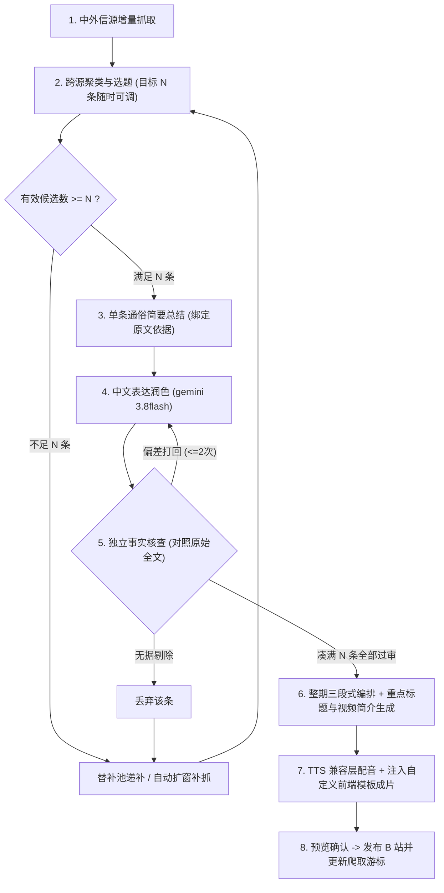

# AI 每日报自动化视频工作流 — 业务流程说明

## 一、总结速览

本系统是一套面向大众群体的「AI 每日新闻视频」自动化生产与 B 站发布工作流。系统在设定时间自动增量抓取自上次成功产出以来的**中外混合** AI 资讯，通过可随时调整的目标条数配置与“候选替补 + 自动扩窗补抓”机制确保每期条数充足；随后按阶段选择本机 CLI 或 HTTP 模型接口依次完成**跨源聚类选题 → 大众向通俗总结 → 中文口播表达润色（`gemini 3.8flash`） → 独立事实核查（有偏差打回润色环节微调、无依据直接剔除并补位） → 整期三段式编排与重点标题/简介生成**；最终经可随时切换本地模型或云服务的 TTS 兼容层合成配音，将数据与音频嵌入自定义前端模板生成视频，经人工预览确认后发布至 B 站。

---

## 二、业务流程全景图

---

## 三、分步业务规则详解

### 1. 中外信源增量抓取
- 以各信源上次成功抓取的游标为起点，自动拉取此后新增的**中外混合** AI 资讯（预留安全重叠窗口，防止源站延迟导致漏抓）；新闻按“文章级消费状态”管理，只有发布成功的事件才计入已播库，没用上的候选留给下一期（详见 [开发设计文档.md](./开发设计文档.md) §6.1）。
- 覆盖海外一手官方博客、一线科技媒体及国内主流科技媒体，同步提取结构化正文与配图资源并本地缓存。

### 2. 跨源聚类排重与动态补齐选题
- **聚类与防重**：合并中外多家媒体对同一事件的报道（避免同天重复，同时保留多源对照依据），并比对历史已播库过滤“旧闻翻炒”。
- **条数随时可调与绝不缺条**：每期播报条数 `N` 支持随时通过配置调整；初筛阶段额外保留超额替补池，若初选不足或后续环节发生剔除导致少于 `N` 条，优先从替补池顺位递补，仍不足则自动扩大回溯时间窗口或备选信源补抓，直到凑满 `N` 条。

### 3. 单条通俗简要总结
- 面向非技术背景的普通大众受众，剔除晦涩专业黑话，用通俗简练的语言逐条提炼核心事实（发生了什么、对普通人有何影响、当前使用边界）。
- 每条总结强制绑定对应的原文事实依据（来源链接与原文支撑片段），为后续审核提供直接溯源锚点。

### 4. 中文表达润色（`gemini 3.8flash`）
- 调用指定模型（`gemini 3.8flash`）对总结内容进行二次表达优化，去除翻译腔与生硬书面感，使其更贴合自然流畅的中文口播习惯。
- 同步规范数字、符号及中英文专有名词的口播读法，并提炼一条供片头目录展示的精简短标题。

### 5. 独立事实核查（打回第 4 步微调）
- 审核 Agent 在**与写稿/润色上下文完全隔离**的状态下，对照原始新闻全文逐条核查润色后终稿，重点校验数字实体、因果关系、时态边界（严格区分“已正式开放”与“内测/演示期货”）。
- **两级处理机制**：
  - **存在措辞偏差或轻微夸大**：附具体修改批注**打回第 4 步，由润色模型微调措辞**（单条打回上限 2 轮）；
  - **无原文依据或 2 轮微调仍不达标**：直接剔除该条并记录审计日志，触发第 2 步自动补齐替补新闻。

### 6. 整期编排与投稿文案包装
- **视频三段式结构**：
  1. **开场导语与目录速览**：结合开场导语，在前端粗略展示本期全部新闻的简短看点目录；
  2. **逐条新闻播报**：按编排顺序一条一条展开播报已过审的精选新闻；
  3. **动态片尾引导**：根据当期新闻主题每期动态生成自然贴合的结尾互动引导。
- **B 站标题与简介**：自动生成突出**当期头号重点新闻**的投稿标题，并生成包含本期导览、各条新闻时间点（空降章节）与原始参考信源的视频简介。

### 7. TTS 配音与前端模板合成
- 通过 **TTS 调度兼容层**（支持随时切换本地开源模型或云端 TTS 服务）生成导语、逐条新闻与片尾的口播音频及时间轴。
- 将结构化文稿、本地图片及配音时间轴数据打包注入**自定义前端模板**，合成最终新闻视频成片。

### 8. 人工预览与 B 站发布
- 向创作者推送「视频成片 + 重点标题 + 视频简介」进行预览（支持人工确认或微调标题、简介）。
- 确认无误后自动上传并发布至 B 站（合规开启 AI 生成内容声明），发布成功后将本期事件写入已播库，并把相关文章标记为已消费。

---

## 四、技术兼容层与架构约定

- **模型调用**。Core 按阶段配置选择模型。`@aidaily/cli-bridge` 适配本机 `agy` 和 Codex CLI，`@aidaily/model-api` 直接调用 DeepSeek 等支持 OpenAI 请求格式的服务。两者共用结构化校验、重试和审计。
- **TTS 调度兼容层（`@aidaily/tts`）**：统一文本分段入参与音频/时间轴出参格式，支持在本地 TTS 模型与云端 TTS 服务间通过配置自由切换。
- **Monorepo 工程架构**：采用 TypeScript + `npm workspaces` 管理（薄壳双入口 `apps/web` 与 `apps/cli` 共用核心包 `@aidaily/core`，前端模板独立存放于 `templates/`），详细目录与模块职责见 [项目架构说明.md](./项目架构说明.md)。
