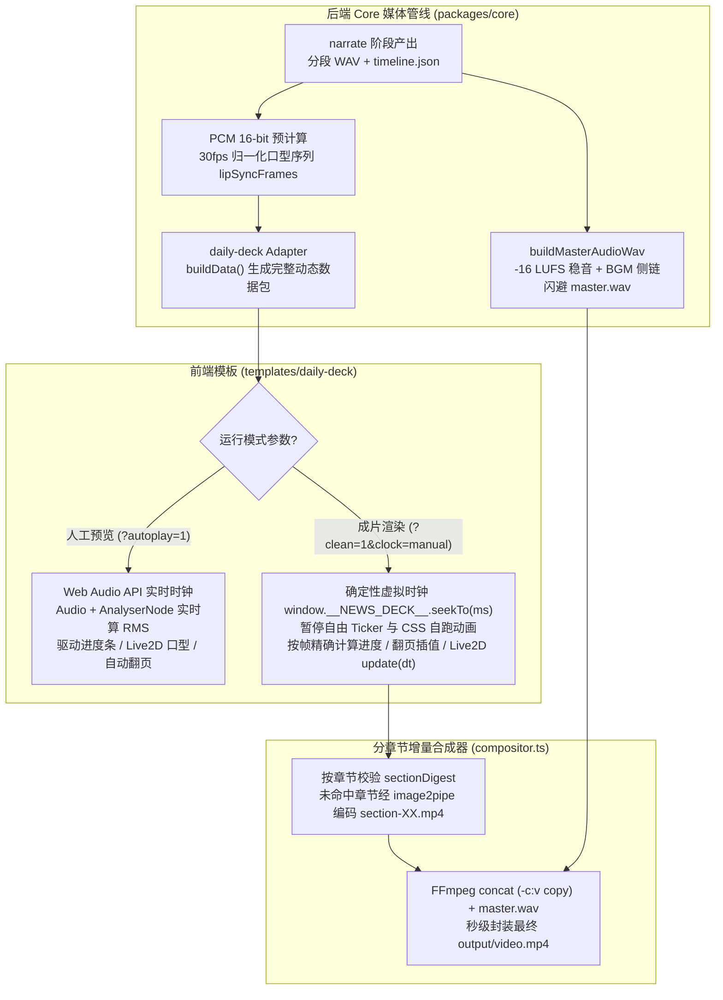

# AI 每日报 — 前端动态模板与 Live2D 确定性渲染升级方案

> 本文档完整定义 `daily-deck` 前端播报模板视觉交互升级（顶部章节总结进度条、右下角大尺寸 Live2D 看板娘、前端原生音频自动播放）与后端 **路线 A（确定性虚拟时钟步进 + 分章节视频缓存合成）** 的技术架构、数据契约及分步实施计划，作为后续编码落地的唯一设计依据。

## 一、升级目标与核心设计决策

围绕**“进度可视化、角色活态化、预览有声化、成片零掉帧且保持画面纯粹”**五大原则，本次升级锁定的关键架构决策如下：

| 模块维度 | 现行实现 | 升级后方案（已拍板） |
| :--- | :--- | :--- |
| **顶部进度与导航** | `52px` 单行刊头 + 右侧无文字短横线盲点（`.progress-tick`）+ 画布最底部 `3px` 细线 | 重构为 **`80px` 双层章节导航栏**：上层为刊头/日期/当值主播徽章/总计时器；下层为**带每阶段极简总结（6～10 字）的分段进度轨道**，随语音连续推进并绑定主播专属主题色，移除底部 `3px` 细线 |
| **右下角看板娘** | `122 × 202` 悬空静态 PNG 角标（占画布面积 `< 1.2%`） | 升级为 **`300 × 420` 贴底破框半身 Live2D 舞台**（`right: 32px; bottom: 0px`），接入已拆分绑骨的 Live2D 模型，支持**语音包络实时口型同步、呼吸眨眼物理微动与阵营情绪切换**，异常时回退静态 PNG |
| **前端音频与交互预览** | 前端无音频输入，仅靠 `setInterval` 空跑读秒自动翻页 | 注入各章节语音与可选 BGM（`/__run_assets__/audio/...`），由 **`Web Audio API` 接管播放生命周期**：实时驱动章节进度与口型、播完停顿 `pagePaddingSec` 自动翻页、点选章节音频同步跳转 |
| **成片视频渲染管线** | `?motion=static` 每页截 1 张静态 PNG，FFmpeg 硬切拼接（无法呈现任何动态效果） | **路线 A：确定性虚拟时钟步进渲染（`seekTo(ms)`）**：后端预提取 `30fps` 音频 RMS 口型数组，Playwright 锁定虚拟时钟逐帧步进并通过 `ffmpeg -f image2pipe` **按章节分段缓存 `.mp4`**，最终复用 `master.wav` 母带无损合成 |
| **画面克制边界** | 纯客观精简标题、高亮结论与短语要点 | **保持画面纯粹**：不叠加底部滚动单句字幕，不弹出看板娘头顶锐评对话框气泡，避免视觉噪音干扰核心资讯阅读 |

---

## 二、总体架构与双模时钟运行机制

本次升级的核心在于让同一套 `templates/daily-deck` 前端代码同时服务于 **“浏览器实时有声预览（Realtime Audio Clock）”** 与 **“无头浏览器确定性成片导出（Manual Virtual Clock）”** 两种模式，且二者 100% 共享同一套 UI 布局、翻页过渡与 Live2D 参数映射逻辑。



---

## 三、分模块详细设计方案

### 3.1 模块一：顶部双层“章节极简总结进度条”重构

#### 1. 空间预算与几何尺寸（基于 `1920 × 1080` 画布）
- 画布外边距保持 `.deck-canvas` 现有设定（上下 `48px~52px`、左右 `104px`，内部有效宽度 `1712px`）。
- `.deck-header` 高度从 `52px` 扩展为 **`80px`**（向下方 `.deck-slide-body` 借用 `28px` 高度，正文卡片可用高度仍高达 `876px`，完全兼容现有字号自适应守卫）：
  - **第一层（`26px`，刊头元数据行）**：
    - 左侧：`AI 每日报` 品牌字标 + 日期 + 期号 + 当值主播胶囊徽章（圆点染色 `var(--host-accent)`，如 `本期播报 · DeepSeek娘`）。
    - 右侧：全局时间读数 `MM:SS / MM:SS`（等宽字体 `JetBrains Mono`）+ 页码 `02 / 06`。
  - **第二层（`46px`，分段式章节总结轨道，顶距 `8px`）**：
    - 整条轨道包含 `totalPages = N + 2` 个分段胶囊槽位：`[导览]`、`[01 极简总结]`、`[02 极简总结]`、…、`[0N 极简总结]`、`[速览]`，槽间距 `8px`。
    - 移除原画布最底部 `.autoplay-progress-track`（避免与 B 站播放器底栏重叠）。

#### 2. 弹性宽度分配与多条数防拥挤策略
- **拒绝纯按秒数比例分配宽度**：开场导览（约 6～10s）与片尾速览（约 5～8s）若按真实时长等比缩放仅占几十像素，无法容纳文字。
- **固定首尾 + 弹性新闻槽算法**：
  - 首尾槽位（`导览`、`速览`）：固定宽度 `92px`，居中展示标签。
  - 中间新闻槽位（共 `N` 条，共享约 `1512px`）：
    - 当 `1 <= N <= 5` 时：各新闻槽等宽（每个槽位宽 `296px ~ 1512px`），完整单行常驻展示 `序号 + 极简总结`（如 `01 DeepSeek开源V4`）。
    - 当 `N >= 6` 时：启用**手风琴微展开权重**——当前正在播报的新闻槽位 `flex: 1.75`（字号 `18px`，完整展示不截断），其余非激活新闻槽位 `flex: 1`（字号 `16px`，超出安全省略），槽位切换使用 `flex-grow 0.32s cubic-bezier(0.22, 1, 0.36, 1)` 平滑过渡。

#### 3. 三态视觉反馈与段内平滑填充
每个章节槽位由底层背景框、动态进度遮罩层（`transform: scaleX(ratio)`，`transform-origin: left`）与上层文本组成：
1. **已播完态（`idx < currentPage`）**：进度层 `scaleX(1)` 填满柔和浅底色，文字降为次级灰（`var(--ink-muted)`），视觉上明确归档。
2. **播报激活态（`idx === currentPage`）**：
   - 边框高亮为当期主播主题色 `var(--host-accent)`；
   - 底部 `4px` 实心高亮进度条 + 槽内 `12%` 透明度主题色水波背景随当前页内进度 `sectionProgress`（`0.000 ~ 1.000`）逐帧线性推进；
   - 序号与极简总结采用高对比度主墨色 `var(--ink)` 加粗展示。
3. **待播预告态（`idx > currentPage`）**：保持干净纸面底色与清晰可读的次级深色文字，让观众随时扫视后文看点。

#### 4. `progressLabel` 文案字段规范
- 在采编润色契约（`PolishedItemSchema`）中新增 `progressLabel` 字段：**必填，严格限制 `4 ~ 10` 个汉字（或等价宽度短词）**，要求直给“主体 + 核心动作/结果”（例如：`GPT-5 推理降价五成`、`Claude 开放本地执行`、`英伟达发布新款架构`）。
- 前端清洗层 `sanitizeSingleNewsItem` 同步增加 `HARD_LIMITS.progressLabel = 12`：若旧数据或手工测试 JSON 未提供 `progressLabel`，自动从 `shortTitle`（或 `title`）按完整码点无感截取兜底，绝不报错。

---

### 3.2 模块二：右下角大尺寸 Live2D 看板娘舞台

#### 1. “贴底破框”布局与正文防遮挡微调
- **新舞台几何定位（`.corner-mascot-dock`）**：
  - 尺寸由 `122 × 202` 放大至 **`300 × 420`**（约为 1080p 画布高度的 `38.9%`）。
  - 锚点由 `right: 124px; bottom: 68px` 调整为 **`right: 28px; bottom: 0px`**，`z-index: 20`，`pointer-events: none`。
  - 角色模型底部直接贴齐 `1080p` 画布下沿自然站立（半个身位利用 `.deck-canvas` 右侧原有的 `104px` 留白区，仅向卡片内部右下方探入约 `224px` 宽、`364px` 高的三角视觉区）。
- **各页面右侧安全留白协同调整**：
  1. **封面页（`.cover-right`）与片尾页（`.outro-layout`）**：右侧内边距由 `96px` 调整为 `236px`，确保议程列表行尾元信息与汇总表来源列不被角色头部或肩膀遮挡。
  2. **新闻页 · 无图全幅模式（`.is-full-panel .news-synopsis-col`）**：右侧内边距由 `250px` 微调至 `272px`，左侧大字结论与要点完全处于黄金阅读区。
  3. **新闻页 · 有图分栏模式（`.is-split-image .news-reference-col`）**：
     - 右侧配图框（`.official-plate-figure`）取消右侧死留白挤压，改为上方全宽舒展展示（高度占卡片上方约 `68% ~ 72%`），或者右侧为看板娘留出 `228px` 通道并将 `.official-plate-caption` 图注左对齐限制最大宽度，保证参数表、跑分图 100% 完整可见且不与 Live2D 重叠。

#### 2. Live2D 模型目录规范与静态服务挂载
- **资产存放目录约定**：
  ```text
  assets/mascots/
  ├── deepseek.png                 # 保留：静态兜底图 & 管理台角色头像缩略图
  ├── gpt.png
  ├── gemini.png
  ├── claude.png
  ├── deepseek/                    # Live2D 模型包目录（放入已拆分绑骨产物）
  │   ├── *.model3.json            # 自动扫描目录下首个 .model3.json 作为入口
  │   ├── *.moc3
  │   ├── *.physics3.json          # 可选物理文件
  │   ├── textures/                # 贴图集 PNG
  │   ├── expressions/             # 可选表情 .exp3.json
  │   └── motions/                 # 可选动作 .motion3.json
  ├── gpt/
  ├── gemini/
  └── claude/
  ```
- **零拷贝只读静态路由（`packages/core/src/templates/server.ts`）**：
  - Live2D 纹理贴图体积通常较大（数 MB 至数十 MB），**不在每次 `run` 时重复拷贝进 `storage/runs/<runId>/assets/`**。
  - 在 `startTemplateHttpServer` 中新增只读受限前缀 `/__mascot_assets__/`，直接安全映射至仓库根目录 `assets/mascots/`（同样经过 `resolveConfinedFile` 防目录穿越校验），并补齐 `.moc3`（`application/octet-stream`）、`.json`、`.mp3`、`.m4a`、`.flac` 等 MIME 类型。
  - 后端在 `buildRenderableIssue` 时自动扫描 `assets/mascots/<hostId>/` 下是否存在 `*.model3.json`，若存在则将 `/__mascot_assets__/<hostId>/<entry>.model3.json` 作为 `hostLive2dModelUrl` 传给前端；若某角色暂未放入模型目录，自动回退使用静态 `hostMascotUrl`。

#### 3. Live2D 渲染器与参数驱动设计（`<Live2DMascotCanvas />`）
- **技术栈选型**：前端引入轻量 WebGL 渲染层（`pixi.js` + 适配 Cubism 4/5 `.model3.json` 的渲染封装，并在页面中按需加载本地打包的 Cubism Core 运行时 `live2dcubismcore.min.js`，确保离线无外网环境下 100% 可用）。
- **核心参数实时映射**：
  1. **WebGL 上下文配置**：强制开启 `backgroundAlpha: 0`（全透明底）、`preserveDrawingBuffer: true`（保证 Playwright 任意时刻截图绝不出现空白透明丢失）、`antialias: true`、分辨率对齐画布像素比。
  2. **口型同步（Lip-Sync）**：将当前时刻归一化口型开合度 `mouthOpen ∈ [0, 1]` 写入标准参数 `ParamMouthOpenY`（同时兼容常见的 `PARAM_MOUTH_OPEN_Y` 命名），说话时辅以极轻微的下颌/头部联动增益，闭嘴停顿期归零。
  3. **自然生命感（呼吸、眨眼、物理）**：
     - 呼吸：`ParamBreath = 0.5 + 0.5 * sin(2π * t / 3200)`；
     - 确定性伪随机眨眼：基于时间轴 `t` 与固定种子的周期函数（约每 `3.8s ~ 5.5s` 触发一次 `160ms` 闭眼再睁开曲线，且**避开 `t = 800ms` 封面抓图时刻**，杜绝封面截到闭眼帧）；
     - 物理演算：驱动模型自带 `.physics3.json` 产生自然的发丝与服饰轻微摆动。
  4. **阵营立场微表情联动（可选模型支持）**：
     - 根据当前新闻相对当期主播的阵营关系（`own` 自家 / `rival` 友商 / `neutral` 行业）自动传入 `mascotMood: 'proud' | 'surprised' | 'neutral'`；若模型 `.model3.json` 配置了对应命名的 Expression，则在翻页切入时平滑切换表情，未配置则静默跳过不报错。
  5. **防崩溃隔离兜底**：外层继续包裹 `DeckErrorBoundary`，一旦模型文件损坏或 WebGL 初始化异常，立即无缝降级渲染 `SafeMedia` 静态 PNG，并在 `runtimeErrors` 记录告警。

---

### 3.3 模块三：前端音频自动播放与路线 A 确定性合成管线

#### 1. 音频包络预计算器（后端 `packages/core/src/media/lipsync.ts`）
为了在确定性步进渲染（路线 A）中摆脱浏览器音频解码异步延迟，后端在 `render` 阶段开始前直接从各段落 `.wav` 文件（`pcm_s16le`）提取 `fps`（默认 `30fps`）对齐的口型开合度数组：
- 按每帧采样窗口 `windowSize = Math.floor(sampleRate / fps)` 读取双声道/单声道 PCM 样本计算均方根振幅 `rms`；
- 施加底噪门限（低于 `-42 dBFS` 归零，确保句间 `240ms` 停顿与页尾 `600ms` 留白期嘴巴完全闭合）；
- 对有效语音区间执行对数压缩归一化至 `[0, 1]`，并做非对称包络平滑（张嘴响应系数 `α_open = 0.65`，闭嘴回落系数 `α_close = 0.35`），保留三位小数写入各章节数据的 `lipSyncFrames: number[]`（一段 40 秒的新闻仅 1200 个数字，JSON 体积约 5KB）。

#### 2. 前端双模时钟控制器（`useDeckClock`）

| 特性 | 模式一：浏览器实时预览模式（默认 / `?autoplay=1`） | 模式二：确定性虚拟时钟模式（`?clean=1&clock=manual`） |
| :--- | :--- | :--- |
| **触发场景** | 本地开发调试、Web 管理台内嵌预览试听 | 后端 Playwright 成片渲染阶段 |
| **时钟源** | 浏览器 `<audio>` 元素 `currentTime` + `requestAnimationFrame` 高频采样 | 外部通过 `window.__NEWS_DECK__.seekTo(globalTimeMs)` 显式指定毫秒数 |
| **声音输出** | 真实播放各章节 `/__run_assets__/audio/<sec>.wav`（可选叠加低音量循环 BGM）；若遇浏览器无手势自动播放拦截（`NotAllowedError`），显示极简“点击开始有声播报”胶囊一键解锁 | **前端完全静音不播 `<audio>`**（最终成片音轨直接使用后端 FFmpeg 混音的母带 `master.wav`，保证 `-16 LUFS` 与侧链闪避无损） |
| **口型数据来源** | 优先读取预计算的 `lipSyncFrames`（按 `audio.currentTime` 插值），若无预计算数组则通过 `AudioContext` + `AnalyserNode` 实时提取频谱能量 | 直接按当前章节内帧序号读取 `lipSyncFrames[frameIndex]`，100% 可复现 |
| **CSS 翻页与动画** | 原生实时触发 `glide / flip / fade` 过渡动画 | 所有过渡动画绑定 CSS 变量 `--virtual-progress` 或通过 Web Animations API `currentTime` 精确锁定在对应毫秒位置，绝不受截图耗时影响 |
| **Live2D 更新** | 挂载 `requestAnimationFrame` 按真实帧间隔驱动 | 关闭自动 Ticker，`seekTo(ms)` 按精确步长 `dt` 手动调用 `model.update(dt)` 并同步执行 `renderer.render(stage)` 后再返回 Promise |

#### 3. 路线 A：分章节增量视频合成管线（升级 `compositor.ts` 与 `ffmpeg.ts`）
为了同时兼顾 **“30fps 全动态画面（进度条 + Live2D + 翻页过渡）”** 与 **“管理台换单张配图 / 换 BGM 时秒级重渲”**，渲染阶段采用 **按 `TimelineSection` 分片缓存编码** 架构：

1. **分章节摘要校验（`sections-progress.json`）**：
   - 将整期视频拆分为与 `timeline.sections` 一一对应的独立视频分片：`storage/runs/<runId>/frames/section-00.mp4`、`section-01.mp4`、…、`section-NN.mp4`。
   - 为每个章节单独计算内容哈希 `sectionDigest`：纳入 `(模板构建哈希, 分辨率与帧率, hostId 及 Live2D 模型文件 mtime/size, 当前页渲染数据, 前一页渲染数据[用于入场翻页过渡帧], 该章 durationMs, lipSyncFrames)`。
   - **增量复用收益**：
     - 若用户在管理台**仅切换了 BGM**：所有章节 `sectionDigest` 100% 命中缓存，**完全无需启动 Chromium 浏览器**，仅重跑 `buildMasterAudioWav` 并用 FFmpeg `-c:v copy` 重新混流封装，**2～3 秒完成重渲**；
     - 若用户在管理台**修改了第 `k` 条新闻的配图或图注**：仅重渲 `section-k.mp4`（以及若开启跨页叠化翻页时的 `section-(k+1)` 前半秒过渡），其余所有章节直接复用本地分片！
2. **单章节 `image2pipe` 零落盘流式编码**：
   - 对未命中缓存的章节 `s`（时长 `pageMs`，总帧数 `totalFrames = Math.round(pageMs * fps / 1000)`）：
     - 启动子进程 `ffmpeg -y -f image2pipe -framerate 30 -c:v mjpeg -i - -c:v libx264 -preset fast -crf 18 -pix_fmt yuv420p section-XX.tmp.mp4`；
     - 在进入章节首帧前，先让前端在章节起点执行 15 步（`500ms`）虚拟物理预热（使 Live2D 头发与衣摆处于自然垂落稳态）；
     - 循环 `f = 0 .. totalFrames - 1`：调用 `await page.evaluate((t) => window.__NEWS_DECK__.seekTo(t), startMs + f * (1000 / fps))`，随后调用 `const buf = await page.screenshot({ type: 'jpeg', quality: 92 })` 直接写入 FFmpeg `stdin` 管道（内存中流式完成，不在磁盘生成数千张零碎图片文件）。
   - 顺带在 `section-00` 的 `t = 800ms`（封面稳定帧、非眨眼窗口）额外截取一张无损 PNG 生成高清视频封面 `output/cover.jpg`。
3. **无损拼接与母带封装（`composeSectionsVideoMp4`）**：
   - 使用 FFmpeg `concat` 解复用器将全部 `section-XX.mp4` 视频轨（`-c:v copy` 零重编码损耗）与 `buildMasterAudioWav` 产出的 `audio/master.wav` 合并，输出 `H.264 + AAC + faststart` 的标准 `output/video.mp4`，随后无缝衔接现有的 `qa.ts` 质量门禁（校验音画时长差、黑屏率、响度与分辨率）。

---

## 四、数据契约与接口变更清单

### 4.1 共享契约层（`packages/contracts`）
1. **`editorial.ts`（`PolishedItemSchema`）**：
   - 新增 `progressLabel: z.string().min(1).max(12)`（采编提示词要求 `6 ~ 10` 字，校验上限放宽至 `12` 字留出安全弹性）。
2. **`ContentLimitsSchema`（`template.ts`）**：
   - 新增可选或默认项 `progressLabel: z.number().int().positive().default(10)`。
3. **`RenderableIssue` & `RenderableNewsItem`（`template.ts`）**：
   - `RenderableIssue` 新增 `hostLive2dModelPath?: string`、`bgmPath?: string`；
   - `RenderableNewsItem` 继承 `progressLabel`，并新增 `mascotMood?: 'neutral' | 'proud' | 'surprised' | 'thinking'`（根据新闻主体 `entity` 与当期 `hostId` 阵营关系自动推导）。
4. **`TemplateAdapter`（`template.ts`）**：
   - 扩展支持动态分片渲染协议（保留旧 `capture` 兼容 `solid-color` 测试适配器，新增可选 `renderSections?(opts)` 方法供 `daily-deck` 执行虚拟时钟流式分片合成）。

### 4.2 前端模板 Schema 与桥接协议（`templates/daily-deck`）
1. **`DailyIssueInput` / `SanitizedDailyIssue`（`src/schema/newsSchema.ts`）**：
   - 顶层新增：
     - `hostDisplayName?: string`（如 `DeepSeek 娘`）
     - `hostLive2dUrl?: string | null`（指向 `.model3.json`）
     - `bgmAudioUrl?: string | null` + `bgmVolumeDb?: number`
     - `pagePaddingSec?: number`
     - `coverAudioUrl?: string | null`、`coverSpeechSec?: number`、`coverLipSync?: number[]`
     - `outroAudioUrl?: string | null`、`outroSpeechSec?: number`、`outroLipSync?: number[]`
   - 单条新闻 `NewsItemInput` / `SanitizedNewsItem` 新增：
     - `progressLabel: string`
     - `audioUrl: string | null`
     - `speechDurationSec: number`
     - `lipSyncFrames: number[]`
     - `mascotMood: 'neutral' | 'proud' | 'surprised' | 'thinking'`
2. **`NewsDeckBridgeAPI`（`src/bridge/videoSynthBridge.ts`）**：
   ```ts
   export interface NewsDeckBridgeAPI {
     // 保留原有控制方法
     getState: () => DeckBridgeState;
     getPageCount: () => number;
     getCurrentPage: () => number;
     goToPage: (index: number) => Promise<number>;
     nextPage: () => Promise<boolean>;
     prevPage: () => Promise<boolean>;
     setNewsData: (raw: unknown) => SetNewsDataResult;
     getHealthReport: () => DeckHealthReport;

     // 新增：确定性渲染与 Live2D 就绪控制接口
     waitUntilReady: (timeoutMs?: number) => Promise<{ ok: boolean; live2dLoaded: boolean }>;
     warmupPhysics: (atTimeMs: number, steps?: number) => Promise<void>;
     seekTo: (globalTimeMs: number) => Promise<{
       currentPage: number;
       sectionProgress: number;
       mouthOpen: number;
       isTransitioning: boolean;
     }>;
   }
   ```

---

## 五、分步实施拆分计划（6 步闭环落地）

后续代码开发按以下 6 个解耦阶段推进，每一步均可独立编译并通过单测验收：

### 步骤 1：契约扩展、采编 `progressLabel` 产出与口型包络提取器
- **涉及文件**：
  - `packages/contracts/src/{editorial,template}.ts`
  - `config/settings.yaml`、`packages/core/src/editorial/{prompts,s4-polish,prechecks}.ts`
  - `packages/core/src/media/lipsync.ts`（新增）
- **核心任务**：
  1. 在契约与采编润色提示词中加入 `progressLabel`（6～10 字极简阶段总结）及阵营情绪推导工具函数 `deriveMascotMood(hostId, itemEntity)`。
  2. 实现纯 TypeScript 的 WAV PCM 口型包络提取函数 `extractWavLipSyncFrames(wavPath, fps)`，覆盖静音门限、峰值归一化与张闭嘴非对称平滑，并编写单测验证静音段归零与人声段波形响应。

### 步骤 2：静态资源服务扩展与 Live2D 模型自动发现
- **涉及文件**：
  - `packages/core/src/templates/server.ts`
  - `packages/core/src/media/compositor.ts`
  - `packages/core/src/templates/adapters/daily-deck.ts`
- **核心任务**：
  1. 在 `server.ts` 新增 `/__mascot_assets__/` 安全只读路由（指向 `assets/mascots/`）及 `.moc3`、音频格式 MIME 支持。
  2. 实现 `resolveHostLive2dEntry(rootDir, hostId)` 自动探测 `assets/mascots/<hostId>/*.model3.json`。
  3. 升级 `daily-deck.ts` 的 `buildData()`：把封面、各条新闻、片尾的 `/__run_assets__/audio/...` 路径、`speechDurationSec`、`lipSyncFrames`、`progressLabel`、`hostLive2dUrl` 与 `bgmAudioUrl` 完整组装注入前端。

### 步骤 3：前端顶部双层“章节极简总结进度条”与版面留白重调
- **涉及文件**：
  - `templates/daily-deck/src/schema/newsSchema.ts`
  - `templates/daily-deck/src/components/deck/DeckHeader.tsx`
  - `templates/daily-deck/src/styles/deck.css`
  - `templates/daily-deck/src/data/sampleIssue.ts`
- **核心任务**：
  1. 升级 `newsSchema.ts` 校验清洗逻辑（支持新音频/口型字段与 `progressLabel` 自动兜底）。
  2. 重写 `DeckHeader.tsx` 为 `80px` 双层结构：上层展示刊头、当值主播徽章与总计时器；下层实现 `[导览] + [01..0N 极简总结] + [速览]` 分段进度槽，支持 1～8 条自适应弹性宽度、段内连续进度填充与点击跳页。
  3. 移除旧底部 `3px` 进度条，同步调整封面、正文（分栏有图 / 全幅无图）及片尾页的右下角防遮挡安全区内边距。

### 步骤 4：右下角大尺寸 Live2D 舞台组件接入
- **涉及文件**：
  - `templates/daily-deck/package.json`、`templates/daily-deck/public/`（内置离线 Cubism Core 运行时）
  - `templates/daily-deck/src/components/mascot/CornerMascot.tsx`
  - `templates/daily-deck/src/components/mascot/Live2DMascotCanvas.tsx`（新增）
- **核心任务**：
  1. 构建 `300 × 420` 贴底破框舞台容器（`right: 28px; bottom: 0px`）。
  2. 实现 `<Live2DMascotCanvas />`：加载 `hostLive2dUrl` 指向的 `.model3.json`，实现透明 WebGL 渲染（`preserveDrawingBuffer: true`）、口型参数 `ParamMouthOpenY` 映射、确定性呼吸与避开封面抓图时刻的眨眼曲线、物理摆动更新及阵营表情切换；同时暴露命令式 `stepSimulation(timeMs, dtMs, mouthOpen)` 供虚拟时钟调用。
  3. 保留 `DeckErrorBoundary` + 静态 `<hostId>.png` 降级兜底，确保无模型或单元测试 JSDOM 环境下零报错。

### 步骤 5：前端音频自动播放状态机与 `seekTo(ms)` 虚拟时钟桥接
- **涉及文件**：
  - `templates/daily-deck/src/hooks/useDeckClock.ts`（新增）
  - `templates/daily-deck/src/components/deck/{NewsDeck,DeckControls,PageTransitionStage}.tsx`
  - `templates/daily-deck/src/bridge/videoSynthBridge.ts`
- **核心任务**：
  1. 实现浏览器预览态音频播放器：自动加载当页 `audioUrl` 驱动顶部章节进度与 Live2D 口型，播完等待 `pagePaddingSec` 自动翻页；手动翻页或点击顶部章节槽时音频同步跳转；在 `DeckControls` 增加静音/音量开关，并针对浏览器自动播放限制提供轻量一键开播解锁提示。
  2. 实现 `?clock=manual` 确定性虚拟时钟模式：让翻页过渡动画（`PageTransitionStage`）、章节进度计算与 Live2D 帧步进全部受控于 `window.__NEWS_DECK__.seekTo(globalTimeMs)`，实现任意毫秒输入对应唯一确定的像素画面。

### 步骤 6：路线 A 分章节流式合成管线与 Web 管理台预览打通
- **涉及文件**：
  - `packages/core/src/media/{compositor,ffmpeg}.ts`
  - `packages/core/src/templates/adapters/daily-deck.ts`
  - `apps/web`（任务审核页模板实时有声预览入口，可选联动）
  - `packages/core/test/render-qa.test.ts`、`templates/daily-deck/src/__tests__/deckGuardrails.test.tsx`
- **核心任务**：
  1. 在 `ffmpeg.ts` 新增 `encodeFramesStreamToMp4`（`image2pipe` 管道编码）与 `concatSectionVideosWithMasterAudio`（`-c:v copy` + `master.wav` 合成）。
  2. 在 `compositor.ts` 与 `daily-deck.ts` 落地分章节 `sectionDigest` 增量缓存渲染、物理预热、封面高清帧抓取与取消信号安全回收（确保中断任务时干净关闭 Chromium 与 FFmpeg 管道）。
  3. 补齐前端与核心层自动化测试，执行全仓 `build`、`typecheck`、`lint`、`test` 及端到端成片 `qa` 验证。

---

## 六、开发启动前的本地资产放置说明

由于你已完成 Live2D 形象拆分制作，只需按角色 ID 将导出好的模型运行包放入以下对应文件夹即可（入口 `.model3.json` 文件名不限，系统将自动识别）：

- `assets/mascots/deepseek/`（DeepSeek 娘 Live2D 运行包）
- `assets/mascots/gpt/`（GPT 娘 Live2D 运行包）
- `assets/mascots/gemini/`（Gemini 娘 Live2D 运行包）
- `assets/mascots/claude/`（Claude 娘 Live2D 运行包）

原有的 `assets/mascots/<hostId>.png` 建议继续保留在原位，用作管理台角色选择器图标与异常安全兜底。
