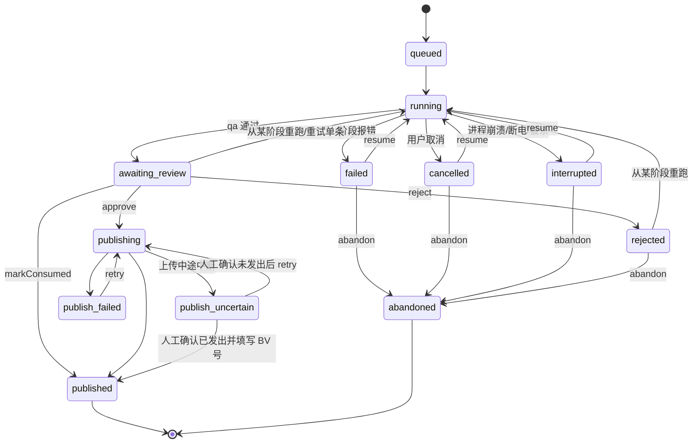
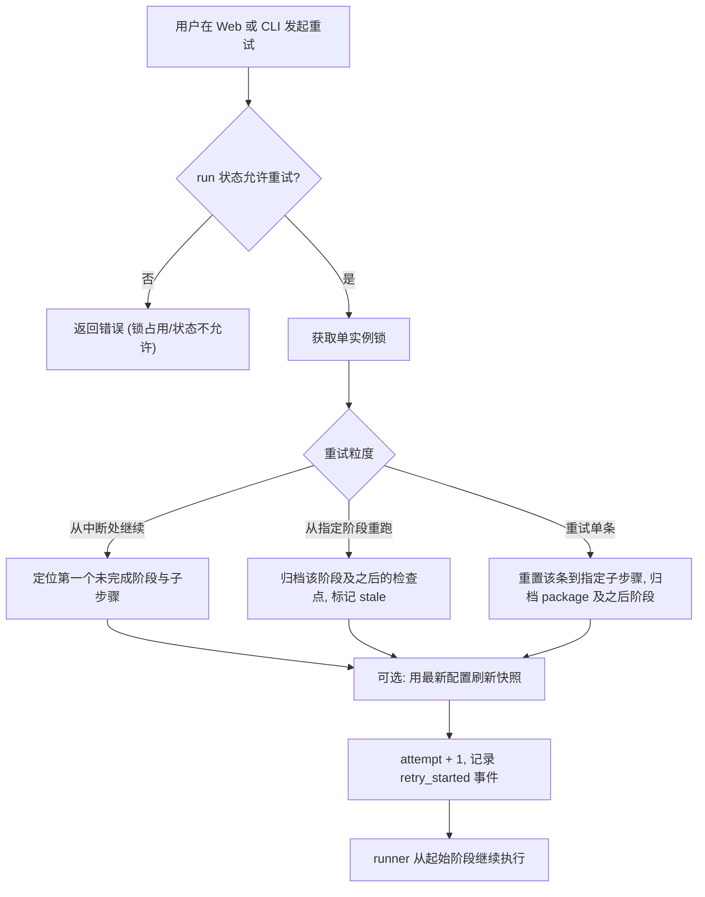
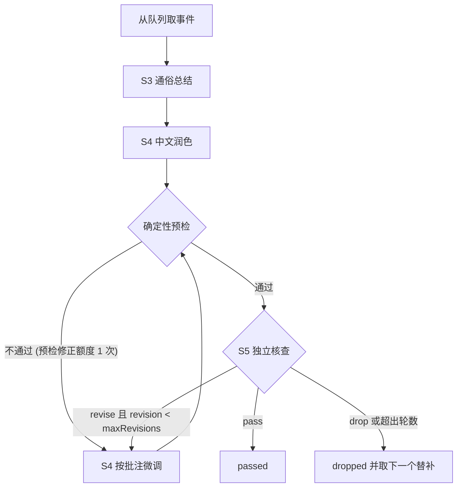
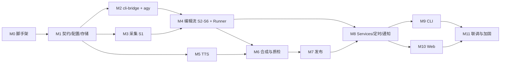

# AI 每日报 — 开发设计文档（v1）

> 配套文档：[业务流程说明.md](./业务流程说明.md)（业务规则）、[项目架构说明.md](./项目架构说明.md)（架构总览）。
> 本文是开发实施的唯一技术依据，按里程碑逐个实现即可完成整个项目。
> 前端视频模板（当前位于 `templates/daily-deck/`）仍在迭代，本文**只定义与模板的对接契约**，不涉及模板内部实现。

---

## 0. 总结速览

- **目标**：在 macOS 本机运行，自动完成「增量抓取中外 AI 新闻 → 聚类选题（缺条自动补抓）→ 通俗总结 → 中文润色 → 独立事实核查（打回润色微调 / 剔除补位）→ 整期编排与 B 站标题简介 → TTS 配音 → 模板合成 MP4 → 人工审核后发布 B 站（强制开启 AI 声明）」。
- **工程形态**：TypeScript + `npm workspaces` Monorepo，共 6 个工作区：`@aidaily/contracts`、`@aidaily/cli-bridge`、`@aidaily/tts`、`@aidaily/core`、`apps/cli`、`apps/web`（Next.js）。
- **核心原则**：全部业务逻辑只放在 `@aidaily/core`；`apps/cli` 与 `apps/web` 是薄壳，只调用 core 的公开 Service。
- **运行模型**：CLI 前台直接执行；Web 通过 core 派生独立 worker 进程执行；定时由用户新建定时任务（必填执行时间与每期条数，不设全局默认值）并同步为 macOS `launchd` 任务；所有进程只通过 SQLite（WAL 模式）和文件共享状态，跨端实时同步。
- **AI 调用**。Core 按任务快照为每个阶段选择模型。`cli-bridge` 运行本机 `agy` 或 Codex CLI，`model-api` 直接请求第三方 HTTP 服务，两者经过 `model-runtime` 的 Zod 校验和失败重试。
- **兼容层与扩展边界**：TTS（`@aidaily/tts`）与通知（`Notifier`）在 v1 均只落地抽象接口、调度管线与空/测试桩（具体本地或云端 TTS 引擎、飞书等通知渠道留待后续按接口接入）。
- **稳定性**：抓取游标与文章消费状态分开管理，保证不漏不重；阶段检查点支持断点续跑；单实例锁加心跳防止重复运行；先做确定性预检（引文、数字、长度、自我描述），再做独立核查；成片经 ffprobe 质检；发布前有人工审核。
- **开发计划**：12 个里程碑（M0–M11）。M6 里的模板适配器要等模板定稿，其余可以立即开工。

---

## 1. 范围

| 在范围内（v1） | 不在范围内（v1） |
| :--- | :--- |
| 中外 RSS/Atom 信源增量抓取、正文与配图提取 | 前端视频模板内部实现（只定义契约） |
| S2–S6 编辑 Agent 工作流（各阶段 CLI 与模型可随时配置，v1 支持 `agy`） | `agy` 以外的 AI CLI（保留适配器扩展点） |
| TTS 抽象兼容层（`TtsProvider` 接口、音频切片拼接管线与测试用 `silent` 桩） | 具体本地 / 云端 TTS 引擎实现（后续按需接入） |
| Playwright 截帧 + FFmpeg 合成、成片质检 | 云服务器 / Docker 部署（v1 只支持 macOS 本机） |
| B 站发布（`biliup`，强制开启 AI 声明）、人工审核闸门 | 非 RSS 的网页列表爬虫（预留 `kind: html-list`） |
| CLI 与 Next.js 后台双入口、可增删定时任务（launchd）、通知抽象接口 | 具体通知渠道实现（v1 为空实现，后期接入飞书） |
| （已包含在双入口定时管理中） | 多用户、复杂权限体系（Web 只监听 127.0.0.1，校验本机 Host 与同源请求并支持可选访问令牌）、多平台分发（只发 B 站） |

---

## 2. 技术选型

| 领域 | 选型 | 说明 |
| :--- | :--- | :--- |
| 运行时 | Node.js 24（`engines: >=24`） | 本机为 v24，内置 `node:sqlite` |
| 语言 | TypeScript 5.x，`strict`，纯 ESM | 全仓共用 `tsconfig.base.json` |
| 包管理 | npm workspaces（npm 11） | 在根目录统一执行 `npm install / run` |
| 构建 | `tsup`（packages 与 cli）、`next build`（web） | packages 输出到 `dist/`（ESM + d.ts） |
| 代码规范 | Biome（lint + format） | 包含禁止跨层导入的规则 |
| 测试 | Vitest（projects 模式） | 单元测试 + 假依赖集成测试 |
| Schema | zod v4（用 `z.toJSONSchema` 生成 JSON Schema） | 统一定义在 contracts |
| 数据库 | `node:sqlite`（`DatabaseSync`），WAL 模式 | 封装在 `storage/db.ts`，可替换为 better-sqlite3 |
| 配置 | YAML（`yaml` 包的 Document API，写回时保留注释） | `config/*.yaml` |
| 抓取 | 原生 `fetch` + `AbortSignal.timeout`、`p-limit` | 使用 ETag / Last-Modified 条件请求 |
| Feed 解析 | `fast-xml-parser` + 自写 RSS2/Atom 归一化 | |
| 正文提取 | `@mozilla/readability` + `jsdom` | |
| 子进程 | `execa` | 只在 cli-bridge 内使用 |
| 渲染 | `playwright`（chromium） | 截取模板每页 1920×1080 PNG |
| 音视频 | 系统 `ffmpeg` / `ffprobe`（本机 9.0） | 拼接、混音、响度、质检 |
| 日志 | `pino` | 同时写入 SQLite 表 `run_events` |
| CLI | `commander` | |
| Web | Next.js（最新稳定版，App Router）+ Tailwind CSS v4 + shadcn/ui | Server Components + Server Actions + SSE |
| 时间 | `date-fns` v4 + `@date-fns/tz` | 存储 UTC ISO，展示时用配置的时区 |
| B 站上传 | `biliup`（biliup-rs CLI），经 cli-bridge 调用 | 需要在本机安装 |

---

## 3. 仓库结构（文件级）

```text
ai每日报/
├── package.json                  # workspaces 顺序见 §13 M0
├── package-lock.json
├── tsconfig.base.json
├── biome.json
├── vitest.config.ts              # projects: packages/*, apps/cli
├── .gitignore                    # node_modules, dist, .next, storage/, .env*
├── .env.example                  # TTS_API_KEY 等密钥占位
├── AGENTS.md                     # 项目协作规范与文档索引
├── docs/
│   ├── 业务流程说明.md
│   ├── 项目架构说明.md
│   └── 开发设计文档.md
├── config/
│   ├── settings.yaml             # 运行配置（§5.1）
│   └── sources.yaml              # 信源清单（§5.2）
├── templates/
│   └── daily-deck/               # 现有视频模板（迭代中，暂不纳入 workspaces；模板自带 package.json 独立构建）
├── packages/
│   ├── contracts/src/
│   │   ├── index.ts
│   │   ├── config.ts             # Settings / Sources 的 zod schema
│   │   ├── article.ts            # Article、SourceDef
│   │   ├── editorial.ts          # SelectionResult、SummaryDraft、PolishedItem、FactCheckResult、IssuePackage
│   │   ├── run.ts                # Stage、RunStatus、RunSummary、RunDetail、RunEvent
│   │   ├── media.ts              # NarrationSection、Timeline、QaReport
│   │   ├── publish.ts            # PublishDraft、PublishRecord
│   │   └── template.ts           # ContentLimits、RenderableIssue、PagePlan、TemplateAdapter
│   ├── cli-bridge/src/
│   │   ├── index.ts              # CliBridge
│   │   ├── types.ts / errors.ts
│   │   ├── exec.ts               # 子进程执行、超时、取消
│   │   ├── json.ts               # JSON 提取、zod 校验
│   │   ├── semaphore.ts          # 按 CLI 限制并发
│   │   └── adapters/{agy.ts, generic.ts}
│   └── tts/src/
│       ├── index.ts              # TtsService（含 provider 注册表）
│       ├── types.ts / registry.ts / cache.ts
│       ├── audio.ts              # ffmpeg 归一化、去静音、拼接、时长测量
│       └── providers/silent.ts   # v1 仅内置测试静音桩，具体本地/云端 provider 后续按接口扩展
│   └── core/
│       ├── prompts/{s2-select.md, s3-summarize.md, s4-polish.md, s4-revise.md, s5-factcheck.md, s6-package.md}
│       ├── test/fixtures/{fake-agy.mjs, feeds/, articles/, agy-outputs/}
│       └── src/
│           ├── index.ts          # createCore() —— 唯一公开入口
│           ├── context.ts        # CoreContext：config、db、paths、logger、bridge、tts、notifier
│           ├── paths.ts
│           ├── config/{loader.ts, writer.ts}
│           ├── storage/{db.ts, migrate.ts, migrations/001_init.sql, files.ts, repos/*.ts}
│           ├── collector/{fetcher.ts, feed-parser.ts, canonical-url.ts, extractor.ts, images.ts, expiry.ts}
│           ├── editorial/{llm.ts, prompts.ts, prechecks.ts, similarity.ts,
│           │              s2-select.ts, s3-summarize.ts, s4-polish.ts, s5-factcheck.ts, s6-package.ts,
│           │              item-pipeline.ts, refill.ts}
│           ├── media/{narration.ts, timeline.ts, compositor.ts, ffmpeg.ts, qa.ts}
│           ├── templates/{registry.ts, server.ts, adapters/solid-color.ts, adapters/daily-deck.ts}
│           ├── publish/{description.ts, bilibili.ts, consumption.ts}
│           ├── workflow/{stages.ts, runner.ts, lock.ts, heartbeat.ts, events.ts, recovery.ts, cancel.ts}
│           ├── services/{task.ts, publish.ts, config.ts, scheduler.ts, source.ts, system.ts}
│           ├── notify/index.ts   # Notifier 抽象接口与默认 NoopNotifier（预留后续接入飞书）
│           └── worker/main.ts    # 独立 worker 入口（派生运行时使用，构建为 dist/worker.mjs）
├── apps/
│   ├── cli/src/{index.ts, output.ts, commands/*.ts}
│   └── web/src/
│       ├── lib/core.ts           # server-only 的 core 单例
│       ├── app/(dashboard)/{page.tsx, runs/, runs/[id]/, schedules/, settings/, sources/, history/}
│       ├── app/api/runs/[id]/events/route.ts               # SSE
│       ├── app/api/runs/[id]/artifacts/[...path]/route.ts  # 产物文件流（支持 Range）
│       └── components/
└── storage/                      # 运行时生成（§7）
```

---

## 4. 运行模型

### 4.1 进程模型

| 触发方式 | 执行方式 |
| :--- | :--- |
| CLI `aidaily run -n <N>` | 在 CLI 进程内直接调用 core 的 `executeRun`，前台输出进度；加 `--detach` 时改为派生 worker |
| Web「立即运行 / 续跑 / 发布」 | core 派生独立进程：`node packages/core/dist/worker.mjs --run-id <id> --action run\|resume\|publish`，使用 `detached + unref`，输出写入 `storage/runs/<id>/worker.log`。关掉浏览器或 Web 服务都不影响任务 |
| 定时 | `launchd` 按每条已启用定时任务配置的时间执行 `node apps/cli/dist/index.mjs run -n <itemCount> --trigger schedule --schedule-id <scheduleId>` |

> worker 入口属于 core 自身，Web 不依赖 CLI 应用，所以不违反薄壳原则。

### 4.2 单实例与心跳
- 同一时刻只允许一个 run 处于 `running` 或 `publishing`。锁记录在 `locks` 表（name=`pipeline`），包含 `owner_run`、`pid`、`heartbeat_at`。
- 运行期间每 10 秒更新一次心跳。获取锁时，如果持锁进程的 `pid` 已经不存在，或心跳超过 60 秒未更新，就认定是陈旧锁：先把旧 run 标记为 `interrupted`（**保留它预留的文章和全部检查点，以便之后从中断的阶段重试**，见 §4.6），再由新任务接管锁。
- 定时触发时如果锁被占用，记录 `schedule_skipped` 事件并经 `Notifier` 抽象接口派发通知（v1 为空实现、仅落库事件日志）；CLI 返回退出码 3。

### 4.3 跨端状态同步
- 进程之间不直接通信，统一读写 SQLite 和 `storage/` 下的文件。
- `taskService.watch()` 每 1 秒轮询一次 `run_events`（条件 `id > cursor`）。CLI 的 `logs -f` 和 Web 的 SSE 都基于它实现。
- Web 的 SSE 在任务和游标通过校验后立即发送连接注释帧，并设置 `X-Accel-Buffering: no`。重连时按 `Last-Event-ID` 继续发送事件。

### 4.4 Run 状态机



- `markConsumed`：不发 B 站，只把本期计入已播库。
- `abandon`：放弃本期，释放预留文章，之后不能再重试。
- 可重试状态：`failed`、`cancelled`、`interrupted`、`rejected`、`awaiting_review`（详见 §4.6）。

### 4.5 阶段（Stage）与业务步骤的对应关系

| Stage | 业务步骤 | 检查点文件 |
| :--- | :--- | :--- |
| `collect` | S1 增量抓取 | `stages/collect.json` |
| `select` | S2 聚类选题 | `stages/select.json` |
| `edit` | S3 总结 → S4 润色 → S5 核查（逐条循环 + 补位） | `stages/edit.json` + `items/*.json` |
| `package` | S6 整期编排、标题简介 | `stages/package.json` |
| `narrate` | S7a TTS 配音与时间轴 | `stages/narrate.json` + `timeline.json` |
| `render` | S7b 模板截帧 + FFmpeg 合成 | `stages/render.json` |
| `qa` | S7c 成片质检 | `qa.json` |
| `review` / `publish` | S8 审核与发布 | `output/publish.json` |

- 每个阶段成功后写入检查点，并更新 `run_stages` 和 `runs.current_stage`。
- 中断与重试的完整规则见 §4.6。

### 4.6 阶段中断与重试

目标：任何阶段因为任何原因中断，都能**随时**从该阶段（或任意更早的阶段）重试，已完成的工作不重做，也不会重复扣用新闻或重复发布。

#### 4.6.1 中断的类型与识别

| 中断类型 | 如何识别 | run 状态 | 预留文章与检查点 |
| :--- | :--- | :--- | :--- |
| 阶段报错（重试次数用完、质检不过、凑不够条数等） | runner 捕获异常 | `failed` + `error_code` | 全部保留 |
| 用户取消 | `cancel_requested=1`，runner 在步骤之间响应，并中止正在运行的子进程 | `cancelled` | 全部保留 |
| 进程崩溃、断电、睡眠被杀、终端关闭 | 心跳超过 60 秒未更新且 pid 不存在；任何入口调用 `createCore()` 时由 `recovery.recoverStaleRuns()` 检测 | `interrupted` | 全部保留 |
| 上传 B 站时中断 | 发布进程中断时 `publish_records.status = publishing` | `publish_uncertain` | 全部保留 |

- 被中断的阶段在 `run_stages` 中标记为 `failed` 或 `interrupted`，并记录 `error`。
- 预留文章只在 `abandon`、发布成功或 `markConsumed` 时才会处理（§6.1）。另外，重试窗口 `retry.reservationHoldHours`（默认 48 小时）到期后，`recovery` 会把仍未重试的 run 自动置为 `abandoned` 并释放文章，避免新闻被长期锁住。

#### 4.6.2 重试的三种粒度

| 粒度 | 入口 | 行为 |
| :--- | :--- | :--- |
| **从中断处继续**（默认） | `tasks.resume(runId)` | 找到第一个未完成的阶段，在阶段内部从最后一个完成的子步骤接着做（见 §4.6.3） |
| **从指定阶段重跑** | `tasks.resume(runId, { fromStage })` | 指定阶段及其之后阶段的检查点全部作废（归档，不删除），从该阶段重新执行 |
| **重试单条新闻** | `tasks.retryItem(runId, itemId, { fromStep })` | 只重做某一条新闻的 `summarize` / `polish` / `factcheck` 子步骤；完成后自动把 `package` 及之后的阶段作废并重跑 |

- 允许重试的状态：`failed`、`cancelled`、`interrupted`、`rejected`、`awaiting_review`。`running` 和 `publishing` 时不允许（返回锁占用错误）；`published` 和 `abandoned` 不允许。
- 只能从「已完成阶段 + 第一个未完成阶段」中选择 `fromStage`。例如 `select` 未完成时，不能直接从 `render` 开始。
- 每次重试都要重新获取单实例锁，`run_stages.attempt` 加 1，并记录 `retry_started` 事件（包含粒度、起始阶段、操作入口）。
- 后台重试由提交端核对任务状态和执行轮次，再将运行锁交给指定的工作进程。工作进程写入重试事件和运行状态后，提交端才返回启动成功。等待超过 15 秒时提示刷新查看任务状态，已取得运行许可的工作进程继续执行。

#### 4.6.3 各阶段的续跑粒度与幂等规则

| 阶段 | 从中断处继续时 | 从该阶段重跑时 |
| :--- | :--- | :--- |
| `collect` | 整阶段重跑（按 URL 去重，已入库的文章不会重复插入；已推进的信源游标不回退） | 同左 |
| `select` | 整阶段重跑：先释放本 run 已预留的文章、删除本 run 的 `events`，再重新选题 | 同左；同时作废 `edit` 及之后的产物 |
| `edit` | **按条目续跑**：`passed` 的条目保留；做到一半的条目根据 `item_versions` 中最后一条记录，从下一个子步骤继续（已有 summary 就从 polish 开始，已有 polish 就从预检 / 核查开始）；`revision` 计数保留 | 所有条目回到 `queued`，`revision` 清零，从 S3 开始；历史版本保留在 `item_versions` 中供对比 |
| `package` | 整阶段重跑 | 同左 |
| `narrate` | 按段落续跑；TTS 缓存命中的句子不再合成 | 删除段落音频后重新拼接（缓存仍然生效） |
| `render` | 按页续跑：已存在且内容哈希匹配的 `frames/page-XX.png` 直接复用，最后整体重新合成视频 | 删除截图，全部重新截取并合成 |
| `qa` | 整阶段重跑 | 同左 |
| `publish` | `publish_failed`：直接重新上传。`publish_uncertain`：**禁止自动重传**，必须先人工到 B 站后台确认：没发出去就点「确认未发布，重试」；已经发出去就填写 BV 号并标记为 `published` | — |

规则：
1. **幂等**：每个阶段的实现必须可以重复执行。所有输出都先写临时文件再 rename；数据库写入放在事务里。
2. **作废而不删除**：从某阶段重跑时，把该阶段及之后的检查点和产物移动到 `runs/<id>/archive/<attempt>-<stage>/`，`run_stages.status` 置为 `stale`。Web 中可以对比新旧版本。
3. **实时配置与配置快照**：定时触发、手动重跑与跨阶段流转默认重读磁盘最新生效配置（`useLatestConfig: true`），并将刷新后的有效参数同步写回任务配置快照；需要严格复现旧参数时可在重跑或单条重做时显式传入 `useLatestConfig: false`（CLI `--keep-snapshot`）。刷新快照动作记入事件日志。
4. **条数**：重试不会修改 `item_count`。如果需要不同的条数，应该新开一期。

#### 4.6.4 重试流程



---

## 5. 配置设计

### 5.1 `config/settings.yaml`（完整默认值）

```yaml
version: 1
timezone: Asia/Shanghai

issue:
  # 每期条数 N 不在全局设默认值，在新建定时任务或手动触发时显式填写
  reserveFactor: 2          # 候选事件数 = N × reserveFactor（前 N 个为主选，其余为替补）
  freshnessHours: 48        # 候选新闻的默认时效
  itemConcurrency: 3        # 同时处理的条目数
  allowPartial: false       # 候补或复检不足 N 条时是否允许减量出片（默认严格补足 N 条）
  refill:
    maxRounds: 3
    useBackupSources: true
    lookbackStepHours: 24
    maxLookbackHours: 96

retry:
  reservationHoldHours: 48  # 失败/中断/取消的 run 在此时长内可随时重试；到期未重试则自动 abandoned 并释放预留文章

retention:
  keepRuns: 30              # 保留最近完成的期数（不含发布保留及未过期/不确定发布任务）
  maxAgeDays: 30            # 超过天数的过期任务及其产物可清理
  maxLogAgeDays: 14         # 运行日志保存天数
  autoCleanup: false        # 是否在任务收尾后自动执行清理（也可随时手动运行 aidaily cleanup）

editorial:
  maxRevisions: 2           # 核查打回润色的最大轮数
  compactStyle: true        # 是否启用紧凑型播报文案与配音片段生成模式
  requireImageOptIn: true   # 仅当单条显式选择或上传配图时才启用文章附图，未选时不自动拉取
  sourceMaxChars: 20000     # 单个事件送入模型的原文总字数上限
  historyDedupDays: 14
  metaTextBlacklist: ["已依据", "以下是", "根据您提供", "作为AI", "总结如下", "```"]

contentLimits:              # 默认值取自当前模板，模板适配器可以覆盖
  headline: 42
  leadSummary: 84
  title: 48
  shortTitle: 16
  category: 8
  summary: 90
  keyPointsMax: 3
  keyPoint: 28
  detail: 200
  hostComment: 46
  narrationSentence: 40

ai:
  # 网页设置可以添加模型 API 连接，配置有序兜底渠道池，并为各阶段选择运行模式（pool | custom）。
  maxConcurrentCalls: 3
  providers: {}
  stages:
    select:    { mode: pool, cli: agy, model: gemini-4-hydrogen-high, timeoutSec: 300, retries: 2 }
    summarize: { mode: pool, cli: agy, model: gemini-4-hydrogen-high, timeoutSec: 240, retries: 2 }
    polish:    { mode: pool, cli: agy, model: gemini-4-hydrogen-high, timeoutSec: 180, retries: 2 }
    factcheck: { mode: pool, cli: agy, model: gemini-4-hydrogen-high, timeoutSec: 300, retries: 2 }
    package:   { mode: pool, cli: agy, model: gemini-4-hydrogen-high, timeoutSec: 240, retries: 2 }
  channels:
    - { cli: agy, model: gemini-4-hydrogen-high, retries: 2, enabled: true }

clis:
  codex:
    adapter: codex
    bin: codex
  agy:
    adapter: agy
    bin: /Applications/Gemini.app/Contents/Helpers/agy
    extraArgs: []
  biliup:
    adapter: generic
    bin: biliup

tts:
  provider: qwen-local      # 默认使用配置中指定的本地语音引擎，测试/无模型时可切为 silent
  providers:
    silent: { charsPerSecond: 4.5 }
    qwen-local: { backend: metal, bin: assets/tts/bin/audiocpp_server, model: assets/tts/models/Qwen3-TTS-12Hz-1.7B-Base-GGUF/qwen3-tts-12hz-1.7b-base-q8_0_v2.gguf }
  postprocess:
    sampleRate: 48000
    loudnessLUFS: -16
    trimSilence: true
    sentenceGapMs: 250
    sectionGapMs: 600

template:
  active: daily-deck
  registry:
    daily-deck:  { dir: templates/daily-deck, adapter: daily-deck }
    solid-color: { dir: "", adapter: solid-color }   # 测试用
  cover: { dir: templates/cover-card }   # 视频封面模板；不配置时直接用第 0 页截图作封面

render:
  width: 1920
  height: 1080
  fps: 30
  pagePaddingSec: 0.6       # 每页语音播完后的停留时间
  bgm: { file: "", volumeDb: -22, duckDb: -10 }
  # 可选：切换下一条时的鼠标点击音效。file 留空关闭；文件缺失时只记警告、不加音效。
  # 音效在人声与背景音乐混好（含背景音乐避让）之后叠加，发声时刻 = 第 2 页起每页开始时间 - leadMs
  pageTurnSfx: { file: "assets/sfx/page-click.wav", volumeDb: -9, leadMs: 60, postDelayMs: 1000 }

publish:
  mode: manual-review       # manual-review | auto（auto 只在 qa 通过时自动发布）
  bilibili:
    cli: biliup
    cookieFile: ~/cookies.json   # 支持 ~ 家目录、绝对路径或相对项目根目录；默认复用家目录下 biliup login 生成的凭据
    tid: 0                  # 待确认（§14）
    copyright: 1
    uploadTimeoutSec: 600   # 投稿命令行执行超时时间（秒）
    titleMax: 80
    descMax: 2000
    tagsMax: 12
    defaultTags: [AI, 人工智能, 科技资讯, AI每日报]
    aiDeclaration: true     # 强制开启 B 站平台 AI 生成内容声明标识
    aiDisclaimerText: "本视频由 AI 辅助整理与配音，内容均经原文核查，参考来源见简介。"

# 定时任务（执行时间 + 每期条数）不在配置文件设默认值，统一在 SQLite schedules 表中手动新建管理

notify:
  provider: none            # v1 仅保留抽象接口（none），后期可扩展 feishu 等渠道
  config: {}

web:
  host: 127.0.0.1
  port: 3000
```

### 5.2 `config/sources.yaml`

```yaml
sources:
  # pool: primary 每次都抓；backup 只在补抓时启用。tier: 1 官方 / 2 媒体 / 3 社区
  - { id: openai-news,   name: OpenAI News,        lang: en, tier: 1, kind: rss, pool: primary, url: "https://openai.com/news/rss.xml" }
  - { id: deepmind-blog, name: Google DeepMind,    lang: en, tier: 1, kind: rss, pool: primary, url: "https://deepmind.google/blog/rss.xml" }
  - { id: google-ai,     name: Google AI Blog,     lang: en, tier: 1, kind: rss, pool: primary, url: "https://blog.google/innovation-and-ai/technology/ai/rss/" }
  - { id: hf-blog,       name: Hugging Face Blog,  lang: en, tier: 1, kind: rss, pool: primary, url: "https://huggingface.co/blog/feed.xml" }
  - { id: techcrunch-ai, name: TechCrunch AI,      lang: en, tier: 2, kind: rss, pool: primary, url: "https://techcrunch.com/category/artificial-intelligence/feed/" }
  - { id: verge-ai,      name: The Verge AI,       lang: en, tier: 2, kind: rss, pool: primary, url: "https://www.theverge.com/rss/ai-artificial-intelligence/index.xml" }
  - { id: mittr-ai,      name: MIT Tech Review AI, lang: en, tier: 2, kind: rss, pool: backup,  url: "https://www.technologyreview.com/topic/artificial-intelligence/feed" }
  - { id: qbitai,        name: 量子位,              lang: zh, tier: 2, kind: rss, pool: primary, url: "https://www.qbitai.com/feed" }
  - { id: infoq-cn,      name: InfoQ 中文,         lang: zh, tier: 2, kind: rss, pool: primary, url: "https://www.infoq.cn/feed" }
  - { id: geekpark,      name: 极客公园,           lang: zh, tier: 2, kind: rss, pool: backup,  url: "https://www.geekpark.net/rss" }
  - { id: ithome,        name: IT之家,              lang: zh, tier: 2, kind: rss, pool: backup,  url: "https://www.ithome.com/rss/" }
  - { id: hn-ai,         name: Hacker News (AI),   lang: en, tier: 3, kind: rss, pool: backup,  url: "https://hnrss.org/newest?q=AI+OR+LLM&points=100" }
```

> 以上地址需要在 M3 用 `aidaily sources test` 逐个验证，不可用的要修正或替换。36氪、IT之家等综合媒体不全是 AI 内容，由 S2 过滤。

### 5.3 配置读写规则
- 用 `contracts/config.ts` 中的 zod schema 校验。校验失败时，任何入口都拒绝启动任务，并指出出错的字段路径。
- `configService.update()` 通过 `yaml` 的 Document API 修改配置，**保留注释**；先写临时文件再 rename，保证写入是原子的。
- 每个 run 创建时，把当时的完整配置快照写入 `runs.config_snapshot`。运行过程中只读这份快照，中途改配置不影响正在运行的任务。
- 密钥只放在 `.env`（如 `TTS_API_KEY`）或 `storage/secrets/`（目录权限 700，文件权限 600），不写进 YAML。
- 网页「模型 API 配置」支持新增、编辑和删除连接。Core 校验名称在 API 与本机命令间唯一。改名时同步更新当前引用的阶段，删除前须切换引用该连接的阶段。
- 网页录入的密钥保存为权限 600 的文件，YAML 和任务快照只保存文件名。更换或移除密钥时，已有任务快照仍可按原引用重试。地址换到另一个域名、端口或协议时，需提供新密钥或明确移除当前密钥。

---

## 6. 数据模型（`storage/migrations/001_init.sql`）

```sql
PRAGMA journal_mode = WAL;
PRAGMA foreign_keys = ON;

CREATE TABLE schema_migrations (version INTEGER PRIMARY KEY, applied_at TEXT NOT NULL);

CREATE TABLE source_state (
  source_id TEXT PRIMARY KEY,
  last_fetched_at TEXT,              -- 上次成功抓取的时间（抓取游标）
  last_item_published_at TEXT,       -- 已见过的最新文章的发布时间
  etag TEXT,
  last_modified TEXT,
  consecutive_failures INTEGER NOT NULL DEFAULT 0,
  last_error TEXT
);

CREATE TABLE articles (
  id TEXT PRIMARY KEY,               -- sha1(canonical_url)
  source_id TEXT NOT NULL,
  canonical_url TEXT NOT NULL UNIQUE,
  title TEXT NOT NULL,
  title_norm TEXT NOT NULL,
  lang TEXT NOT NULL,
  published_at TEXT,                 -- 源站给出的时间；缺失时用 first_seen_at
  first_seen_at TEXT NOT NULL,
  excerpt TEXT,
  content_path TEXT,                 -- storage/articles/<id>.json
  content_chars INTEGER,
  image_path TEXT,
  extract_status TEXT NOT NULL DEFAULT 'pending',  -- pending | ok | feed_only | failed
  status TEXT NOT NULL DEFAULT 'new',              -- new | reserved | consumed | expired | rejected
  reserved_by_run TEXT
);
CREATE INDEX idx_articles_status_pub ON articles(status, published_at);

CREATE TABLE runs (
  id TEXT PRIMARY KEY,               -- 格式如 20261116-0800-a1b2
  trigger TEXT NOT NULL,             -- manual-cli | manual-web | schedule
  schedule_id TEXT,                  -- 由定时任务触发时记录对应的 schedules.id
  status TEXT NOT NULL,              -- queued | running | failed | cancelled | interrupted | awaiting_review | rejected | publishing | publish_failed | publish_uncertain | published | abandoned
  current_stage TEXT,
  item_count INTEGER NOT NULL,       -- 创建任务时必填，无默认值
  config_snapshot TEXT NOT NULL,
  cancel_requested INTEGER NOT NULL DEFAULT 0,
  attempt INTEGER NOT NULL DEFAULT 1,  -- 每次重试加 1
  error_code TEXT,
  error TEXT,
  pid INTEGER,
  heartbeat_at TEXT,
  created_at TEXT NOT NULL,
  started_at TEXT,
  finished_at TEXT,
  retry_deadline_at TEXT             -- 进入可重试状态时写入（now + reservationHoldHours），到期自动 abandoned
);

CREATE TABLE run_stages (
  run_id TEXT NOT NULL REFERENCES runs(id),
  stage TEXT NOT NULL,
  status TEXT NOT NULL,              -- pending | running | done | failed | interrupted | stale | skipped
  attempt INTEGER NOT NULL DEFAULT 0,
  started_at TEXT, finished_at TEXT, error TEXT, checkpoint_path TEXT,
  PRIMARY KEY (run_id, stage)
);

CREATE TABLE run_events (
  id INTEGER PRIMARY KEY AUTOINCREMENT,
  run_id TEXT NOT NULL,
  ts TEXT NOT NULL,
  level TEXT NOT NULL,               -- debug | info | warn | error
  stage TEXT,
  item_id TEXT,
  type TEXT NOT NULL,                -- stage_started / item_dropped / llm_call / refill / ...
  message TEXT NOT NULL,             -- 面向用户的中文描述
  data TEXT                          -- JSON
);
CREATE INDEX idx_run_events_run ON run_events(run_id, id);

CREATE TABLE events (                -- S2 聚类得到的新闻事件
  id TEXT PRIMARY KEY,
  run_id TEXT NOT NULL REFERENCES runs(id),
  rank INTEGER NOT NULL,
  role TEXT NOT NULL,                -- primary | reserve
  title TEXT NOT NULL,
  article_ids TEXT NOT NULL,         -- JSON array
  category TEXT, entity TEXT,
  score REAL NOT NULL, public_appeal REAL, reason TEXT,
  refill_round INTEGER NOT NULL DEFAULT 0
);

CREATE TABLE run_items (
  id TEXT PRIMARY KEY,
  run_id TEXT NOT NULL REFERENCES runs(id),
  event_id TEXT NOT NULL REFERENCES events(id),
  position INTEGER,                  -- S6 之后确定的播出顺序
  status TEXT NOT NULL,              -- queued | summarizing | polishing | prechecking | checking | revising | passed | dropped
  revision INTEGER NOT NULL DEFAULT 0,
  drop_reason TEXT,
  final_json TEXT,                   -- 通过后的 PolishedItem
  updated_at TEXT NOT NULL
);

CREATE TABLE item_versions (         -- 每一轮的稿件与核查记录（用于审计和 Web 对比）
  id INTEGER PRIMARY KEY AUTOINCREMENT,
  item_id TEXT NOT NULL REFERENCES run_items(id),
  kind TEXT NOT NULL,                -- summary | polish | revise | precheck | factcheck
  round INTEGER NOT NULL,
  payload TEXT NOT NULL,
  created_at TEXT NOT NULL
);

CREATE TABLE llm_calls (
  id INTEGER PRIMARY KEY AUTOINCREMENT,
  run_id TEXT, stage TEXT, item_id TEXT,
  cli TEXT NOT NULL, model TEXT, attempt INTEGER NOT NULL,
  status TEXT NOT NULL,              -- ok | timeout | bad_output | exit_error | auth_error
  duration_ms INTEGER, input_tokens INTEGER, output_tokens INTEGER,
  conversation_id TEXT,
  log_path TEXT,                     -- 完整 prompt 与原始输出所在文件
  created_at TEXT NOT NULL
);

CREATE TABLE published_history (     -- 已播库（跨期防重）
  event_id TEXT PRIMARY KEY,
  run_id TEXT NOT NULL,
  title TEXT NOT NULL,
  title_norm TEXT NOT NULL,
  entity TEXT,
  article_urls TEXT NOT NULL,
  published_at TEXT NOT NULL
);

CREATE TABLE publish_records (
  run_id TEXT PRIMARY KEY REFERENCES runs(id),
  platform TEXT NOT NULL DEFAULT 'bilibili',
  title TEXT, description TEXT, tags TEXT,
  status TEXT NOT NULL,              -- draft | publishing | published | failed | uncertain | consumed_only
  bvid TEXT,
  attempts INTEGER NOT NULL DEFAULT 0,
  error TEXT,
  updated_at TEXT NOT NULL
);

CREATE TABLE schedules (             -- 用户手动创建的定时任务（无默认时间与默认条数）
  id TEXT PRIMARY KEY,               -- 格式如 sched-a1b2c3
  name TEXT NOT NULL,
  time_expr TEXT NOT NULL,           -- 必填：每日时间 "HH:mm"（后续可扩展星期/cron）
  item_count INTEGER NOT NULL,       -- 必填：每期条数 N（正整数，无默认值）
  enabled INTEGER NOT NULL DEFAULT 1,
  last_run_id TEXT,
  last_triggered_at TEXT,
  created_at TEXT NOT NULL,
  updated_at TEXT NOT NULL
);

CREATE TABLE locks (
  name TEXT PRIMARY KEY,
  owner_run TEXT, pid INTEGER, acquired_at TEXT, heartbeat_at TEXT
);
```

### 6.1 文章消费规则（保证“自上次以来”不漏不重）

| 时机 | 动作 |
| :--- | :--- |
| `collect` | 新文章以 `new` 状态入库；抓取成功后立即推进该信源的游标（文章已经落库，后续步骤失败也不会丢） |
| `collect` 结束时 | 发布时间早于 `maxLookbackHours` 的 `new` 文章标记为 `expired` |
| `select` | 被选中的事件（主选 + 替补）对应的文章标记为 `reserved`，并记录 `reserved_by_run` |
| run 失败 / 取消 / 中断 / 被拒绝 | **预留不释放**，检查点保留，等待随时重试（§4.6） |
| 从 `select` 阶段重跑 | 先释放本 run 原有的预留，再重新选题并预留 |
| `abandon`，或超过 `retry.reservationHoldHours` 未重试 | 本 run 预留的文章全部退回 `new`，下一期可以继续用 |
| 发布成功或 `markConsumed` | 在同一个事务内：已播事件的文章标记为 `consumed`，并写入 `published_history`；没用上的替补退回 `new` |

> 抓取进度和文章消费状态分开管理：任务中途失败时，既不会重复抓取，也不会丢新闻；失败的 run 在重试窗口内保留选题，重试时内容不变。

---

## 7. 产物目录

```text
storage/
├── state.sqlite (+ -wal, -shm)
├── articles/<articleId>.json        # {url, title, lang, publishedAt, text, feedContent}
├── images/<articleId>.<ext>
├── tts-cache/<sha1>.wav             # 以 provider + voice + 文本为键缓存，续跑时不重复合成
├── tmp/agy/<uuid>/                  # 每次 agy 调用的隔离空工作目录（用完删除）
├── secrets/                         # 目录权限 700
├── logs/{scheduler.log, web.log}
└── runs/<runId>/
    ├── run.log / worker.log
    ├── stages/{collect,select,edit,package,narrate,render}.json
    ├── llm/<seq>-<stage>[-<itemId>].json   # prompt、命令参数、原始 stdout/stderr、解析结果
    ├── items/<itemId>.json
    ├── audio/<sectionKey>/seg-XX.wav, audio/<sectionKey>.wav, narration.wav, mix.wav
    ├── timeline.json
    ├── template-data.json
    ├── frames/page-XX.png
    ├── qa.json
    ├── cover.json                    # 审核时人工修改过的封面文字（没改过则不存在）
    ├── output/{video.mp4, cover.jpg, publish.json}
    └── archive/<attempt>-<stage>/      # 从某阶段重跑时，被作废的检查点与产物移到这里（供对比，不删除）
```

---

## 8. 包设计

### 8.1 `@aidaily/contracts`

只包含 zod schema 与类型，除 zod 外**没有其他运行时依赖**。核心定义如下：

```ts
export const Stage = z.enum(['collect', 'select', 'edit', 'package', 'narrate', 'render', 'qa', 'review', 'publish']);
export const RunStatus = z.enum(['queued', 'running', 'awaiting_review', 'publishing', 'published',
  'publish_failed', 'failed', 'cancelled', 'rejected']);
export const Trigger = z.enum(['manual-cli', 'manual-web', 'schedule']);

export const Evidence = z.object({
  claim: z.string(),                 // 稿件中的事实陈述
  articleId: z.string(),
  quote: z.string(),                 // 原文逐字引语（保持原文语言）
});

export const SelectionResult = z.object({
  events: z.array(z.object({
    title: z.string(),
    articleIds: z.array(z.string()).min(1),
    category: z.string(),
    entity: z.string(),              // 主体：OpenAI / Anthropic / Google / DeepSeek / 阿里 / 其他…
    score: z.number(),               // 重要度 1-10
    publicAppeal: z.number(),        // 大众关注度 1-10
    reason: z.string(),
    duplicateOfHistory: z.boolean(),
  })),
});

export const Availability = z.enum(['available_now', 'paid_only', 'limited_preview',
  'announced_only', 'open_source', 'research', 'unknown']);

export const SummaryDraft = z.object({
  facts: z.array(z.string()).min(1).max(6),   // 发生了什么
  relevance: z.string(),                       // 对普通人的意义
  availability: Availability,
  availabilityNote: z.string(),                // 目前能怎么用、有什么限制
  evidence: z.array(Evidence).min(1),
});

export const PolishedItem = z.object({
  title: z.string(),
  shortTitle: z.string(),            // 片头目录用
  category: z.string(),
  entity: z.string(),
  summary: z.string(),               // 一句话总结
  keyPoints: z.array(z.string()).max(3),
  detail: z.string(),
  hostComment: z.string(),           // 主持人 / 角色短评
  narration: z.array(z.string()).min(1),   // 口播分句（已转成口语读法）
  evidence: z.array(Evidence).min(1),
});

export const ClaimStatus = z.enum(['supported', 'unsupported', 'distorted', 'exaggerated', 'outdated']);
export const FactCheckResult = z.object({
  verdict: z.enum(['pass', 'revise', 'drop']),
  claims: z.array(z.object({ text: z.string(), status: ClaimStatus, note: z.string() })),
  revisionNotes: z.array(z.string()),
  dropReason: z.string().optional(),
});

export const IssuePackage = z.object({
  order: z.array(z.string()),        // run_item id 的播出顺序，头条在前
  headlineItemId: z.string(),
  headline: z.string(),
  leadSummary: z.string(),
  intro: z.object({ narration: z.array(z.string()), hostComment: z.string() }),
  outro: z.object({ narration: z.array(z.string()), hostComment: z.string(), cta: z.string() }),
  publish: z.object({ title: z.string(), descriptionIntro: z.string(), tags: z.array(z.string()) }),
  cover: z.object({ title: z.string(), subtitle: z.string() }).optional(), // 封面主标题（可用 *星号* 高亮）与副标题
});

export const Timeline = z.object({
  totalMs: z.number(),
  sections: z.array(z.object({
    key: z.string(),                 // intro | item-01 … | outro
    kind: z.enum(['intro', 'item', 'outro']),
    itemId: z.string().optional(),
    audioFile: z.string(),
    startMs: z.number(),             // 在成片中的起点（已计入页面停留）
    speechMs: z.number(),            // 语音时长
    pageMs: z.number(),              // 页面总时长 = speechMs + 页面停留
    sentences: z.array(z.object({ text: z.string(), startMs: z.number(), durationMs: z.number() })),
  })),
});
```

模板契约（`template.ts`，TS 接口）：

```ts
export interface RenderableIssue {      // core 产出的整期数据，与具体模板无关
  date: string; issueNumber: string; headline: string; leadSummary: string;
  intro: IssuePackage['intro']; outro: IssuePackage['outro'];
  items: Array<PolishedItem & { id: string; position: number; source: string;
    sourceUrl: string; publishedAt: string; imagePath?: string; impact: 'breaking' | 'high' | 'normal' }>;
}
export interface PagePlan { index: number; sectionKey: string; durationMs: number }
export interface TemplateAdapter {
  id: string;
  contentLimits?: Partial<ContentLimits>;                        // 覆盖默认字数上限
  buildData(issue: RenderableIssue, timeline: Timeline): unknown; // 生成模板需要的 JSON
  planPages(issue: RenderableIssue, timeline: Timeline): PagePlan[];
  prepare(opts: { dir: string; runDir: string }): Promise<{ baseUrl: string; close(): Promise<void> }>; // 构建模板并启动静态服务
  capture(page: import('playwright').Page, data: unknown, plan: PagePlan[], outDir: string): Promise<string[]>; // 输出每页 PNG
}
```

### 8.2 `@aidaily/cli-bridge`（通用 CLI 兼容层）

```ts
export interface InvokeRequest<T> {
  cli: string;                       // 注册名，例如 'agy'
  prompt: string;
  schema?: z.ZodType<T>;             // 提供时走结构化输出
  model?: string;
  timeoutMs: number;
  retries: number;
  signal?: AbortSignal;              // 取消时杀掉子进程
  meta?: { runId?: string; stage?: string; itemId?: string };
}
export interface InvokeResult<T> {
  data: T; rawStdout: string; durationMs: number; attempts: number;
  usage?: { inputTokens: number; outputTokens: number }; conversationId?: string;
}
export interface CliAdapter {
  id: string;
  buildCommand(req: InvokeRequest<unknown>, cfg: CliConfig, workDir: string):
    { bin: string; args: string[]; stdin?: string; env?: Record<string, string> };
  parse(stdout: string, stderr: string, exitCode: number):
    { payload: unknown; usage?: InvokeResult<unknown>['usage']; conversationId?: string };
  healthcheck(cfg: CliConfig): Promise<{ ok: boolean; detail: string }>;
  listModels?(cfg: CliConfig): Promise<string[]>;
}
export class CliBridge {
  constructor(opts: { configs: Record<string, CliConfig>; tmpDir: string; logCall?: (rec: CallRecord) => void });
  register(adapter: CliAdapter): void;
  invoke<T>(req: InvokeRequest<T>): Promise<InvokeResult<T>>;
  // 用于非 LLM 工具（biliup、launchctl 等）
  exec(cli: string, args: string[], opts?: { timeoutMs?: number; signal?: AbortSignal; stdio?: 'pipe' | 'inherit' }):
    Promise<{ stdout: string; stderr: string; exitCode: number }>;
  health(cli: string): Promise<{ ok: boolean; detail: string }>;
  listModels(cli: string): Promise<string[]>;
}
```

**错误类型与重试**

| 错误 | 触发条件 | 是否重试 |
| :--- | :--- | :--- |
| `CliNotFoundError` | bin 不存在 | 否 |
| `CliAuthError` | stderr 中出现登录 / 认证类关键字 | 否（通知用户重新登录） |
| `CliTimeoutError` | 超过 `timeoutMs` | 是 |
| `CliExitError` | 退出码非零，或 agy 返回的 `status` 不是 SUCCESS | 是 |
| `CliOutputError` | 输出不是 JSON，或 zod 校验失败 | 是；重试时在 prompt 末尾附上“上次输出不符合要求：<zod 报错摘要>” |
| `PromptTooLargeError` | prompt 超过长度上限 | 否 |

- 重试间隔依次为 2 秒、8 秒、20 秒。`model-runtime` 按调用名称和本期的 `ai.maxConcurrentCalls` 限制并发，CLI 与 HTTP 都使用这一规则。
- 每次调用（包括每次重试）都通过 `logCall` 回调写入 `llm_calls` 表和 `runs/<id>/llm/*.json`。

**agy 适配器（基于 2026-11-16 本机实测）**

- 命令：`<bin> -p <prompt> --model <model> --output-format json --disable-slash-commands --print-timeout <sec>s [--json-schema <schemaJson>] ...extraArgs`
- 实测结论及对应设计：
  1. **print 模式默认不读取 stdin 里的文本**，原文必须直接写进 `-p` 参数。macOS 命令行参数总长上限约 1MB，所以适配器把 prompt 限制在 400KB 以内（上游的 `sourceMaxChars` 能保证不会超）。备用通道是 `--input-format stream-json --output-format stream-json`（通过 stdin 传 NDJSON），在 M2 验证后用于超大输入。
  2. stdout 是一个 JSON 对象：`{conversation_id, status, response, duration_seconds, num_turns, structured_output, json_schema, usage{input_tokens, output_tokens, thinking_tokens, cache_read_tokens, total_tokens}}`。`status !== "SUCCESS"` 就视为失败；有 schema 时取 `structured_output` 交给 zod 校验，没有 schema 时取 `response`。
  3. `structured_output` 里可能夹带“已依据所给内容……”这类对任务本身的描述。所有 prompt 都要写明“字段值就是最终成品文本，不要描述任务本身”，同时由 core 预检用 `metaTextBlacklist` 拦截。
  4. 每次调用固定消耗约 1.5 万 input tokens、耗时约 4 秒。按此估算，每期约 25–35 次调用。
- 隔离：每次调用都以 `storage/tmp/agy/<uuid>/` 空目录作为 `cwd`，用完删除；不传 `--dangerously-skip-permissions`；所有材料都放在 prompt 里，不依赖工具调用。
- JSON Schema：用 `z.toJSONSchema()` 生成，只用基础关键字（type / properties / required / enum / items）。字数等约束由 zod 和预检兜底；agy 是否支持 `maxLength` 在 M2 验证。
- `listModels`：解析 `agy models` 的输出，去掉加载动画的控制字符，每行取第一列作为模型 ID。
- `healthcheck`：`agy --help` 返回 0，并能完成一次极小的结构化调用。

**generic 适配器**：通过配置 `bin`、`argsTemplate`（占位符 `{prompt}`、`{model}`、`{schemaFile}`、`{out}`）和 `parse`（`json` | `text` | `json-field:<path>`）接入任意 CLI；`exec()` 供 biliup、launchctl 等非 LLM 工具使用。

**Codex CLI 适配器**在临时目录执行 `codex exec`。提示词走标准输入，最终结果从 `--output-last-message` 文件读取，用量和线程 ID 来自 JSONL 事件。结构化调用用 `--output-schema`，写入业务规则之前经过本地 Zod 校验。

**模型 HTTP 接口**位于 `@aidaily/model-api`。`ai.providers.<调用名称>` 指定 `adapter`、`protocol`、`baseUrl` 和可选的 `apiKeyEnv`、`apiKeyFile`。当前适配器 `openai-compatible` 支持 `chat-completions` 和 `responses`。Chat Completions 默认使用 `json_object`，可配置 `jsonMode: prompt`。Responses 和 Codex 共用严格 JSON Schema 的转换，传输协议要求补齐的可选空字段在本地恢复为缺省状态。

Core 按任务快照查找阶段的 `cli` 字段。该名称可以指向 `clis` 的本机工具或 `ai.providers` 的 HTTP 连接，两处名称应互不重复。密钥在实际请求时解析。HTTP 使用状态决定重试，超时、网络故障、限流和服务端错误可重试。认证失败、额度耗尽和明确拒答直接返回。模型列表缺失时可以手填模型 ID。`doctor` 检查正在使用的调用方式，`models --cli <调用名称>` 可查询两种传输的模型列表。

### 8.3 `@aidaily/tts`（TTS 抽象兼容层）

> v1 仅抽象并落地 `TtsProvider` 接口、provider 注册表、基于 ffmpeg 的音频切片拼接管线（`audio.ts`）和缓存机制，**暂不实现具体的本地或云端 TTS 引擎**（仅内置测试用 `silent` 静音桩）。后续确定具体方案后，只需按接口实现新的 `TtsProvider` 并注册即可无缝接入，上游 core 流程无需改动。

```ts
export interface TtsProvider {
  id: string;
  synthesize(req: { text: string; outFile: string; signal?: AbortSignal }): Promise<void>; // 可输出任意常见音频格式
  healthcheck(): Promise<{ ok: boolean; detail: string }>;
  start?(): Promise<void>; stop?(): Promise<void>;          // 可选生命周期钩子（供后续本地模型按需启停以释放内存）
}
export interface NarrationSection { key: string; kind: 'intro' | 'item' | 'outro'; itemId?: string; sentences: string[] }
export interface SectionAudio {
  key: string; file: string; speechMs: number;
  sentences: { text: string; offsetMs: number; durationMs: number }[];
}
export class TtsService {
  constructor(opts: { settings: TtsSettings; cacheDir: string; bridge: CliBridge; ffmpegBin?: string });
  register(provider: TtsProvider): void;                    // 动态注册外部/本地/云端 TTS provider
  listProviders(): string[];
  synthesizeSections(sections: NarrationSection[], outDir: string, signal?: AbortSignal): Promise<SectionAudio[]>;
  test(text: string, outFile: string): Promise<void>;      // 供设置页或命令行测试当前 provider
}
```

处理流程（`audio.ts` 统一调用 ffmpeg，对所有 `TtsProvider` 实现透明）：
1. 若 provider 实现可选 `start()`，在整期合成前调用，并在 `finally` 中调用 `stop()`。
2. 逐句调用 provider；先查 `tts-cache`，命中就跳过合成。
3. 每句转成 48k 单声道 WAV，用 `silenceremove` 去掉首尾静音，再用 ffprobe 取精确时长。
4. 句与句之间插入 `sentenceGapMs` 的静音，拼成段落音频，并记录每句在段落中的偏移。
5. 返回 `SectionAudio[]`。全片拼接和响度归一化（`loudnorm` 双遍，目标 -16 LUFS）放在 core 的 timeline / compositor 里做，这样才能和页面停留时间对齐。

v1 内置 provider（测试桩）：

| provider | 用途 | 实现 |
| :--- | :--- | :--- |
| `silent` | 联调与自动化测试 | 按 `charsPerSecond` 生成静音（ffmpeg `anullsrc`） |

> 后续扩展接入示例（v1 仅预留接口与配置槽位，不实现）：本地开源模型（HTTP API 或命令行调用）、云端 TTS API 等，均通过 `TtsProvider` + `ttsService.register()` 接入。

### 8.4 `@aidaily/core`

#### 8.4.1 公开入口

```ts
export async function createCore(opts?: { rootDir?: string }): Promise<Core>;
// rootDir 默认值：从 cwd 向上查找，第一个包含 config/settings.yaml 的目录
export interface Core {
  tasks: TaskService; publish: PublishService; config: ConfigService;
  scheduler: SchedulerService; sources: SourceService; system: SystemService;
  close(): Promise<void>;
}
```

`createCore` 依次执行：加载并校验配置 → 打开数据库（WAL，`busy_timeout=5000`）→ 执行迁移 → 创建 CliBridge / TtsService / Notifier → 调用 `recovery.recoverStaleRuns()`。

#### 8.4.2 Service 接口（CLI 与 Web 共用，签名固定）

```ts
interface TaskService {
  start(opts: { itemCount: number; trigger?: Trigger; scheduleId?: string; detach?: boolean }): Promise<{ runId: string }>; // itemCount 为必填正整数，无默认值
  // 重试（§4.6）：不传 fromStage 时从中断处继续；传入时从该阶段重跑并作废之后的检查点
  resume(runId: string, opts?: { fromStage?: Stage; useLatestConfig?: boolean; detach?: boolean }): Promise<void>;
  // 单条重试：只重做某条新闻的子步骤，完成后自动重跑 package 及之后的阶段
  retryItem(runId: string, itemId: string, opts?: { fromStep?: 'summarize' | 'polish' | 'factcheck'; useLatestConfig?: boolean; detach?: boolean }): Promise<void>;
  getRetryOptions(runId: string): Promise<{ resumable: boolean; resumeFrom?: Stage; allowedFromStages: Stage[]; retryDeadlineAt?: string }>; // 供 UI 显示可选重试点
  abandon(runId: string): Promise<void>;               // 放弃本期并释放预留文章
  cancel(runId: string): Promise<void>;                 // 设置 cancel_requested，runner 收到后中止子进程（之后仍可 resume）
  list(q?: { status?: RunStatus[]; limit?: number; before?: string }): Promise<RunSummary[]>;
  get(runId: string): Promise<RunDetail>;               // 阶段、条目、替补、产物、发布记录
  getItemHistory(itemId: string): Promise<ItemVersion[]>;
  getLlmCalls(runId: string): Promise<LlmCallRecord[]>;
  events(runId: string, afterId?: number, limit?: number): Promise<RunEvent[]>;
  watch(runId: string, onEvent: (e: RunEvent) => void, signal: AbortSignal): Promise<void>;
  resolveArtifact(runId: string, relPath: string): string;  // 防止目录穿越，越界时抛错
}
interface PublishService {
  getDraft(runId: string): Promise<PublishDraft>;
  updateDraft(runId: string, patch: { title?: string; description?: string; tags?: string[] }): Promise<PublishDraft>; // 会校验长度
  approve(runId: string, opts?: { detach?: boolean }): Promise<void>;
  retry(runId: string, opts?: { detach?: boolean }): Promise<void>;          // publish_failed 时重传
  confirmUncertain(runId: string, result: { published: false } | { published: true; bvid: string }): Promise<void>; // publish_uncertain 时人工确认结果
  reject(runId: string, reason?: string): Promise<void>;
  markConsumed(runId: string): Promise<void>;
  biliLoginCommand(): { bin: string; args: string[] };  // 扫码登录是交互式的，只由 CLI 以 inherit stdio 执行
}
interface ConfigService {
  getSettings(): Settings;
  updateSettings(patch: DeepPartial<Settings>): Promise<Settings>; // 支持随时修改 ai.stages.<stage>.{cli, model} 等配置
  getSources(): SourceDef[]; updateSources(next: SourceDef[]): Promise<void>;
}
interface ScheduleJob {
  id: string; name: string; time: string; itemCount: number; enabled: boolean;
  installed: boolean; lastRunId?: string; lastTriggeredAt?: string; nextRunAt?: string;
}
interface SchedulerService {
  list(): Promise<ScheduleJob[]>;
  create(input: { name?: string; time: string; itemCount: number; enabled?: boolean }): Promise<ScheduleJob>; // time 与 itemCount 必填，无默认值
  update(id: string, patch: { name?: string; time?: string; itemCount?: number; enabled?: boolean }): Promise<ScheduleJob>;
  remove(id: string): Promise<void>;
  sync(): Promise<void>;          // 将 schedules 表全部任务同步到 macOS launchd plist
}
interface SourceService { list(): Promise<SourceHealth[]>; test(sourceId: string): Promise<SourceTestResult> }
interface SystemService { doctor(): Promise<DoctorReport>; listModels(cli: string): Promise<string[]> }
```

> Web 端调用 `start` / `resume` / `retryItem` / `approve` / `retry` 时一律传 `detach: true`。

#### 8.4.3 Runner 主流程

```ts
async function executeRun(ctx: CoreContext, runId: string, opts: { startStage?: Stage }) {
  await lock.acquire('pipeline', runId);               // 陈旧锁接管见 §4.2
  const hb = heartbeat.start(runId);
  const signal = cancel.signalFor(runId);             // 轮询 cancel_requested
  // startStage 由 resume / retryItem 预先计算（§4.6.2）；新任务为 collect
  try {
    for (const stage of PIPELINE.from(opts.startStage)) { // collect → select → edit → package → narrate → render → qa
      if (stages.isDone(runId, stage)) continue;       // 已完成且未被作废的阶段直接复用检查点
      await stages.mark(runId, stage, 'running');
      const out = await STAGE_IMPL[stage](ctx, runId, signal);  // 各阶段内部自行做子步骤续跑（§4.6.3）
      await checkpoints.save(runId, stage, out);
      await stages.mark(runId, stage, 'done');
    }
    await runs.setStatus(runId, 'awaiting_review');
    await notify('awaiting_review', runId);
    if (snapshot.publish.mode === 'auto') await publishFlow(ctx, runId);
  } catch (err) {
    // 取消记为 cancelled，其他记为 failed；当前阶段标记 failed。
    // 预留文章与检查点全部保留，写入 retry_deadline_at，等待随时重试（§4.6）。
    await runs.fail(runId, toErrorCode(err), err);
    await notify('failed', runId);
  } finally { hb.stop(); await lock.release('pipeline', runId); }
}
```

进程被强杀时 `catch` / `finally` 不会执行，由 `recovery.recoverStaleRuns()` 根据心跳把 run 标记为 `interrupted`、把当前阶段标记为 `interrupted` 并释放锁；同时把超过 `retry_deadline_at` 的可重试 run 置为 `abandoned` 并释放文章。

错误码：`collect_all_failed`、`insufficient_items`、`editorial_failed`、`package_failed`、`llm_unavailable`、`tts_failed`、`render_failed`、`qa_failed`、`interrupted`、`cancelled`、`publish_failed`、`publish_uncertain`。

#### 8.4.4 S1 `collect`
1. 并发抓取所有已启用、`pool=primary` 的信源（并发 4，超时 15 秒，重试 2 次），请求时带上 ETag / Last-Modified；返回 304 直接算成功。
2. 把 RSS2 / Atom 解析成统一的 `{url, title, publishedAt, summary, content}`。每批主力或备用信源以批次开始时间减去本期配置的 `maxLookbackHours` 作为最早发布时间。有游标时，取该时间和 `last_item_published_at - 2h` 中较晚的一个。跳过早于该时间的条目。有游标时跳过无发布时间的条目，无游标时以首次发现时间入库。
3. 规范化 URL：去掉 `utm_*`、`ref`、`fbclid` 等参数和锚点，host 转小写，去掉末尾的 `/`。`id = sha1(canonical_url)`，已存在就跳过。
4. 对新文章提取正文（并发 4）：
   - Readability 提取的正文不足 400 字时，改用 feed 里的 content / summary，并标记 `feed_only`；
   - 仍不足 200 字就标记 `failed`，不进入候选；
   - 下载 `og:image`（只接受 `image/*`，不超过 5MB），下载失败不影响文章入库。
5. 每个信源完成时立即记录中文运行事件，包含信源名称、完成进度、新增可用文章数或失败原因。更新 `source_state`，失败时 `consecutive_failures` 加 1，达到连续失败告警阈值时额外记录告警并通知。
6. 所有信源都失败时，run 以 `collect_all_failed` 失败。
7. 执行过期处理（§6.1）。
8. 检查点内容：`{sourcesOk, sourcesFailed, newArticleIds}`。

**候选池的定义**：`status = new`，`extract_status` 为 `ok` 或 `feed_only`，并且 `published_at ≥ now - freshnessHours`。

#### 8.4.5 S2 `select`
1. 确定性预过滤：
   - 仅按**规范化链接相同**与**归一化标题完全一致**跳过最近 `historyDedupDays` 天内的 `published_history`、近期已消费文章及（启用最早时间下限时）早于下限的已入库文章，绝不按标题字符二元组相似度直接删除候选；
   - 同批次中归一化标题完全相同的多源文章合并为同一候选组。
2. 候选超过 80 条时，按信源等级加权和发布时间，保留前 80 条。
3. 调用 LLM（stage=`select`）：
   - 输入：候选列表 `[{id, source, tier, lang, publishedAt, title, excerpt≤300字}]`、最近 `historyDedupDays` 天的已播/已消费记录（含日期、主体与简短摘要），以及在启用最早时间下限时按词项相关性召回的前期来源参考列表（过滤正文抽取失败条目，并按跨时区日界线宽限排除同日未确凿早于下限的纯日期条目）；本期需要的事件数 `N × reserveFactor`。
   - 规则：必须与 AI 相关；**严格分层评估模型与高关注度事件优先级**：仅大众高度关注的主流核心模型（如 GPT、Claude、Gemini、DeepSeek、GLM、Qwen、Kimi、混元、豆包等主力系列）重磅发布或真正业内顶尖/破圈模型、主流 AI 产品/API 的价格/订阅额度/重置与白嫖福利变动，以及全局级行业大事件列为最高优先级；其次选核心 AI 工具链实质大功能更新与高关注安全/产品争议；**能力比较一般的非主流/小众/衍生模型、招聘启事、边角 UI 小开关、地方社会奇闻与无细节单句宣传短推显著降低优先级或过滤**；剔除纯学术刷榜、营销软文和没有出处的传闻；同一事件的多源报道合并成一个事件（官方博客与短推合并）；结合摘要与历史/前期参考按**「是否同一具体事件且无新事实」**执行事件级去重（同题换词、跨语种转述与滞后回顾标为 `duplicateOfHistory=true`；仅差型号/代号/版本/代际的新发布或传闻后的官方正式发布属于新事件，正常保留）。
   - 输出：`SelectionResult`，按推荐顺序排列。
4. 后处理：
   - 丢弃 `duplicateOfHistory=true` 的事件、事件标题与历史/前期来源归一化完全一致的事件，以及引用了无效 `articleId` 或包含早于最早时间文章的事件；
   - 前 N 个为 `primary`，其余为 `reserve`，写入 `events` 表，并预留对应文章。
5. 事件数不足 N 时，先执行补抓（§8.4.8）。

#### 8.4.6 S3–S5 `edit`（逐条流水线）



**协调器（item-pipeline.ts）**
- 维护 `passed`（已通过的条数）和 `active`（正在处理的条数），`active` 不超过 `itemConcurrency`。
- 只要 `passed + active < N` 且队列不空，就继续从队列取事件（先主选、后替补）。
- 队列已空、`passed < N` 且 `active = 0` 时，触发补抓；补抓失败则 run 以 `insufficient_items` 失败。
- `passed` 达到 N 后，取消剩余正在处理的条目（标回 `queued`，退回替补），进入下一阶段。

**S3 总结（stage=`summarize`）**
- 输入：事件内的全部文章，每篇用 `<article id="…" lang="…" source="…" publishedAt="…">正文</article>` 包裹，总长度不超过 `sourceMaxChars`（字数优先分给等级高的信源）。
- 规则：只使用原文信息；面向普通人；写清楚现在能不能用；每条事实都附上原文的逐字引语（保持原文语言）。
- 输出：`SummaryDraft`。

**S4 润色（stage=`polish`，按配置路由 CLI 与模型，示例为 `gemini-3.8-flash-high`）**
- 输入：`SummaryDraft`、`contentLimits`、写作风格指南：
  - 口语化，去掉翻译腔；
  - 规定数字和英文专有名词的读法；
  - 不得新增事实；
  - narration 每句不超过 `narrationSentence` 字，不含 URL 和 Markdown 符号。
- 注：与 `select`、`summarize`、`factcheck`、`package` 一样，调用前动态读取 `snapshot.ai.stages.polish`（`{ cli, model }`），不在代码中写死任何模型。
- 输出：`PolishedItem`（evidence 沿用 SummaryDraft 的）。
- **微调模式**（`s4-revise.md`）：输入上一版 PolishedItem、批注列表和 evidence，只修改被批注的部分，其余保持不变。

**确定性预检（prechecks.ts）**，结果写入 `item_versions(kind=precheck)`：
1. 引文必须存在：做 NFKC 归一化、合并空白、统一引号后，每条 `evidence.quote` 都必须是对应文章正文的子串；不是子串时，允许最长公共子串达到引语长度的 90%。
2. 数字必须一致：稿件各字段里的阿拉伯数字（去掉千分位、统一全半角）必须出现在 evidence 或原文中，否则不通过。中文数字只记 warn。
3. 长度：超过 `contentLimits` 就不通过；`keyPoints` 条数不能超过上限。
4. 自我描述：命中 `metaTextBlacklist` 就不通过。
5. narration：句子不能为空，不能含 URL 或 Markdown 符号，必须包含中文。

预检不通过时，把具体问题作为批注送回 S4 微调，预检修正额度为 1 次；再不通过就按一轮核查打回处理，计入 `revision`。

**S5 独立核查（stage=`factcheck`，独立模型、全新调用）**
- 输入：原文全文和最终稿（title、summary、keyPoints、detail、narration、hostComment）。**不提供** SummaryDraft 或任何写稿过程，避免审核被写稿的思路带偏。
- 从五个方面核查：数字与实体；已经可用还是只是预告；有没有脑补和过度推断；时效；平台合规。
- 输出：`FactCheckResult`。
- core 强制保证结论一致：
  - 只要有一条 claim 不是 `supported`，模型却给了 `pass`，就改按 `revise` 处理；
  - 核心事实为 `unsupported` 且无法修正时，判为 `drop`。
- 每次 `revise` 时 `revision` 加 1；超过 `maxRevisions` 就判 `drop`（`drop_reason=exceeded_revisions`）。

#### 8.4.7 S6 `package`（stage=`package`）
- 输入：已通过的条目（title、shortTitle、summary、category、entity、事件 score）、日期、期号 `VOL.YYYY.MM.DD`。
- 输出：`IssuePackage`，要求：
  - 按重要度排序，头条放第一；`headline` 突出头条。
  - 开场口播：问候加本期看点概述，不超过 4 句（画面同时展示目录）。
  - 结尾口播：结合本期内容动态生成收尾和互动引导。
  - B 站标题不超过 `titleMax`，突出头条；`descriptionIntro` 写本期导览；tags 数量不超过 `tagsMax` 减去默认标签数。
  - 封面文字 `cover`：主标题 4～14 字（不含高亮星号，最多一处 `*重点词*`），副标题不超过 22 字；超长或星号不成对时打回重写，漏填只记警告、由头条短标题自动补上。
- 输出同样要过长度和自我描述预检，不通过就带批注重试，最多 2 次。

#### 8.4.8 补抓 `refill.ts`
每一轮（第 r 轮，1 ≤ r ≤ `maxRounds`）：
1. 第 1 轮且 `useBackupSources=true` 时，抓取 `pool=backup` 的信源。
2. 时效窗口放宽到 `freshnessHours + r × lookbackStepHours`（不超过 `maxLookbackHours`），窗口内已 `expired` 的文章重新成为候选。
3. 排除本 run 已经用过的文章，对新增候选重新执行 S2；新事件以 `reserve` 身份加入队列（`refill_round = r`）。
4. 每轮都记录一条 `refill` 事件。`maxRounds` 轮之后仍然不够，就以 `insufficient_items` 失败并通知。

#### 8.4.9 S7 `narrate` / `render` / `qa`
- **narrate**：
  1. 按 `IssuePackage.order` 组织段落：`intro → item-01..N → outro`；
  2. 调用 `TtsService.synthesizeSections`（内部若 provider 实现了可选生命周期钩子 `start()`/`stop()`，会在 `try / finally` 中自动执行，确保后续接入本地 TTS 时不长期占内存）；
  3. `timeline.ts` 计算每段的 `startMs`、`speechOffsetMs`（启用 `render.pageTurnSfx` 时第 2 页起默认延后 `1000ms` 再开播）和 `pageMs`（`speechOffsetMs + speechMs + pagePaddingSec`，段与段之间留 `sectionGapMs`），写入 `timeline.json`。
- **render**：
  1. 组装 `RenderableIssue`，用 `adapter.buildData()` 生成 `template-data.json`，用 `planPages()` 生成页面计划。
  2. `adapter.prepare()` 构建模板并启动静态服务。
  3. Playwright 以 chromium 打开页面（1920×1080，`deviceScaleFactor=1`），由 `adapter.capture()` 输出 `frames/page-XX.png`。daily-deck 模板默认用 600ms 渐变翻页，新闻页卡片最多 4 张、跟着口播字幕句首逐张出现，因此新闻页的代表截图取在口播进行到 85% 处（卡片已全部出齐）。
  4. ffmpeg 合成：
     - 每页 PNG 显示 `pageMs`（concat demuxer）；
     - 音轨把各段音频按 `startMs + speechOffsetMs` 摆放（`adelay` + `amix`），再用 `loudnorm` 归一到 -16 LUFS；
     - 有 BGM 时，用 `sidechaincompress` 在人声出现时压低背景音乐；配置了 `render.pageTurnSfx` 时，最后在每次翻页前 `leadMs` 毫秒处叠加鼠标点击音效（不参与背景音乐避让）。
  5. 编码参数：H.264 High、`crf 18`、`yuv420p`、30fps、AAC 192k / 48kHz、`+faststart`。
  6. 生成 `cover.jpg`：配置了 `template.cover.dir` 时，用封面模板（`templates/cover-card/`）按当前生效的封面文字出图（优先级：`cover.json` 人工修改 > 编排结果 `cover` > 头条短标题 / 导语自动截取）；未配置或出图失败时退回第 0 页截图，并记一条警告日志。
- **qa**：结果写入 `qa.json`。任何一项不通过，run 都以 `qa_failed` 失败，可用 `resume --from render` 重做。检查项：
  - 同时有视频流和音频流，分辨率、帧率与配置一致；
  - 视频与音频时长相差不到 0.3 秒，总时长与 `timeline.totalMs` 相差不到 0.5 秒；
  - `volumedetect` 测得的平均音量高于 -35dB；
  - `blackdetect` 测得的黑场占比低于 5%；每张截图的文件大小高于阈值（用来排除空白页）。

#### 8.4.10 S8 审核与发布
1. `description.ts` 生成最终简介，依次包含：
   - `descriptionIntro`；
   - 章节时间轴（如 `00:00 开场`、`00:15 01 <shortTitle>`，由 timeline 计算）；
   - 参考来源（`01 来源名 - URL`）；
   - `aiDisclaimerText`。

   超过 `descMax` 时，先截短来源列表。结果写入 `publish_records(status=draft)`。
2. run 进入 `awaiting_review` 并发通知。在 Web 或 CLI 中可以预览成片，修改标题、简介和标签。
3. `approve` 后进入 `publishing`，通过 `bridge.exec('biliup', …)` 上传（**强制开启平台 AI 生成内容声明标识** `aiDeclaration: true`）：

   `biliup -u <cookieFile> upload --copyright 1 --tid <tid> --cover <cover.jpg> --title <t> --desc <d> --tag <csv> [--dtime <unix10>] --extra-fields '{"is_ai":1}' <video.mp4>`

   已在 M7 实测 `biliup-cli 0.2.4`（`aarch64-macos`）：通过 `-u <cookieFile>` 传入 Cookie 文件，默认推荐投稿分区 `tid: 231`（科技·计算机技术），通过 `--extra-fields '{"is_ai":1}'` 透传 B 站平台 AI 生成内容声明字段，通过正则 `/\b(BV[0-9A-Za-z]{10})\b/` 从命令输出解析 BV 号。上传失败最多重试 3 次（间隔 10 秒 / 60 秒 / 180 秒），都失败就进入 `publish_failed`。上传开始前把 `publish_records.status` 置为 `publishing`；如果上传过程中进程中断（无法确定 B 站是否已收稿），recovery 会把 run 置为 `publish_uncertain`，**禁止自动重传**，由用户确认后调用 `publish.confirmUncertain()`（§4.6.3）。
4. 发布成功后，在同一个事务内完成：`publish_records.status` 改为 `published` 并记录 bvid；执行消费提交（§6.1）；run 状态改为 `published`。然后经 `Notifier` 派发通知。
5. `markConsumed`：不发 B 站，只把本期计入已播库（`consumed_only`）。`reject`：释放预留的文章，状态改为 `rejected`。

#### 8.4.11 定时（launchd）
- 每个用户新建的定时任务对应一个独立的 plist：`~/Library/LaunchAgents/com.aidaily.schedule.<id>.plist`（均由用户在后台或 CLI 显式填写执行时间 `HH:mm` 与每期条数 `N`，不设默认值）。
  - `StartCalendarInterval`：`{ Hour: HH, Minute: mm }`；
  - `ProgramArguments`：`[<node 绝对路径>, <repo>/apps/cli/dist/index.mjs, run, -n, <itemCount>, --trigger, schedule, --schedule-id, <id>]`；
  - `WorkingDirectory`：仓库根目录；
  - `EnvironmentVariables.PATH`：包含 agy 所在目录、`/opt/homebrew/bin` 和当前 node 所在目录；
  - `StandardOutPath` / `StandardErrorPath`：`storage/logs/scheduler.log`。
- `create` / `update` / `remove` / `sync`：修改 SQLite `schedules` 表后自动同步对应 plist——已启用任务写入并 `launchctl bootstrap gui/<uid> <plist>`；停用或删除时先 `launchctl bootout gui/<uid> <plist>`（忽略失败）再删除 plist 文件。
- 到点时如果机器在睡眠，launchd 会在唤醒后补跑一次。

#### 8.4.12 通知（抽象接口，v1 暂不实现具体渠道）
- `notify/index.ts` 定义统一 `Notifier` 接口：`notify(event: { type: NotifyEventType; runId?: string; message: string; data?: unknown }): Promise<void>`。
- 预定义事件：`awaiting_review`、`failed`、`published`、`publish_failed`、`source_unhealthy`、`schedule_skipped`。
- **v1 实现**：默认注入 `NoopNotifier`（不向外部平台发请求，但所有事件均已结构化记录在 `run_events` 表，Web 与 CLI 可见）。
- **后续扩展**：后期决定接入飞书时，新增 `FeishuNotifier` 实现 `Notifier` 接口并在 `settings.notify.provider` 切换为 `feishu`（填写 webhook/应用配置）即可，主流程代码零改动。

---

## 9. `apps/cli`（命令设计）

全局参数：`--json`（输出机器可读的 JSON）、`--root <dir>`。退出码：0 成功 / 1 错误 / 2 参数错误 / 3 锁被占用。

| 命令 | 说明 | 调用的 Service |
| :--- | :--- | :--- |
| `aidaily run -n <N> [--detach] [--trigger schedule] [--schedule-id <id>]` | 跑一期（`-n <N>` 必填，无默认值）；默认在前台执行并实时打印事件 | `tasks.start` + `tasks.watch` |
| `aidaily resume <runId> [--from <stage>] [--latest-config \| --keep-snapshot] [--detach]` | 重试：默认按最新生效配置执行；传 `--keep-snapshot` 沿用旧快照，传 `--from` 从该阶段重跑（之后产物作废归档） | `tasks.resume` |
| `aidaily retry-item <runId> <itemId> [--from summarize\|polish\|factcheck] [--latest-config \| --keep-snapshot]` | 只重试某一条新闻（默认按最新配置执行），完成后自动重跑 package 及之后的阶段 | `tasks.retryItem` |
| `aidaily retry-options <runId>` | 查看当前可重试的阶段、默认续跑点和重试截止时间 | `tasks.getRetryOptions` |
| `aidaily abandon <runId>` | 放弃本期，释放预留文章 | `tasks.abandon` |
| `aidaily cancel <runId>` | 取消任务（之后仍可 `resume`） | `tasks.cancel` |
| `aidaily runs [--status <s,...>] [--limit 20]` | 任务列表 | `tasks.list` |
| `aidaily show <runId> [--items]` | 任务详情、条目、核查结论 | `tasks.get` / `getItemHistory` |
| `aidaily logs <runId> [-f]` | 查看日志，`-f` 实时跟随 | `tasks.events` / `watch` |
| `aidaily review <runId> [--open]` | 显示标题、简介、标签和成片路径；`--open` 用系统播放器打开成片 | `publish.getDraft` |
| `aidaily cover <runId> [--title <t>] [--subtitle <s>]` | 查看封面文字；带参数时修改文字并只重新生成封面图片（仅待审核 / 投稿失败可改） | `publish.getCover` / `publish.updateCover` |
| `aidaily approve <runId> [--title <t>] [--desc-file <f>] [--tags a,b]` | 修改后确认发布 | `publish.updateDraft` + `approve` |
| `aidaily reject <runId> [--reason <r>]` | 拒绝发布 | `publish.reject` |
| `aidaily consume <runId>` | 不发布，只计入已播 | `publish.markConsumed` |
| `aidaily publish-retry <runId>` | 重试发布（`publish_failed`） | `publish.retry` |
| `aidaily publish-confirm <runId> (--not-published \| --bvid <BV号>)` | 上传中断（`publish_uncertain`）后人工确认结果 | `publish.confirmUncertain` |
| `aidaily config get [path]` / `config set <path> <value>` | 读写配置（含随时切换 `ai.stages.<stage>.{cli, model}` 等点号路径） | `config.*` |
| `aidaily sources [list \| test <id>]` | 查看信源健康状况 / 试抓 | `sources.*` |
| `aidaily schedule list` | 列出所有已配置的定时任务 | `scheduler.list` |
| `aidaily schedule create --time <HH:mm> -n <N> [--name <name>]` | 新建定时任务（时间与条数均为必填，无默认值）并同步 launchd | `scheduler.create` |
| `aidaily schedule update <id> [--time <HH:mm>] [-n <N>] [--enable \| --disable]` | 修改或启停定时任务 | `scheduler.update` |
| `aidaily schedule remove <id>` | 删除定时任务并卸载对应 launchd plist | `scheduler.remove` |
| `aidaily schedule sync` | 将数据库定时任务全量重同步到 launchd | `scheduler.sync` |
| `aidaily models [--cli agy]` | 列出可用模型 | `system.listModels` |
| `aidaily doctor` | 检查 node、agy、ffmpeg、ffprobe、playwright chromium、biliup、TTS 接口状态、磁盘和配置 | `system.doctor` |
| `aidaily bili login` | 扫码登录 B 站（交互式，inherit stdio），cookie 保存到配置的路径 | `publish.biliLoginCommand` |
| `aidaily global install \| uninstall \| status` | 注册/卸载本机 `~/.local/bin/aidaily` 全局启动命令，任意目录直接定位当前仓库 | `daemon.*GlobalCli*` |
| `aidaily daemon status \| start \| stop \| restart \| install \| uninstall \| logs` | 管理低占用后台守护进程、macOS 开机自启配置与定时唤醒日志 | `daemon.*` |
| `aidaily web [--open] [--foreground] [--dev]` | 打开或唤醒守护进程按需托管的网页控制台（无访问超时自动休眠释放内存），或前台直跑 | `daemon.wakeWeb` / `daemon.startForegroundWeb` |

使用方式：在根目录执行 `npm run aidaily -- <cmd>`；或执行 `npm run global:install` / `aidaily global install` 注册为全局命令。

---

## 10. `apps/web`（Next.js 后台）

### 10.1 页面

| 路由 | 内容 |
| :--- | :--- |
| `/` 总览 | 当前运行情况（阶段进度条 + 实时日志尾部）、待审核提醒、最近 10 期状态、信源健康摘要、已启用定时任务下次执行时间；「立即运行」弹窗（手动必填本期条数 N，不预填默认值） |
| `/runs` | 任务列表（可按状态筛选，显示触发方式、关联定时任务、耗时、条数） |
| `/runs/[id]` | 分为多个页签，见下方说明 |
| `/schedules` | **定时任务管理页**：任务列表（执行时间、每期条数、状态、上次运行）、启停开关、编辑、删除、「新建定时任务」弹窗（执行时间 `HH:mm` 与每期条数 `N` 均为必填，不设默认值） |
| `/settings` | 按配置分区的表单：**阶段 CLI 与模型路由**（每个阶段独立下拉选择已注册 CLI 与来自 `system.listModels` 的可用模型，随时保存切换）、补抓策略、TTS 抽象 provider 状态占位、模板、渲染、发布模式与 B 站参数 |
| `/sources` | 信源列表、启用开关、试抓、健康状态 |
| `/history` | 已播历史 |

`/runs/[id]` 的页签：
- **进度**：阶段时间线（每个阶段显示状态、耗时、尝试次数、错误信息）、SSE 实时日志；可取消。run 处于可重试状态时显示**重试面板**：
  - 「从中断处继续」按钮（标出默认续跑点）；
  - 每个允许的阶段旁都有「从此阶段重跑」按钮（确认弹窗提示哪些产物会被作废归档）；
  - 「使用最新配置」勾选框；
  - 重试截止时间倒计时、「放弃本期」按钮；
  - 历次尝试记录（来自 `retry_started` 事件），可查看 `archive/` 中的旧版本。
- **新闻条目**：每条新闻展示原文链接与可折叠的正文、S3 总结、S4 各轮润色、预检结果、S5 核查结论与批注、版本对比、最终稿；另外列出被剔除的条目及原因、替补记录。每条新闻都有「重试这条」按钮（可选从总结 / 润色 / 核查开始）。
- **候选池**：S2 选出的主选和替补，以及各自的评分。
- **成片**：视频播放、封面、timeline、分段音频。
- **发布**：封面卡片（预览封面，修改主标题 / 副标题后只重新生成封面图片，不重新合成视频）；编辑标题 / 简介 / 标签（带字数统计），确认发布、拒绝、只计入已播；发布日志、BV 号链接；`publish_uncertain` 时显示「确认未发布，重试」与「已发布，填写 BV 号」两个操作。
- **模型调用**：调用列表、耗时、tokens，可查看原始 prompt 和输出。

### 10.2 实现约定
- `lib/core.ts`：加 `import 'server-only'`，在模块级维护单例 `getCore()`。所有页面只通过它调用 Service。
- 读数据：Server Components 直接调用 Service。
- 写数据：放在 `actions.ts` 的 Server Actions 里，先用 zod 解析表单，再调用 Service，最后 `revalidatePath`。Action 里不写任何业务判断。
- `GET /api/runs/[id]/events`：用 `ReadableStream` 实现 SSE，基于 `tasks.watch`；每 15 秒发一条注释作为心跳；支持用 `Last-Event-ID` 断点续传。
- `GET /api/runs/[id]/artifacts/[...path]`：先经 `tasks.resolveArtifact` 做路径安全检查；支持 HTTP Range，视频可以拖动进度。
- `next.config.ts`：`serverExternalPackages: ['playwright', 'jsdom']`；所有路由设置 `runtime = 'nodejs'`；启动命令为 `next start -H 127.0.0.1 -p 3000`。
- 本机安全防护：默认只监听 `127.0.0.1`，并在 `proxy.ts` 与 API 路由中强制校验 `Host`/`X-Forwarded-Host` 回环白名单及同源（`Sec-Fetch-Site`、`Origin`、`Referer`），拒绝跨站 CSRF/DNS Rebinding 请求；可选配置 `AIDAILY_WEB_TOKEN` 启用请求令牌认证。文档中提醒不要在未配置隔离措施时绑定到 `0.0.0.0`。

---

## 11. 稳定性设计清单

| 风险 | 应对措施 |
| :--- | :--- |
| 信源超时或改版 | 每个信源单独设超时和重试，互不影响；连续失败 3 次告警；所有信源都失败才判 run 失败 |
| 漏抓或重复 | 2 小时重叠窗口；URL 规范化去重；文章级消费状态；与 14 天已播及已消费记录做链接与标题精确去重；LLM 结合摘要与历史/前期参考按同一事件语义去重 |
| 新闻凑不够 N 条 | 依次用替补池、备用信源、放宽时效补足，最多 3 轮；仍不够就明确失败并通知 |
| 模型输出格式错误 | `--json-schema` 约束 + zod 校验 + 附带错误信息重试 |
| 模型幻觉 | 引文与数字的确定性预检 + 独立模型核查 + 打回次数上限 + 剔除 + 人工审核 |
| 成品里混入自我描述 | prompt 约束 + 黑名单预检 |
| CLI 卡死 | 子进程超时后强杀，`--print-timeout` 作为第二道保险；取消信号会传到子进程 |
| 任务中途崩溃或中断 | 心跳识别为 `interrupted`；预留文章与检查点保留至重试截止时间；可随时从中断处、任意已完成阶段或单条新闻重试（§4.6）；条目级、段落级、页面级续跑 + TTS 缓存，已完成的工作不重做 |
| 发布中途中断导致重复投稿 | 进入 `publish_uncertain` 后禁止自动重传，必须人工确认 |
| 重复运行 | SQLite 单实例锁 + 心跳；定时遇到锁被占用就跳过并通知 |
| 16GB 内存吃紧 | 经 TTS `start()`/`stop()` 生命周期在阶段结束释放本地语音资源；浏览器只在渲染阶段启动，用完关闭 |
| 有问题的成片被发出去 | ffprobe / volumedetect / blackdetect 质检 + 默认人工审核 |
| B 站登录失效或上传失败 | 成片和文案已经保存在本地；`publish_failed` 状态可以重试；用 `bili login` 重新登录后继续发布 |
| 配置被改错 | zod 校验 + 原子写入 + 每个 run 使用自己的配置快照 |
| 磁盘占用增长 | `doctor` 会检查并提示磁盘占用；提供 `retention` 策略（保留期数/天数/日志天数/可选任务后自动清理）以及 `aidaily cleanup` 命令安全清理历史产物 |

---

## 12. 测试策略

- **单元测试**：contracts schema、URL 规范化、feed 解析（RSS / Atom fixtures）、精确标题去重与前期参考召回、各项预检规则、timeline 计算、简介生成与截断、agy 输出解析（用本机实测拿到的 JSON 作为 fixture）、配置写回时保留注释、锁与陈旧锁接管。
- **假依赖集成测试**（不联网，也不调用真实模型）：
  - `test/fixtures/fake-agy.mjs` 模拟 agy 命令行：读取 `-p` 参数，根据 prompt 中的阶段标记 `<!--stage:xxx-->` 返回预先准备好的 `structured_output`，输出结构与真实 agy 完全一致。
    - 设置 `FAKE_AGY_MODE=timeout|bad_json|meta_text|auth_error` 可以注入故障；
    - 设置 `FAKE_AGY_SCRIPT=<json>` 可以按调用次序编排返回内容，用来构造 revise / drop 等场景。
  - 用本地 fixture HTTP 服务提供 RSS 和文章 HTML。
  - TTS 用 `silent`，模板用 `solid-color` 适配器（纯色 PNG 加页码文字）。
  - 端到端：`executeRun` 从 collect 一路跑到 qa，断言能产出 `video.mp4` 且 qa 通过。
- **故障路径测试**：剔除后补位、核查打回到达上限、补抓 3 轮仍失败、陈旧锁接管、LLM 调用中途取消、发布失败后重试、消费事务回滚。
- **中断与重试测试**（§4.6）：
  - 在每个阶段（含 `edit` 的每个子步骤）注入异常或直接 kill 进程，验证状态分别为 `failed` / `interrupted`，预留文章和检查点保留；
  - 「从中断处继续」不重复已完成的工作（断言 LLM 调用次数、TTS 合成次数、截图次数）；
  - 「从指定阶段重跑」正确作废并归档之后的检查点，`run_stages` 置为 `stale`；
  - 「重试单条」只重做该条，并自动重跑 package 及之后的阶段；
  - `useLatestConfig` 刷新快照后使用新模型；
  - 超过 `reservationHoldHours` 自动 `abandoned` 并释放文章；
  - 上传中途 kill 进程进入 `publish_uncertain`，不会自动重传。
- **真实环境冒烟**（需手动开启，设置 `AIDAILY_LIVE=1`）：用真实 agy 跑一条新闻；`sources test` 测全部信源。
- **命令**：`npm run typecheck`、`npm run lint`、`npm test`、`npm run test:e2e`、`npm run test:live`。

---

## 13. 开发里程碑与任务拆分



> 可以并行的部分：M1 完成后，M2、M3、M5 可以同时做；M8 先把接口定好（可以先写桩），M9 和 M10 就能提前开工。M6 里只有 `daily-deck` 适配器依赖模板定稿。

### M0 工程脚手架
- 根 `package.json`：
  - `"private": true`，`"type": "module"`，`engines.node >=24`；
  - `workspaces` 按构建顺序排列：`["packages/contracts", "packages/cli-bridge", "packages/tts", "packages/core", "apps/cli", "apps/web"]`。
- 根目录 scripts：
  - `build`（`npm run build --workspaces --if-present`）、`dev`、`typecheck`（`tsc -b`）、`lint`（`biome check .`）；
  - `test`、`test:e2e`、`test:live`；
  - `aidaily`（`node apps/cli/dist/index.mjs`）、`web`（`npm run start -w apps/web`）。
- `tsconfig.base.json`：strict、`module: NodeNext`、`moduleResolution: NodeNext`、`target: ES2023`；每个包有自己的 tsconfig，并配置 references。
- 每个 package 的 `package.json`：`exports` 指向 `dist/index.js` 和 `dist/index.d.ts`；用 `tsup` 构建；core 额外打包出 `dist/worker.mjs`。
- `biome.json`：配置 `noRestrictedImports`，禁止 `apps/*` 导入 `@aidaily/core/src/*`、`@aidaily/cli-bridge`、`@aidaily/tts`（apps 只能依赖 core 和 contracts）。
- `apps/web`：用 `create-next-app` 初始化（TS、App Router、Tailwind、src 目录），并接入 shadcn/ui。
- 添加 `.gitignore`、`.env.example` 和 `config/*.yaml` 默认文件。
- **验收**：
  - `npm install && npm run build && npm run typecheck && npm run lint && npm test` 全部通过；
  - `npm run aidaily -- --version` 能输出版本号；
  - `npm run dev -w apps/web` 能打开一个空白后台页面。

### M1 契约 / 配置 / 存储
- 实现 contracts 中的全部 schema（§8.1）。
- `config/loader.ts`：加载配置、zod 校验、查找项目根目录；`config/writer.ts`：用 Document API 写回并保留注释，原子写入。
- `storage/db.ts`（`node:sqlite`、WAL、`busy_timeout`、事务工具函数）、`migrate.ts`、`001_init.sql`、各表的 repo、`files.ts`（原子写入、路径工具）。
- `paths.ts`、`context.ts`，以及 `createCore()` 的骨架。
- **验收**：单元测试通过；第一次调用 `createCore()` 会生成 `storage/state.sqlite`，且所有表都已建好；修改配置后注释仍然保留。

### M2 cli-bridge + agy
- 实现 `exec.ts`（基于 execa，支持超时、AbortSignal、输出大小上限）、`errors.ts`、`json.ts`、`semaphore.ts` 和 `CliBridge`。
- 实现 agy 适配器（§8.2）、generic 适配器，以及 `fake-agy.mjs`。
- **第一个任务**：实测以下几点，并把结论写回 §8.2：
  - stream-json 大输入通道能否使用；
  - `--json-schema` 是否支持 `maxLength`；
  - 出错和未登录时 stderr 的特征；
  - `--print-timeout` 超时后的输出格式。
- **验收**：
  - 单元测试和假依赖测试覆盖所有错误类型和重试逻辑；
  - 真实冒烟测试能拿到合法的结构化对象；
  - `listModels` 返回的列表中包含 `gemini-3.8-flash-high`。

### M3 采集 S1
- 实现 `feed-parser.ts`、`canonical-url.ts`、`fetcher.ts`（条件请求、并发、重试）、`extractor.ts`、`images.ts`、`expiry.ts`，以及 `source_state` 的更新逻辑。
- 实现 `SourceService.test()`。
- **验收**：
  - fixture 测试通过；
  - 在真实环境中 `sources test` 测得所有信源可用（不可用的已修正或替换，并同步更新 §5.2）；
  - 连续执行两次 collect，第二次只会新增真正的新文章（或为 0）。

### M4 编辑流 S2–S6 + Runner
- 编写 6 个 prompt 模板（`prompts/*.md`，变量写成 `{{var}}`，开头加 `<!--stage:xxx-->` 标记）；`prompts.ts` 负责填充变量和截断。
- 实现 `s2-select.ts`、`similarity.ts`、`s3`、`s4`（含微调模式）、`prechecks.ts`、`s5`、`item-pipeline.ts`、`refill.ts`、`s6-package.ts`。
- 实现 `workflow/*`：stages、runner（先跑到 package 阶段）、lock、heartbeat、events、cancel、recovery；以及 §4.6 的重试机制：`resume`（从中断处继续 / 从指定阶段重跑）、`retryItem`、`getRetryOptions`、`abandon`、检查点作废归档、`useLatestConfig`、重试截止自动 abandoned。各阶段实现时同步满足 §4.6.3 的续跑粒度与幂等规则。
- **验收**：
  - 假依赖测试覆盖 pass、revise、drop、补位、补抓失败、取消等场景；
  - §12 中「中断与重试测试」在 collect → package 各阶段全部通过（narrate / render / qa / publish 的部分分别在 M5、M6、M7 补齐）；
  - 在真实环境跑一期，能得到 N 条通过的稿件和 IssuePackage；人工抽查，每条事实都有引文支撑。

### M5 TTS 抽象层与时间轴
- 实现 `@aidaily/tts` 的 `TtsProvider` 抽象接口、provider 注册表、基于 ffmpeg 的 `audio.ts`（去静音、切片测量、拼接）、缓存机制与测试用 `silent` 桩（**v1 暂不实现具体本地或云端 TTS 引擎**）。
- 实现 core 的 `narration.ts`、`timeline.ts` 和 `narrate` 阶段（含 `start()`/`stop()` 生命周期钩子调用）。
- **验收**：
  - 单元测试注册一个自定义 mock `TtsProvider` 并切换配置即可跑通，上游 core 零改动；
  - `timeline` 中各段时长与 ffprobe 实测值相差不到 50ms；
  - 续跑时能命中缓存，不会重复合成；`narrate` 中途中断后从中断处继续，只合成剩余段落。

### M6 合成与质检
- 不依赖模板、可以先做的部分：`templates/registry.ts`、`server.ts`、`solid-color` 适配器、`compositor.ts`（Playwright 截帧 + ffmpeg 合成 + 响度 + BGM）、`qa.ts`，以及 `render` / `qa` 阶段。
- 模板定稿后再做：
  - 决定模板是否纳入 workspaces（默认不纳入，由适配器在 `templates/daily-deck/` 内执行 `npm install` / `npm run build`）；
  - 实现 `daily-deck` 适配器：`buildData` 做字段映射，并把 `entity` 映射到角色；`prepare` 构建模板并启动服务；`capture` 调用模板的页面桥接 API 截图；
  - 按模板的限制覆盖 `contentLimits`。
- **验收**：
  - 用 solid-color 生成的 `video.mp4` 为 1920×1080、30fps，音画相差不到 0.3 秒，翻页时间点与段落边界的误差不超过 1 帧，qa 通过；
  - `render` 中途中断后从中断处继续，复用已有截图；qa 失败后可从 `render` 重跑；
  - 接入 daily-deck 后，画面与数据一致，没有图片加载失败。

### M7 发布
- **第一个任务**：安装 biliup，实测 `login` / `upload` 的参数、**AI 生成内容声明的精确 CLI 参数/提交字段**、如何解析返回的 BV 号，结论写回 §8.4.10 并固化强制开启 AI 声明。
- 实现 `description.ts`、`bilibili.ts`、`consumption.ts`（事务），以及 PublishService 的全部方法。
- **验收**：
  - 用测试稿跑通上传：用 `--dtime` 把发布时间定到几天之后，确认后台能看到（且带有 AI 生成内容声明）后再删除；
  - 消费事务正确；
  - 发布失败重试和 `publish_failed` 状态的测试通过；
  - 上传中途 kill 进程后进入 `publish_uncertain`，不会自动重传；`confirmUncertain` 两种结果均处理正确。

### M8 Services / 定时 / 通知接口
- 完善 Service 层（§8.4.2）；实现 `worker/main.ts` 和 detach 派生逻辑；
- 实现 `SchedulerService`（`schedules` 表 CRUD + launchd plist 动态同步，新建强制要求填写时间与条数）、`Notifier` 抽象接口与 `NoopNotifier`（预留后续接入飞书）以及 `SystemService.doctor`。
- **验收**：
  - 用 detach 方式启动的任务，关闭终端后仍继续运行；
  - 新建一条 2 分钟后的定时任务（显式指定时间与条数），到期能自动按指定条数触发；
  - 手动 kill 任务进程后，任意入口启动时都会把该 run 标记为 `interrupted` 并接管陈旧锁，之后可从中断阶段重试；
  - `Notifier` 事件均准确落入 `run_events`。

### M9 CLI
- 实现 §9 的全部命令（`run` 强制要求 `-n`，`schedule create` 强制要求 `--time` 与 `-n`，支持修改各阶段模型配置），支持表格和 `--json` 两种输出，以及规定的退出码。
- **验收**：每条命令都有冒烟测试；`--json` 的输出能被 `JSON.parse` 正常解析；`run` 在前台模式下能实时打印阶段和条目事件；缺省 `-n` 或 `--time` 时明确报参数错误（退出码 2）。

### M10 Web
- 实现 §10 的全部页面（含 `/schedules` 定时任务管理页与新建/立即运行时的必填条数时间表单、`/settings` 各阶段独立切换 CLI 与模型下拉选择器）、Server Actions、SSE 和产物文件流。
- **验收**：
  - 从 Web 启动的任务能实时显示进度；从 CLI 启动的任务在 Web 中也能实时看到；
  - 视频可以拖动进度播放；
  - 在 Web 中修改标题后确认发布，能发布成功；
  - 在 `/schedules` 新建或修改定时任务立即同步到 launchd；在 `/settings` 修改某阶段使用的模型后，下一期按新模型调用；
  - 在 `/runs/[id]` 重试面板中，「从中断处继续」「从此阶段重跑」「重试这条」「使用最新配置」「放弃本期」均可用，并与 CLI 行为一致。

### M11 联调与加固
- 在真实环境连续运行 3 天（manual-review 模式），记录问题并修复。
- 故障演练：断网、agy 未登录、TTS provider 报错、磁盘只读、B 站 cookie 过期。
- 编写 `README.md`：安装、`doctor`、首次登录、配置说明、常见故障处理。
- **验收**：3 天都成功产出待审核的成片；每个演练场景都有明确的错误码、事件记录和恢复方法。

---

## 14. 已锁定决策与剩余待实测项

### 已锁定决策
1. **TTS 兼容层**：v1 只落地 `TtsProvider` 抽象接口、音频处理与测试桩（`silent`），具体本地/云端 TTS 方案待定后按接口扩展。
2. **阶段模型路由**：每个 AI 阶段（`select` / `summarize` / `polish` / `factcheck` / `package`）均可随时通过配置或界面切换所使用的 CLI 与具体模型（润色初始配置为 `gemini-3.8-flash-high`）。
3. **条数与定时无默认值**：不设全局默认新闻条数与定时时间，均在手动立即运行或新建定时任务时显式填写。
4. **B 站 AI 声明**：所有发布投稿强制开启平台 AI 生成内容声明。
5. **通知渠道**：v1 仅定义 `Notifier` 抽象接口与空实现，暂不实现具体渠道，后期按需接入飞书。
6. **阶段中断可随时重试**：任何阶段中断（报错、取消、进程崩溃）后，在重试窗口内都可以从中断处继续、从任意已完成阶段重跑，或只重试某一条新闻；已完成的工作不重做，发布中断时不会自动重传（§4.6）。

### 剩余待实测项（均已在对应里程碑完成实测确认）

| # | 事项 | 说明 | 验证阶段 |
| :--- | :--- | :--- | :--- |
| 1 | B 站分区 `tid` 与 `biliup` 开启 AI 声明的具体参数 | 已安装并实测 `biliup-cli 0.2.4`，默认 `tid: 231` 并通过 `--extra-fields '{"is_ai":1}'` 开启声明（见 §8.4.10） | M7（已完成） |

---

## 15. 编码规范

- 纯 ESM、TS strict；公开 API 中不允许使用 `any`。
- 所有外部 IO（网络、子进程、文件、时间）都通过 `CoreContext` 注入，便于在测试中替换。
- `apps/*` 只能依赖 `@aidaily/core` 和 `@aidaily/contracts` 的公开入口（由 Biome 规则强制）。
- 所有 LLM 输出都必须经过 zod 校验，不能直接信任任何模型输出。
- 时间统一以 UTC ISO 字符串存储，展示时转换为 `settings.timezone`。
- 每个阶段都要能安全地重复执行；所有文件写入都先写临时文件再 rename。
- 面向用户的日志和事件消息用中文，错误码和代码标识用英文。
- prompt 模板放在 `packages/core/prompts/`，修改 prompt 不需要改代码。
