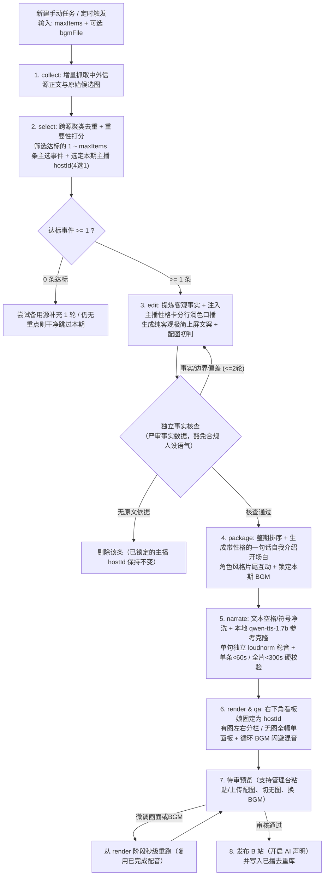

# AI 每日报 — 流程重设计与分步实施方案

> 本文档完整记录工作流重设计后的业务逻辑、四大主播角色性格体系、数据契约变更与分阶段开发拆分计划，作为后续代码改造的实施依据。当前尚未修改任何业务代码。

## 一、重设计目标与新旧机制对照

本次改版围绕**“短平快节奏、鲜明角色性格与音画统一、本地克隆稳音、高醒目自适应画面”**四个核心诉求展开，具体规则变化如下：

| 维度 | 现行实现 | 重设计方案 |
| :--- | :--- | :--- |
| **每期条数策略** | 固定目标条数 `itemCount`，不足时多轮回溯补抓，仍不足则报错中断 | 任务设置**最大条数上限 `maxItems`**（如最多 5 条），AI 按新闻含金量筛选 `1 ~ maxItems` 条重点事件，宁缺毋滥 |
| **视频时长红线** | 仅限制单句字数，单页最长允许 180 秒，总长不受控 | **全片总长控制在 5 分钟（300 秒）以内**，**单条新闻绝对不超过 1 分钟（60 秒）**（理想区间 35～48 秒） |
| **主播音色与立绘** | 静音占位引擎；模板默认写死 `gemini` 且按单条新闻切换不同角色（含 `grok`） | 接入本地 **`qwen-tts-1.7b` 参考音频克隆**，固定 4 套音色（`deepseek`娘、`gpt`娘、`gemini`娘、`claude`娘）；在选题完成后即选定当期唯一主播，右下角看板娘全片同步锁定该角色 |
| **角色性格塑造** | 无角色人设，全篇统一中性播音腔 | 为 4 位角色分别定制独立性格卡（`config/personas.yaml`）；**屏幕文字保持纯客观结论，口播台词融入角色语感、阵营立场互动与一句自我介绍**，同时与独立事实核查边界兼容 |
| **口播文稿规范** | JSON 字符串数组，未针对本地小参数 TTS 做中英空格与符号净洗 | 口播稿严格**一句一行（`\n` 回车分割）**并同步落盘可读文本；合成前清除中英混排多余空格、波浪号与干扰符号，杜绝停顿错乱与怪音 |
| **音频响度处理** | 单句仅裁静音，只在整轨合成时执行一次全局响度均衡 | **单句级 + 整轨级双层处理**：单句先做异常时长重抽、去静音、微淡入淡出与独立双遍 `loudnorm`（`-16 LUFS`），消除单句忽大忽小；整轨再与 BGM 混音 |
| **背景音乐（BGM）** | 全局仅支持填单个文件路径，默认留空且无结尾淡出 | 建立 **`assets/bgm/` 曲库目录**；每次任务可手动选曲，不填则从曲库自动抽选并锁定，全程无缝循环 + 人声侧链闪避压低 + 片尾淡出 |
| **画面布局与配图** | 盲抓文章头图；页面强制左右分栏，无图时右侧塞摘录凑数表，左侧堆砌长段梗概 | 配图改为**可选项**（仅保留参数表/跑分图/发言人推文截图，并支持在管理台手动上传/粘贴替换）；无图时切换**全幅单面板**，只展示高对比度核心结论与极短要点，一眼看懂 |

---

## 二、重设计后的完整业务逻辑

### 2.1 全链路状态流转总览

> **关键时序调整**：由于单条新闻口播稿需要体现主播的说话性格，**当期主播选角必须前置到 `select`（选题）阶段末尾、进入 `edit`（润色）之前完成**，使单条润色（`polish`）与整期编排（`package`）全程共享同一份角色性格设定。



### 2.2 四大主播角色性格体系与护栏设计

结合项目 `assets/mascots/` 现有四张角色立绘的视觉元素与各自模型阵营的技术气质，定制四套差异化主播人设（统一配置于 `config/personas.yaml`，支持在设置中微调，不硬编码进业务代码）：

#### 1. 角色性格设定表

| 角色 ID | 角色名称与立绘视觉锚点 | 核心性格定位 | 说话语感与口播特征 | 阵营互动立场（自家 / 友商 / 行业） | 开场自我介绍示例（第 1 句） |
| :--- | :--- | :--- | :--- | :--- | :--- |
| **`deepseek`** | **DeepSeek 娘**<br/>（圆润蓝鲸尾巴与小鲸鱼发饰、呆毛小虎牙、手捧满满一碗白米饭的憨萌大肥鱼） | **憨憨可爱的“干饭大肥鱼”**<br/>圆滚滚、呆萌耿直、眼里只有干饭和实在干货；平时看着憨厚迷糊不争不抢，遇到开源和省算力却格外实在靠谱 | 憨厚软萌、朴实直白不绕弯，爱用“省口粮、管饱、够吃几大碗饭”等憨直可爱的吃货视角拆解技术，带着天然反差萌 | **播自家**：憨笑着把新成果端出来，像请大家免费加餐一样实在开心；<br/>**播友商**：老老实实夸对手厉害，遇到天价收费会摸着饭碗憨直吐槽太费口粮 | `大家好呀，我是聪明的大肥鱼，刚吃完饭就赶来给大家播今天的新闻啦。` |
| **`gpt`** | **GPT 娘**<br/>（银白长发、青玉龙角龙尾、白绿国风礼服、大气迎宾手势） | **自信从容的“王道领航大小姐”**<br/>见过大风大浪的初代标杆，气场稳健、有大局观，关注大众日常体验 | 端庄明快、大方得体，具备主理人控场感；擅长站在行业风向与普通用户体验的高度做收束 | **播自家**：从容自信、落落大方，不刻意吹嘘；<br/>**播友商**：颇有大姐大风度地淡定认可对手亮点，顺带留足悬念 | `大家好，我是GPT，一起来看看今天 AI 圈都有哪些大动作。` |
| **`gemini`** | **Gemini 娘**<br/>（蓝紫渐变双色发、异色瞳、双子星环猫耳、星空短裙） | **灵动跳脱的“好奇心双子星少女”**<br/>脑洞活跃、热爱新鲜事物，对音视频多模态、硬件联动与未来交互最兴奋 | 轻快鲜活、画面感极强，擅长把枯燥参数转化为具体的日常场景比喻，富有感染力 | **播自家**：掩饰不住的分享欲与新奇感；<br/>**播友商**：像发现新玩具一样好奇拆解到底好玩在哪、有什么短板 | `哈喽大家好，我是哈基米，今天又攒了好多有意思的新消息想分享给你们。` |
| **`claude`** | **Claude 娘**<br/>（琥珀橘棕卷发、百合发饰、怀抱精装厚书、托腮微笑） | **知性温婉的“冷幽默文学学姐”**<br/>逻辑缜密、书卷气浓，偏爱深度推理与严谨工程；表面温柔礼貌，实则自带克制锐评 | 温和条理、用词讲究克制；最擅长慢条斯理地把“宣传很丰满、限制在角落”的反差温和拎出来 | **播自家**：谦逊克制但对代码与推理细节暗藏骄傲；<br/>**播友商**：礼貌肯定进步，再用温柔冷幽默精准戳破公关话术 | `大家好，我是小克，今天由我来带大家看看几条值得留意的 AI 进展。` |

#### 2. 人设注入的三大工程护栏（防尬、防错乱、防误杀）

1. **「画面纯客观 + 口播带性格」严格分轨**：
   - **上屏文字零口癖**：页面渲染的 `title`、`highlight`、`keyPoints` 必须 100% 是客观、精炼的新闻结论与数据，严禁混入“本小姐”“咱们干饭人”等角色腔调，确保视觉阅读高效专业。
   - **口播台词克制自然（80% 客观叙事 + 20% 性格点睛）**：单条 4～7 句口播中，前 3～5 句用贴合角色语感的流畅中文把核心事实与限制条件讲清楚；仅在**最后 1 句**（或首句切入处）加入一句符合该角色性格与阵营立场的轻量反应/点评，点到为止，避免尬演喧宾夺主。
2. **TTS 安全的语气词红线（防 `qwen-tts-1.7b` 破音怪叫）**：
   - 在角色提示词与前置文本清洗器中同时锁死：**严禁使用波浪号 `～`/`~`、音符 `♪`、颜文字、省略号连用 `……` 以及生硬日式二次元叹词（如“呐呐”“呜哇”“哼哼”“呢喵”）**。角色性格必须通过**选词偏好、句式结构与观察视角**来体现，而不是靠怪异语气词，确保参考音频克隆吐字稳健自然。
3. **独立事实核查（`factcheck`）的人设兼容规则**：
   - 原有核查提示词会把任何原文未逐字出现的主观态度判为“脑补推断（`unsupported`）”打回。
   - 升级后的核查规则明确区分**「客观事实陈述」**与**「主播人设视角表达」**：
     - 对所有数字、模型名称、性能增幅、价格、发布状态与使用门槛执行零容忍核对；
     - 允许主播在口播句中使用第一人称阵营称呼（如 GPT 娘播报 OpenAI 时说“我们这边”、播报其他家时说“隔壁谷歌”）以及**严格建立在已核实事实基础上的 1 句性格化收束感言**（不得凭空捏造原文未提及的竞品参数或未证实传闻）。

### 2.3 分步业务规则细则

#### 第 1 步：任务参数与信源增量采集（`collect`）
1. **任务输入参数**：
   - `maxItems`（必填正整数，建议日常设为 `4` 或 `5`）：代表本期**最多**播报几条新闻，不再强行凑数。
   - `bgmFile`（可选字符串）：指定 `assets/bgm/` 下的曲目文件名；留空表示由系统自动抽选。
   - `hostId`（可选覆盖，默认留空自动选角）：允许特殊情况下手动指定某位主播，常规运行均由系统根据当日新闻自动决策。
2. **采集与候选图保留**：
   - 按信源游标增量拉取国内外资讯正文并落盘；原始配图仅下载至本地缓存备查，不默认上屏。

#### 第 2 步：宁缺毋滥动态选题与当期主播选角（`select`）
1. **重要性门槛过滤（`1 ~ maxItems` 条）**：
   - 跨源合并同一事件并过滤近 14 天已播旧闻后，对候选事件按行业实质影响与大众关注度打分（1～10 分）。
   - 仅保留达到重要性阈值（默认 `minScore = 7.5`）的事件，取前 `maxItems` 条作为主选（`primary`），额外预留最多 2 条高分事件作为替补（`reserve`）。
   - 只有当天 `0` 条达标时才触发 1 轮备用信源补抓；若补抓后仍无重点新闻，干净跳过本期，绝不拿凑数水文拉长时长。
2. **前置自动选定当期主播（`hostId`）**：
   - 基于主选池事件立即计算并锁定本期唯一主播写入 `runs.host_id`：
     1. **阵营权重优先**：统计主选事件归属阵营得分（排名第 1 的事件计 `2` 分，其余主选事件各计 `1` 分）。若 `deepseek`、`gpt`（OpenAI）、`gemini`（Google/DeepMind）、`claude`（Anthropic）中某一方得分最高且无并列，直接选定该角色担任当期主播；
     2. **话题调性匹配 + 防连续撞角**：若主选均为第三方行业新闻（如英伟达、Meta、政策或垂直应用）或出现最高分并列，按事件分类倾向匹配（开源/算力效率 → `deepseek`，通用应用/行业大事件 → `gpt`，多模态/智能硬件 → `gemini`，编程/Agent/深度研究 → `claude`），并优先避开上一期刚出场过的主播。
   - 一旦进入下一步 `edit`，本期 `hostId` 即固定不再随个别条目核查剔除而变动，确保已润色条目的角色语气前后统一。

#### 第 3 步：极简画面文案、带性格口播分行润色与独立核查（`edit`）
1. **画面上屏三层极简锚点（纯客观、一眼看懂）**：
   - 删除原先 90～100 字长段落 `summary` 上屏展示，单页文字精简为：
     1. `title`：结论式大标题（`≤ 22` 字，超大字号直给核心结论）；
     2. `highlight`：单句核心高亮签 / 关键数字结论（`≤ 18` 字，如 `API 调用价格直降 50%`、`推理速度提升 2.4 倍`、`即日起向免费用户开放`）；
     3. `keyPoints`：`2 ~ 3` 条短语级关键点（每条严格 `≤ 15` 字，短语化不写长句）。
2. **注入角色性格的逐行口播润色（`s4-polish`）**：
   - 向润色提示词注入 `config/personas.yaml` 中对应 `hostId` 的性格设定（含该新闻主体与当前主播属于“自家 / 友商 / 第三方”的关系提示）。
   - **严格控时字数预算**：单条口播限制为 **`4 ~ 7` 句、总字数 `110 ~ 180` 字**（折合语音约 32～48 秒，留足单条 `< 60s` 红线的安全余量）。
   - **严格一句一行**：每句话独立成行（文本用 `\n` 回车分割），单句 `14 ~ 30` 字；所有百分比、货币、倍数、斜杠必须在文稿层面写成纯中文自然读法，不含任何括号注释或中英文间多余空格。
3. **自动配图准入初判**：
   - 仅当原文章配图经上下文判定为**官方参数对比表、基准跑分图、架构图、产品实机界面或发言人推文截图**时，才将 `preferArticleImage` 标为 `true`，否则默认走无图全幅单面板。
4. **独立事实核查闭环（`s5-factcheck`）**：
   - 按 2.2 节的人设兼容核查规则逐句校验事实准确性与可用范围边界，有事实偏差打回微调（最多 2 轮），失实条目剔除并仅在高分替补可用时递补（若用替补递补，同样使用当前锁定的 `hostId` 润色）。

#### 第 4 步：整期编排、角色自我介绍开场与 BGM 锁定（`package`）
1. **带角色性格的首尾口播生成**：
   - `intro`（开场口播，`2 ~ 3` 句，约 8～12 秒）：**第 1 句必须以当期主播身份向观众打招呼自我介绍**，句式严格贴合地道中文口语习惯（先问候报名字，再自然带出动作，禁止堆砌“……的某某娘来给你播报”这类翻译腔长定语）；第 2～3 句用该角色的说话风格点出今日最核心看点（若今日头条恰好是自家或老对手的新闻，可自然带出一句俏皮铺垫）。
   - `outro`（片尾口播，`1 ~ 2` 句，约 5～8 秒）：以角色口吻做简短收尾与评论区互动引导。
2. **整期逐行口播稿落盘（`narration.txt`）**：
   - 将 `intro`、排序后的各条 `item` 与 `outro` 口播句汇总输出为 `storage/runs/<runId>/narration.txt`，严格一句一回车（`\n`），方便人工快速通读检查语气与断句。
3. **BGM 曲目锁定**：
   - 若创建任务未手动传入 `bgmFile`，从 `assets/bgm/` 曲库自动抽选一首（避开上一期刚用过的曲目）并持久化写入 `runs.bgm_file`。

#### 第 5 步：本地 `Qwen-TTS-1.7B` 参考音频克隆与双层稳音（`narrate`）
1. **确定性文本净洗（TTS Pre-Sanitizer）**：
   - 送入 TTS 模型前逐句执行代码级清洗：
     - 删除中文与中文之间、中文与英文字母/数字之间的**全部空格**（仅保留纯英文词组内部的单个半角空格），杜绝因空格引发莫名气口停顿；
     - 剥离波浪号 `~`/`～`、特殊符号、括号及残留不可见字符；
     - 规范句中逗号与句末终止标点（`。`/`！`/`？`）。
2. **本地参考音频克隆推理**：
   - 根据 `runs.host_id` 加载 `assets/voices/<hostId>/ref.wav` 与 `ref.txt`。
   - `narrate` 开始时拉起本地 Python 常驻推理服务，加载一次 `qwen-tts-1.7b` 模型并缓存当期角色声学特征，逐行合成单句音频，整期结束后关闭释放。
3. **单句级音频精修（彻底解决单句声音忽大忽小）**：
   - **异常时长重抽**：按单句字数校验输出时长合理性，防止模型偶发复读拉长音或吞字，超界自动换随机种子重跑（最多 2 次）；
   - **去首尾静音与防爆音微包络**：FFmpeg `silenceremove` 切除首尾 `-45dB` 以下空白，叠加 `15ms` 淡入与 `20ms` 淡出消除拼接爆音；
   - **单句独立双遍 `loudnorm`**：对每一句单独执行 FFmpeg 双遍响度归一化（目标 `-16 LUFS`，真峰值上限 `-1.5 dBTP`，动态范围 `LRA=7`），保证所有单句在拼接前音量高度一致；
   - **角色隔离缓存**：缓存键包含 `(providerId, hostId, refAudioHash, postprocessConfig, sanitizedText)`。
4. **单条 `< 60s` 与全片 `< 300s` 实测熔断门禁**：
   - 单条拼完（含 `240ms` 句间停顿与页尾缓冲）若实测 `pageMs >= 60,000ms`，自动触发一次该条目的字数压缩重润色并重配该条音频；
   - 整期拼完若 `totalMs > 300,000ms` 且条目数 `> 1`，自动移除排在最末位的次要条目并更新片头导览与时间轴，确保最终成片严格落在 5 分钟以内。

#### 第 6 步：自适应画面渲染与循环 BGM 混音（`render` & `qa`）
1. **右下角看板娘全程同步**：
   - 前端模板锁定 `mascotMode: 'fixed-host'`，`hostMascotId` 设为 `runs.host_id`，全片右下角立绘与配音角色保持 100% 一致（并可根据角色主色调微调页面点缀高亮色：如 DeepSeek 海蓝、GPT 翠绿、Gemini 星紫、Claude 琥珀橙）。
2. **单条新闻页双模式自适应布局**：
   - **有图分栏模式（`split-image`）**：左侧（约 44% 宽）呈现大标题 + 高亮结论卡 + 2～3 条短语要点；右侧（约 56% 宽）大画幅完整展示官方参数表、跑分图或发言人推文截图（`object-fit: contain` 不裁切文字，底部配精简图注）。
   - **无图全幅单面板模式（`full-panel`）**：彻底移除右侧占位栏与凑数表格，将整个 1920×1080 画布（避开右下角看板娘安全区）合为一个居中宽幅大面板，标题放大至 `60~72px`，高亮结论与短语要点大字号排布，视觉极度醒目。
3. **循环 BGM 侧链闪避混音**：
   - 将锁定的 `assets/bgm/<bgmFile>` 循环铺满全片（`-stream_loop -1`），无人声处维持约 `-18dB` 铺底，主播说话时经 `sidechaincompress` 平滑压低 `6~8dB`，片尾最后 `1.5s` 自动 `afade=t=out` 渐弱结束。

#### 第 7 步：人工预览微调（手动传图 / 换曲秒级重渲）与发布
1. **管理台可视化微调**：
   - 进入 `awaiting_review` 后，支持在本地 Web 管理台针对任意新闻**上传或 `⌘V` 粘贴剪贴板截图**（如推文截图、参数表格）、编辑图注、**一键切为无图全幅面板**，或**切换当期 BGM**。
2. **免重配音秒级重渲染**：
   - 修改画面配图或 BGM 后点击「重新合成视频」，直接从 `render` 阶段重跑（`resume --from render`），完全复用已生成的角色克隆音频与时间轴，Playwright 仅重截变更页并由 FFmpeg 重封装 MP4。
3. **审核发布**：确认无误后一键发布 B 站并提交已播历史库。

---

## 三、目录约定、配置文件、数据库与契约变更

### 3.1 目录与配置文件结构约定

```text
ai每日报/
├── config/
│   ├── settings.yaml                # 全局运行参数（模型路由、时长上限、TTS 与 BGM 配置）
│   ├── sources.yaml                 # 新闻订阅信源清单
│   └── personas.yaml                # 新增：4 大主播角色性格卡配置（语感、阵营态度、开场模板、禁用词）
│
├── assets/
│   ├── mascots/                     # 已有：四大角色透明立绘 (deepseek.png / gpt.png / gemini.png / claude.png)
│   ├── voices/                      # 新增：本地 Qwen-TTS-1.7B 参考音频克隆素材库
│   │   ├── deepseek/                #   含 ref.wav (10~20s 干净单声道干声) + ref.txt (逐字参考文本)
│   │   ├── gpt/                     #   含 ref.wav + ref.txt
│   │   ├── gemini/                  #   含 ref.wav + ref.txt
│   │   └── claude/                  #   含 ref.wav + ref.txt
│   └── bgm/                         # 新增：背景音乐曲库目录（存放 .mp3 / .wav / .flac / .m4a）
│
└── storage/runs/<runId>/
    ├── narration.txt                # 新增：整期口播稿纯文本（标注主播名，按段落分组，严格一句一回车 \n）
    ├── custom-assets/               # 新增：管理台人工粘贴/上传的单条新闻配图文件
    ├── audio/                       # 单句标准化音频 seg-XX.wav、段落音频与 master.wav
    ├── frames/                      # 逐页 1920x1080 渲染截图
    └── output/                      # 成片 video.mp4 与封面 cover.jpg
```

### 3.2 `config/personas.yaml` 角色性格配置结构设计

每个角色配置项包含以下结构化字段，供 `s4-polish`、`s4-revise` 与 `s6-package` 提示词模板按需注入：
- `id`：`'deepseek' | 'gpt' | 'gemini' | 'claude'`
- `displayName`：角色中文名（如 `DeepSeek 娘`）
- `campKeywords`：归属“自家阵营”的匹配关键词列表（如 `['deepseek', '深度求索']`）
- `themeAccent`：对应的前端模板主题点缀色标识
- `coreTrait`：一句话核心性格摘要
- `speakingStyle`：口播选词、节奏与句式风格指令
- `stanceGuide`：分别定义播报「自家动态」「友商竞品动态」「第三方行业动态」时的态度分寸
- `introExamples`：2～3 句开场自我介绍参考范例（供模型模仿语气并根据当期内容变化，避免每期死板复读同一句）
- `outroExamples`：2～3 句结尾互动参考范例
- `forbiddenTokens`：TTS 安全禁用词表（如 `['~', '～', '♪', '……', '呐呐', '呢喵']`）

### 3.3 SQLite 数据库增量迁移（`002_workflow_v2`）

1. **`runs` 表**：
   - `item_count` 业务语义明确为最大新闻条数上限 `maxItems`；
   - 新增 `host_id TEXT`：在 `select` 阶段结束时记录选定的当期主播角色 ID；
   - 新增 `bgm_file TEXT`：记录手动指定或自动抽选锁定的 BGM 文件名。
2. **`schedules` 表**：
   - `item_count` 对应定时任务的 `maxItems`；
   - 新增 `bgm_file TEXT`：可选固定 BGM（留空则每次触发自动抽选）。
3. **`run_items` 表**：
   - 新增 `image_mode TEXT NOT NULL DEFAULT 'auto'`（`'auto' | 'custom' | 'none'`）；
   - 新增 `custom_image_path TEXT`；
   - 新增 `custom_image_caption TEXT`。

### 3.4 核心共享契约（`@aidaily/contracts`）关键字段调整

1. **`HostMascotIdSchema`**：`z.enum(['deepseek', 'gpt', 'gemini', 'claude'])`。
2. **`PersonaProfileSchema`**：校验 `config/personas.yaml` 四角色的完整属性，防止缺失任意角色配置。
3. **`PolishedItemSchema`**：
   - 上屏客观展示字段：`title`（`≤ 22` 字）、`shortTitle`（`≤ 16` 字）、`highlight`（必填，`≤ 18` 字）、`keyPoints`（`1 ~ 3` 条，每条 `≤ 15` 字）、`preferArticleImage`（布尔值）、`imageCaption`（可选，`≤ 36` 字）；
   - 口播配音字段：`narration`（`4 ~ 7` 句，单句 `14 ~ 30` 字，总长 `110 ~ 180` 字，纯中文朗读无特殊符号）。
4. **`IssuePackageSchema`**：
   - 包含 `hostId: HostMascotIdSchema`、`intro.narration`（`2 ~ 3` 句，首句含角色自报家门）、`outro.narration`（`1 ~ 2` 句）。

---

## 四、后续开发工作步骤拆分（7 步渐进落地）

后续编码实现按模块依赖关系拆分为 7 个独立可验证的步骤：

### 步骤 1：契约模型、角色性格配置文件与数据库迁移
- **涉及模块**：`packages/contracts`、`config/personas.yaml`、`config/settings.yaml`、`packages/core/src/config`、`packages/core/src/storage`
- **具体工作**：
  1. 在 `@aidaily/contracts` 定义 `HostMascotIdSchema`、`PersonaProfileSchema`、新版精简 `PolishedItemSchema`、新版 `IssuePackageSchema` 及扩展后的 `SettingsSchema`。
  2. 编写 `config/personas.yaml`，完整落地四位角色的性格描述、说话语感、阵营互动分寸、开场/片尾范例与 TTS 禁用符号表，并在 `CoreContext` 启动时加载校验。
  3. 新增 SQLite 迁移 `002_workflow_v2.ts` 及对应 Repository 读写逻辑。
- **验收标准**：配置文件解析校验与 SQLite 新旧库迁移单测全部通过，全仓 `typecheck` 零报错。

### 步骤 2：前置主播选角、`maxItems` 动态选题与角色化口播润色
- **涉及模块**：`packages/core/src/editorial/*`、`packages/core/prompts/*`
- **具体工作**：
  1. 改造 `s2-select.ts`：实现按 `minScore` 门槛筛选 `1 ~ maxItems` 条重点事件，并在 `select` 末尾根据主选池阵营权重、话题分类与上期历史自动选定 `hostId` 写入 `runs.host_id`。
  2. 升级 `s4-polish.md`、`s4-revise.md` 与 `prechecks.ts`：
     - 自动计算当前新闻主体相对 `hostId` 的阵营关系（自家 / 友商 / 第三方），连同角色性格卡注入润色提示词；
     - 强制分离「纯客观极简上屏字段（`title` + `highlight` + 短语 `keyPoints`）」与「带性格语感的逐句口播稿（4～7 句、110～180 字、禁用波浪号等 TTS 危险字符）」。
  3. 升级 `s5-factcheck.md`：锁死客观事实、数字与可用性边界审查的同时，明确豁免合规的第一人称阵营称呼与基于事实的末句角色态度收尾，防止误判打回。
  4. 升级 `s6-package.ts` 与 `s6-package.md`：注入同一角色卡生成首句自我介绍开场白与角色风片尾互动，锁定本期 `bgm_file`，并输出一句一回车的 `narration.txt`。
- **验收标准**：针对四位不同主播分别跑通采编单测，验证口播语气与阵营视角差异鲜明、上屏文案保持纯粹客观、事实核查不发生误杀、`narration.txt` 格式规范。

### 步骤 3：TTS 文本净洗器与本地 `Qwen-TTS-1.7B` 参考音频克隆接入
- **涉及模块**：`packages/tts`、本地 Python 常驻推理脚本、`assets/voices/`
- **具体工作**：
  1. 实现 `sanitizeNarrationSentence()`：清除中英混排多余空格、波浪号、括号注释与非法符号，规范句中逗号与句末标点。
  2. 实现 `QwenLocalTtsProvider` 与配套本地 Python 常驻推理脚本：在 `start()` 阶段加载 `qwen-tts-1.7b` 模型，按 `hostId` 读取 `assets/voices/<hostId>/ref.wav` 与 `ref.txt` 逐句克隆合成，`stop()` 阶段优雅退出；集成至 `aidaily doctor` 环境检查。
  3. 升级 `audio.ts` 单句处理管线：增加字数时长比异常检测重抽、首尾静音修剪、`15ms/20ms` 防爆音淡入淡出，以及**单句独立双遍 `loudnorm`（`-16 LUFS` / `-1.5 dBTP`）**；缓存键纳入 `hostId` 与参考音频哈希。
- **验收标准**：四位角色的克隆试听与连句拼接测试通过，无吞字、无空格诡异停顿、无单句音量忽大忽小。

### 步骤 4：配音时长硬红线熔断与 `assets/bgm/` 曲库循环混音
- **涉及模块**：`packages/core/src/media/narration.ts`、`packages/core/src/media/ffmpeg.ts`、`assets/bgm/`
- **具体工作**：
  1. 在 `narration.ts` 实装时长硬门禁：单条 `pageMs >= 60,000ms` 自动触发压缩重润色并重配该条；全片 `totalMs > 300,000ms` 自动触发末位裁剪与时间轴重算。
  2. 实现 `assets/bgm/` 曲库枚举与防撞曲自动抽选服务。
  3. 完善 `ffmpeg.ts` 主音轨合成：循环所选 BGM，配置人声侧链压低（Ducking）与片尾最后 `1.5s` 自然淡出。
- **验收标准**：超长单条与超长全片自动回落至 `< 60s` 与 `< 300s` 以内；混音后人声清晰突出，BGM 循环无断层且结尾渐弱平滑。

### 步骤 5：前端模板自适应布局重构、角色立绘与主题色联动
- **涉及模块**：`templates/daily-deck`、`packages/core/src/templates/adapters/daily-deck.ts`
- **具体工作**：
  1. 收敛模板看板娘注册表为 `deepseek`、`gpt`、`gemini`、`claude` 四角色，锁定 `fixed-host` 全片一致，并支持随当期主播切换柔和的角色主题点缀色（海蓝 / 翠绿 / 星紫 / 琥珀橙）。
  2. 重构 `NewsCardPage.tsx`：
     - `split-image`（有图左右分栏）：左侧展示大标题 + 高亮结论卡 + 短语要点，右侧高清完整展示参数表或推文截图；
     - `full-panel`（无图全幅单面板）：移除右侧栏与旧版凑数表，整个画布居中排布超大号标题、独立色块高亮结论与极简要点，避让右下角看板娘安全区。
  3. 更新 `daily-deck` 适配器字段映射与构建脚本。
- **验收标准**：模板单元测试全绿；1920×1080 实测有图与无图两种模式文字醒目、排版均衡、无截断与遮挡。

### 步骤 6：Core 媒体微调接口（手动粘贴/上传配图、切无图、换曲重渲）
- **涉及模块**：`packages/core/src/media/compositor.ts`、`packages/core/src/services/taskService.ts`
- **具体工作**：
  1. 在 `compositor.ts` 实现 `custom > none > auto` 三级配图解析优先级。
  2. 在 `Core` 服务层暴露单条配图上传覆盖、切换无图全幅、更换当期 BGM、读取曲库列表及读取角色人设列表等公开方法，无缝衔接 `resume(runId, { fromStage: 'render' })` 免配音重渲。
- **验收标准**：修改单条配图或切换无图后从 `render` 重跑，不消耗大模型与 TTS 算力，数秒内生成更新后的成片 MP4。

### 步骤 7：Web 管理台与 CLI 薄壳对接及端到端验收
- **涉及模块**：`apps/web`、`apps/cli`
- **具体工作**：
  1. `apps/cli`：更新 `run` 与 `schedule` 的 `maxItems`、`--bgm`、`--host`（可选覆盖）参数支持。
  2. `apps/web`：
     - 新建任务与定时任务支持设置 `maxItems` 与 BGM 曲库选择；
     - 任务详情页展示当期选定主播徽章与逐行 `narration.txt` 口播词，提供每条新闻的**拖拽上传 / `⌘V` 粘贴截图框**、「切换无图全幅」按钮、BGM 切换下拉框及「一键重合成画面」按钮；
     - 系统设置页支持查看与微调 4 位角色的性格提示词与试听各自克隆音色。
  3. 运行 `npm run build && npm run typecheck && npm run lint && npm test` 全量校验与成片实测。
- **验收标准**：分层架构检查、单测与集成测试全部通过，真实产出视频符合全部业务指标。

---

## 五、后续启动编码前的本地素材准备清单

1. **本地 `Qwen-TTS-1.7B` 运行环境信息**：本机 Python 环境路径、本地模型权重目录路径及推理调用方式。
2. **4 套角色克隆参考音频（放入 `assets/voices/<角色>/`）**：`deepseek`、`gpt`、`gemini`、`claude` 各自的干净单声道参考干声 `ref.wav`（建议 10～20 秒，语调贴合上述各自性格设定更佳）及严格逐字对应的 `ref.txt`。
3. **初始 BGM 曲库文件（放入 `assets/bgm/`）**：放入 1 首或多首纯音乐文件供任务选曲或自动抽选。
