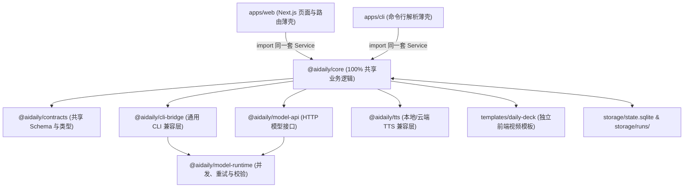

# AI 每日报自动化视频工作流 — 项目架构说明

> 详细开发设计（配置、数据模型、各模块接口、里程碑）见 [开发设计文档.md](./开发设计文档.md)。

## 一、总结速览

本项目采用 **TypeScript + `npm workspaces` Monorepo** 统一管理全仓代码，遵循 **「薄壳双入口 + 共享业务内核」** 的架构原则：`apps/web`（Next.js 后台页面）与 `apps/cli`（命令行工具）本身不包含业务逻辑，均直接引用共享核心包 `@aidaily/core` 对外暴露的同一套业务服务接口；底层通过本机 CLI 兼容层 `@aidaily/cli-bridge`、模型 HTTP 接口 `@aidaily/model-api`、可随时切换本地/云端服务的 `@aidaily/tts`、共享契约 `@aidaily/contracts`，以及独立存放于 `templates/` 的前端视频模板协同完成任务调度、状态同步与成片生产。

---

## 二、Monorepo 目录结构

```text
ai每日报/
├── package.json                     # npm workspaces 根管理 (workspaces: apps/*, packages/*)
├── tsconfig.base.json               # 全仓共享 TypeScript 编译基础配置
├── config/                          # 全局运行配置中心 (settings.yaml / sources.yaml)
├── docs/                            # 业务流程、项目架构与开发设计文档
│
├── apps/                            # 纯接入薄壳层（零业务逻辑，仅负责界面展示与参数转发）
│   ├── web/                         # [Web 接入端] Next.js App Router 后台 (任务监控/核查透视/成片预览与发B站/配置)
│   └── cli/                         # [CLI 接入端] 命令行入口 (`aidaily`)，支持终端/定时脚本/Agent 直接调用
│
├── packages/                        # 核心共享业务与兼容层包
│   ├── core/                        # [@aidaily/core] 100% 统一业务逻辑层 (Web 与 CLI 共同引用的唯一业务入口)
│   │   └── src/
│   │       ├── services/            #   对外统一 Service: taskService / publishService / configService / schedulerService
│   │       ├── workflow/            #   8 步状态机 (增量采集与补抓 -> 聚类 -> 总结 -> 润色 -> 核查 -> 编排 -> 合成 -> 发布)
│   │       └── storage/             #   SQLite (WAL 模式) 状态读写与产物路径管理
│   ├── cli-bridge/                  # [@aidaily/cli-bridge] 本机命令和 Codex CLI 适配器
│   ├── model-api/                   # [@aidaily/model-api] 第三方 HTTP 模型接口
│   ├── model-runtime/               # [@aidaily/model-runtime] 模型调用的并发、重试和审计
│   ├── tts/                         # [@aidaily/tts] TTS 调度兼容层 (本地开源模型 / 云端 TTS 服务一键切换)
│   └── contracts/                   # [@aidaily/contracts] 全仓共享 Zod Schema 与 TypeScript 类型契约
│
├── templates/                       # 独立前端视频模板目录（支持多套模板并存与切换）
│   └── daily-deck/                  # 16:9 新闻视频模板（含 newsSchema.ts 与 window.__NEWS_DECK__ 桥接）
│
└── storage/                         # 本地运行与状态持久化目录 (gitignore)
    ├── state.sqlite                 # SQLite 状态库: 爬取游标、任务记录、历史已播排重库
    └── runs/                        # 每期任务归档目录 storage/runs/<runId>/ (核查审计单、音频、MP4)
```

---

## 三、分层调用与依赖关系



### 核心约束规则
- **业务单一事实源**：`apps/web` 与 `apps/cli` 严禁各自实现爬取、AI 调用、审核流或发布逻辑，双方统一 `import` 调用 `@aidaily/core` 暴露的 `taskService`、`publishService`、`configService`、`schedulerService`。
- **双入口独立运行且状态互通**：底层 `storage/state.sqlite` 启用 **WAL 并发模式**，CLI 可在不启动 Web 服务的情况下独立跑完整流程；通过 CLI 触发的任务与产物也会同步呈现在 Web 后台的任务看板中。
- **阶段模型路由**。`@aidaily/core` 按任务快照，为各阶段选择 `@aidaily/cli-bridge` 中的本机工具或 `@aidaily/model-api` 中的 HTTP 连接，并传入配置的模型 ID。

---

## 四、各模块职责说明

| 模块 | 包名 / 路径 | 核心职责 |
| :--- | :--- | :--- |
| **Web 后台端** | `apps/web` | 基于 Next.js 的轻量交互界面：实时查看任务进展（SSE）、逐条核对「原文 ↔ 总结 ↔ 润色 ↔ 核查批注」、播放成片预览并确认标题简介发 B 站、热修改运行配置。 |
| **CLI 命令行端** | `apps/cli` | 轻量命令行工具：解析命令参数（如跑一期、查看任务、重跑断点、发布 B 站、修改配置）并转发给 `@aidaily/core`，支持 `--json` 输出以便外部脚本或定时任务集成。 |
| **核心业务内核** | `@aidaily/core` | 封装全部 8 步业务流：增量抓取与缺条扩窗补抓、跨源聚类排重、总结→润色→核查闭环、三段式编排与重点标题简介生成、驱动模板合成 MP4、B 站上传及水位线提交。 |
| **通用 CLI 兼容层** | `@aidaily/cli-bridge` | 管理本机子进程和输入输出，内置 `agy`、Codex CLI 与通用适配器。 |
| **模型 HTTP 接口** | `@aidaily/model-api` | 使用 Core 注入的网络接口发起请求，并按协议解析结果和模型列表。 |
| **共享调用逻辑** | `@aidaily/model-runtime` | 为 CLI 与 HTTP 调用提供统一排队、重试、结构化校验和审计。 |
| **TTS 调度兼容层** | `@aidaily/tts` | 统一配音文本分段入参与标准化音频（含精确时长/时间轴）出参，屏蔽底层差异，支持随时切换本地开源 TTS 模型或云端 TTS 服务。 |
| **共享类型契约** | `@aidaily/contracts` | 集中定义全仓通用的 Zod 校验规则与 TS 类型（日报数据格式、任务状态、核查结论、B 站发布元数据），保障前后端及模板间类型安全。 |
| **独立视频模板** | `templates/*` | 独立维护的前端视觉模板（如 `templates/daily-deck`），与业务编排解耦；通过标准日报 JSON 与 `window.__NEWS_DECK__` 桥接协议接收数据并渲染画面。 |
| **本地持久化层** | `storage/` | 存储 `state.sqlite`（增量爬取时间游标、14 天已播防重库、任务状态机记录）及每期归档文件 `storage/runs/<runId>/`（原始抓取、核查日志、分句音频、成品 MP4）。 |
